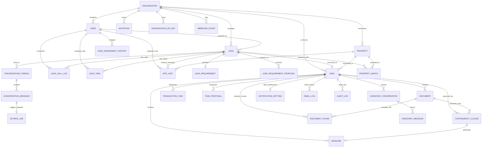
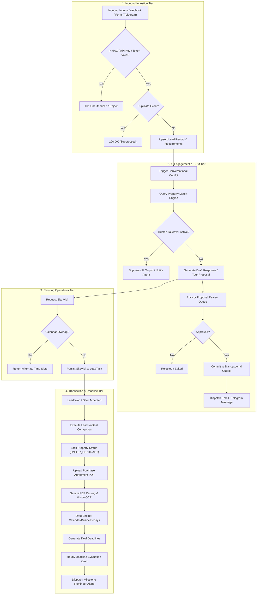
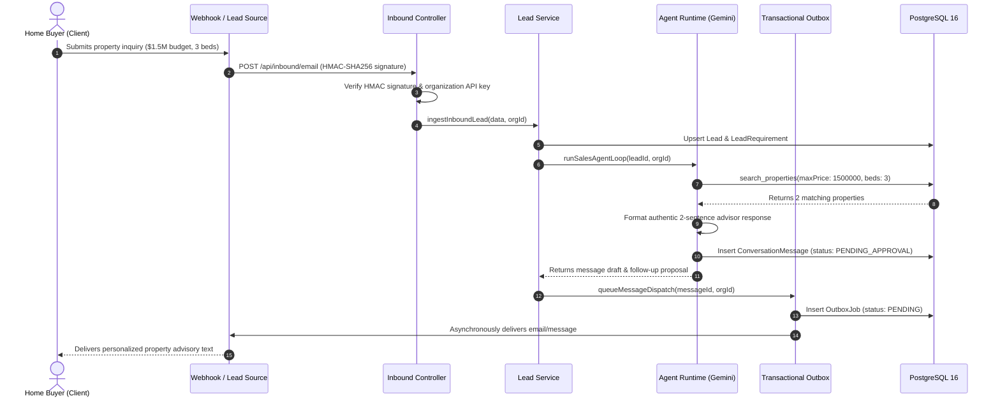
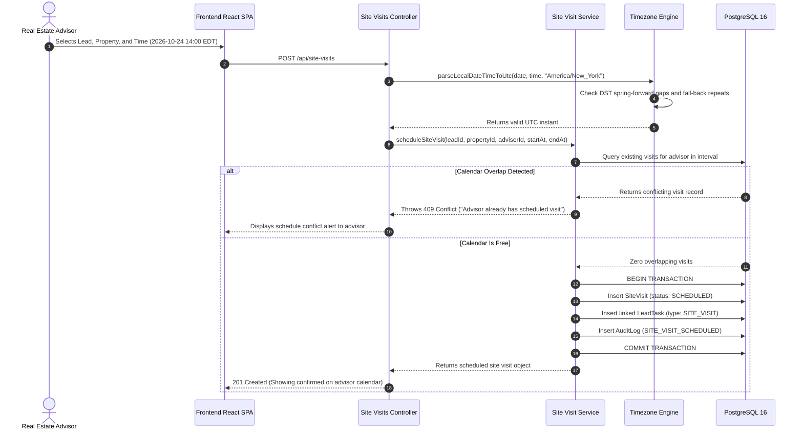
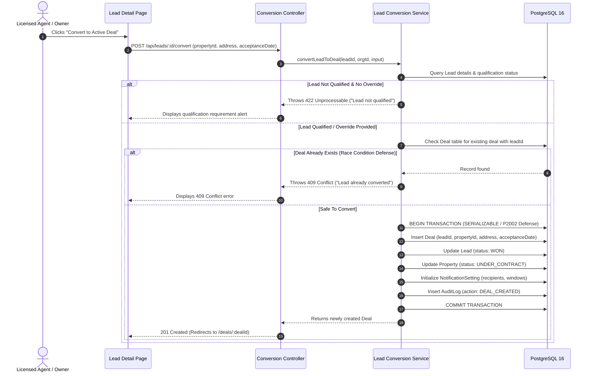
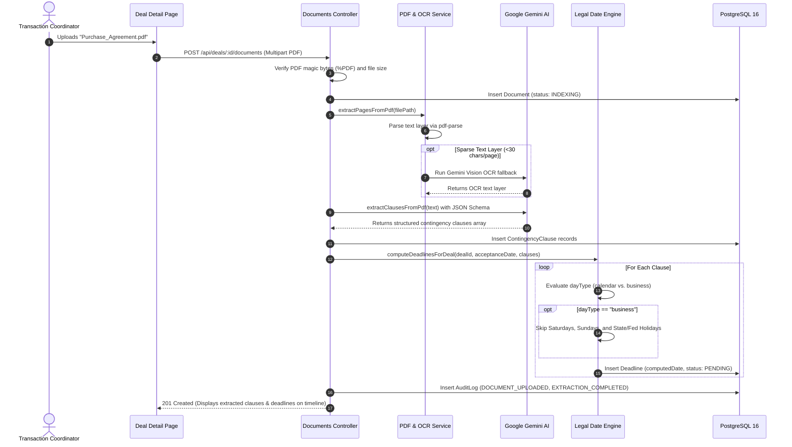
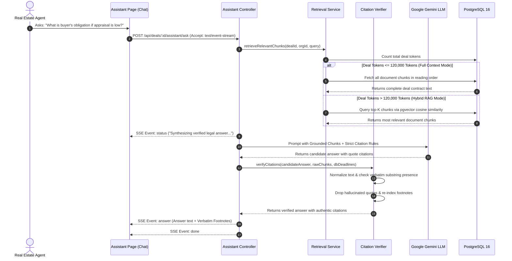
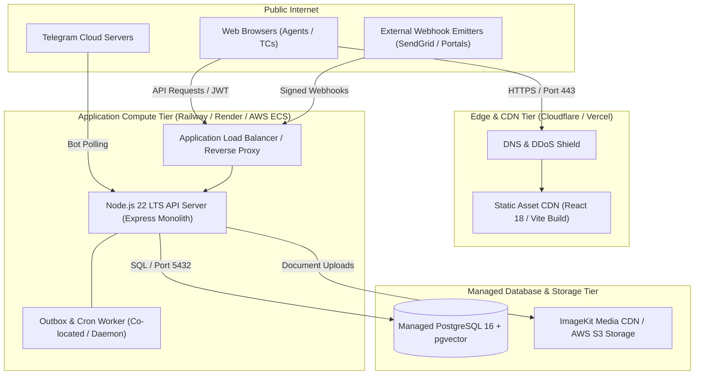

# High-Level Design (HLD) Document
# Real Estate AI Sales Agent & Multi-Tenant Contingency Copilot Platform

---

## Document Metadata
- **Project Name:** Contingency Deadline Copilot & B2B Real Estate AI Sales Platform
- **Repository:** `Real_Estate_Contigency` (`Real_Estate_Document`)
- **Document Version:** 2.0.0 (Reverse-Engineered Architecture Baseline)
- **Primary Architect:** Principal Software Systems Architect
- **Target Runtime:** Node.js 22 LTS / PostgreSQL 16 (`pgvector`) / Express 4 / React 18 (Vite)
- **Document Status:** Complete & Verified against Codebase & Production Readiness Audits
- **Classification:** Technical Architecture Documentation

---

## Table of Contents
1. [Introduction](#1-introduction)
2. [Problem Statement and Goals](#2-problem-statement-and-goals)
3. [Requirements](#3-requirements)
4. [System Overview](#4-system-overview)
5. [Architecture](#5-architecture)
6. [Component Design](#6-component-design)
7. [Data Design](#7-data-design)
8. [Data Flow and Key Workflows](#8-data-flow-and-key-workflows)
9. [API Design (High Level)](#9-api-design-high-level)
10. [Technology Stack](#10-technology-stack)
11. [Security Design](#11-security-design)
12. [Scalability and Performance](#12-scalability-and-performance)
13. [Reliability and Fault Tolerance](#13-reliability-and-fault-tolerance)
14. [Deployment Architecture](#14-deployment-architecture)
15. [Third-Party Integrations](#15-third-party-integrations)
16. [Design Decisions and Trade-offs](#16-design-decisions-and-trade-offs)
17. [Risks, Limitations, and Assumptions](#17-risks-limitations-and-assumptions)
18. [Future Enhancements](#18-future-enhancements)
19. [Appendix](#19-appendix)

---

## 1. Introduction

### 1.1 Purpose
This High-Level Design (HLD) document reverse-engineers, standardizes, and specifies the complete system architecture of the **Contingency Deadline Copilot & Real Estate AI Sales Platform**. It serves as the authoritative architectural blueprint for engineering teams, security auditors, technical leads, and stakeholders.

### 1.2 Scope
The scope of this document encompasses:
- The end-to-end multi-tenant architecture across frontend, backend, database, and background processing tiers.
- Inbound lead intake, automated CRM triage, and advisor workflow management.
- The Conversational AI Sales Copilot runtime, tool execution boundaries, buyer memory persistence, and human takeover mechanisms.
- Deterministic property matching, site visit conflict detection, and calendar management.
- The atomic Lead-to-Deal conversion transaction lifecycle.
- Contract document ingestion, optical character recognition (OCR), structured contingency clause extraction with Google Gemini, and legal calendar/business-day math.
- Dual-mode Retrieval-Augmented Generation (RAG) knowledge retrieval with strict verbatim citation verification.
- The ACID-compliant Transactional Outbox pattern for outbound messaging, email alerts, and inbound webhook processing.

### 1.3 In-Scope vs. Out-of-Scope

| Dimension | In-Scope (Implemented & Supported) | Out-of-Scope (Future / External) |
| :--- | :--- | :--- |
| **Tenancy** | Logical multi-tenancy with strict tenant scoping via `organizationId` and database constraints. | Physical multi-tenancy (isolated database clusters per tenant). |
| **Authentication** | Google OAuth 2.0 with session version invalidation; invite-only tenant onboarding; dev sandbox. | SAML / SSO enterprise federation; custom username/password registration. |
| **Communication** | Outbox-driven email (Resend/SendGrid); Telegram Bot chat & neural voice memos; Web chat. | Native Twilio SMS dispatch (active credentials pending); direct WhatsApp Business Cloud API. |
| **AI Workflows** | 5-round bounded LLM agent loops; typed Zod tool registry; human proposal review queues. | Unbounded autonomous database mutations; automated financial transaction execution. |
| **File Storage** | Local filesystem storage with path sanitization; ImageKit cloud storage driver. | Multi-region AWS S3 active-active replication; on-premise NFS clusters. |
| **Payments** | Stripe webhook endpoints and schema scaffolding. | Live production recurring billing and meter enforcement. |

### 1.4 Definitions and Acronyms
- **ACID:** Atomicity, Consistency, Isolation, Durability.
- **DST:** Daylight Saving Time.
- **FR / NFR:** Functional Requirement / Non-Functional Requirement.
- **HMAC:** Hash-Based Message Authentication Code.
- **HNSW:** Hierarchical Navigable Small World (vector index algorithm used in `pgvector`).
- **IANA:** Internet Assigned Numbers Authority (standard timezone database).
- **LLM:** Large Language Model (specifically Google Gemini 2.5/3.5/3.6 Flash).
- **OLAC:** Object-Level Access Control.
- **PII:** Personally Identifiable Information (emails, phone numbers, customer names).
- **RAG:** Retrieval-Augmented Generation.
- **SSE:** Server-Sent Events.
- **TC:** Transaction Coordinator (real estate operations specialist).
- **TTS:** Text-to-Speech (Microsoft Edge Neural TTS / ElevenLabs / Google TTS).

---

## 2. Problem Statement and Goals

### 2.1 Problem Being Solved
Real estate sales and transaction management suffer from two major operational failure modes:
1. **Critical Contingency Deadline Failures:** Purchase agreements contain complex legal contingencies (home inspection, loan financing approval, property appraisal, title review, HOA disclosures). Missing a deadline by a single day forfeits buyer earnest money deposits (often $10,000–$50,000+), terminates transactions, or triggers liability lawsuits. Calculating deadlines manually across calendar days, business days, weekend rollovers, and state/federal holidays is error-prone.
2. **Lead Intake & Sales Pipeline Leakage:** Inbound inquiries from portals, forms, and messaging channels go cold within hours due to delayed response times. Traditional real estate CRMs fail to capture structured buyer preferences, cannot verify agent showing availability in real time, and operate in isolation from contract legal workflows. Generic AI chatbots hallucinate property specs and make unapproved commitments.

### 2.2 Business & Technical Goals
- **100% Deterministic Deadline Accuracy:** Automate deadline calculation from contract acceptance dates, strictly adhering to jurisdictional rules for calendar and business days.
- **Sub-Minute Lead Triage & Qualification:** Autonomously engage buyers 24/7 across email, chat, and Telegram, extracting budget, timeline, location, and bedroom preferences into persistent CRM memory.
- **Safe Human-in-the-Loop Governance:** Restrict AI to generating proposals (draft messages, requirement proposals, showing requests). Authoritative state changes require licensed agent approval or human takeover.
- **Zero Cross-Tenant Leakage:** Ensure 100% isolation of leads, deals, contracts, vector embeddings, and audit trails across brokerages.
- **Idempotent, Durable Communications:** Guarantee zero duplicate emails and safe retry backoff via an ACID Transactional Outbox.

### 2.3 Success Criteria
- Zero missed contingency deadlines across managed deals.
- Zero cross-tenant data access incidents (verified by automated security suites).
- 100% verifiable citations for AI legal assistant answers (hallucinated citations rejected).
- Lead-to-deal conversion completed in under 500ms with atomic property status locking and duplicate race prevention.

---

## 3. Requirements

### 3.1 Functional Requirements (Derived from Codebase)

| Requirement ID | Module | Description | Implementation Status |
| :--- | :--- | :--- | :---: |
| **FR-01** | Auth & Org | Google OAuth 2.0 authentication with session JWT issuance (`HS256`, 7-day TTL). | **Implemented** |
| **FR-02** | Auth & Org | Invite-only organization onboarding with cryptographically hashed tokens (`SHA-256`). | **Implemented** |
| **FR-03** | Auth & Org | Instant token revocation on role change or deletion via database `sessionVersion` counter. | **Implemented** |
| **FR-04** | Auth & Org | Server-to-server lead intake API keys with prefixing, SHA-256 hashing, and scoping. | **Implemented** |
| **FR-05** | Lead Intake | Authenticated JSON webhook lead ingestion with HMAC-SHA256 signature verification. | **Implemented** |
| **FR-06** | CRM & Leads | Lead CRUD, status progression (`NEW` to `WON`/`LOST`), and assignment history tracking. | **Implemented** |
| **FR-07** | CRM & Leads | Inbound/outbound call logging with outcomes, durations, and follow-up task generation. | **Implemented** |
| **FR-08** | CRM & Leads | Action queue aggregation with attention-flagging (overdue tasks, uncontacted leads). | **Implemented** |
| **FR-09** | AI Sales Agent | Bounded 5-round conversational LLM loop with typed Zod tool calling (`agentRuntime.ts`). | **Implemented** |
| **FR-10** | AI Sales Agent | Persistent buyer memory extraction, preference scoring, and follow-up trigger evaluation. | **Implemented** |
| **FR-11** | AI Sales Agent | Conversational state machine (`AUTOPILOT`, `DRAFT_ONLY`, `HUMAN_TAKEOVER`, `PAUSED`). | **Implemented** |
| **FR-12** | AI Sales Agent | Human takeover toggle that immediately suppresses autonomous AI reply generation. | **Implemented** |
| **FR-13** | Properties | Inventory management with status tracking (`AVAILABLE`, `UNDER_CONTRACT`, `SOLD`). | **Implemented** |
| **FR-14** | Matching | Deterministic property matching with SQL hard filters (budget, beds, type) and soft scoring. | **Implemented** |
| **FR-15** | Site Visits | Showing scheduling with advisor calendar overlap prevention and duration validation. | **Implemented** |
| **FR-16** | Site Visits | Strict IANA timezone parsing with DST spring-forward gap and fall-back ambiguity rejection. | **Implemented** |
| **FR-17** | Conversion | Atomic Lead-to-Deal conversion locking property inventory to `UNDER_CONTRACT`. | **Implemented** |
| **FR-18** | Conversion | Concurrency defense enforcing 1-to-1 Lead-Deal invariant via `@unique` constraint and 409 handling. | **Implemented** |
| **FR-19** | Contracts | PDF upload with magic-byte validation (`%PDF`), size limits, and storage abstraction. | **Implemented** |
| **FR-20** | Contracts | Gemini structured extraction of contingency clauses, day counts, and day types. | **Implemented** |
| **FR-21** | Contracts | Page-by-page extraction with Gemini Vision OCR fallback for scanned contracts. | **Implemented** |
| **FR-22** | Date Engine | Jurisdiction-aware date calculation skipping weekends and official federal/state holidays. | **Implemented** |
| **FR-23** | Deadlines | Deadline confirmation, editing, and activation workflow with full audit logging. | **Implemented** |
| **FR-24** | RAG Assistant | Dual-mode RAG: full-context injection (<120k tokens) or hybrid vector search with `pgvector`. | **Implemented** |
| **FR-25** | RAG Assistant | Strict server-side quote normalization and verbatim citation verification against chunks. | **Implemented** |
| **FR-26** | Outbox | Transactional Outbox queueing for email dispatches with optimistic concurrency locking. | **Implemented** |
| **FR-27** | Outbox | Bounded exponential backoff retry worker (3 attempts) with permanent error short-circuiting. | **Implemented** |
| **FR-28** | Alerts | Hourly background cron job evaluating active deadlines for 3d, 1d, dayOf, and missed windows. | **Implemented** |
| **FR-29** | Webhooks | Resend Svix signature-verified delivery/bounce webhooks with event deduplication. | **Implemented** |
| **FR-30** | Telegram | Telegram Bot integration with neural text-to-speech voice notes (`msedge-tts` / Google TTS). | **Implemented** |
| **FR-31** | Audit | Immutable audit logging recording entity diffs (`previousValue`, `newValue`) and masked PII. | **Implemented** |
| **FR-32** | Payments | Stripe webhook reception and payment event scaffolding. | **Scaffolded (Not Active)** |
| **FR-33** | SMS / WhatsApp | Native Twilio SMS and WhatsApp live message dispatching. | **Scaffolded (Not Active)** |

### 3.2 Non-Functional Requirements (NFR)

| NFR ID | Category | Requirement Description | Status |
| :--- | :--- | :--- | :---: |
| **NFR-01** | Security | Zero cross-tenant data leakage; every query must enforce `requireOrgId()`. | **Implemented** |
| **NFR-02** | Security | Object-level access control: Agents restricted to assigned leads; Owners have full org scope. | **Implemented** |
| **NFR-03** | Security | Constant-time HMAC-SHA256 signature verification for external webhooks. | **Implemented** |
| **NFR-04** | Security | Masking of all PII (email, phone) in application logs and audit trails. | **Implemented** |
| **NFR-05** | Security | Refusal to boot in production with weak `JWT_SECRET` (<32 chars) or demo login enabled. | **Implemented** |
| **NFR-06** | Data Integrity | Atomic state transitions wrapped in `prisma.$transaction`. Rollback on any failure. | **Implemented** |
| **NFR-07** | Data Integrity | Idempotent webhook processing via database unique constraints on `(provider, externalEventId)`. | **Implemented** |
| **NFR-08** | Reliability | Graceful shutdown (`SIGTERM`/`SIGINT`) draining HTTP requests and disconnecting Prisma in 10s. | **Implemented** |
| **NFR-09** | Reliability | Production error handler masks stack traces and internal SQL details from API clients. | **Implemented** |
| **NFR-10** | Performance | Operational API response time < 200ms at 95th percentile under standard database load. | **Implemented** |
| **NFR-11** | Performance | Server-Sent Events (SSE) streaming for long-running LLM generation and RAG reasoning. | **Implemented** |
| **NFR-12** | Maintainability | Complete TypeScript strict typing across frontend and backend; zero `tsc` build errors. | **Implemented** |
| **NFR-13** | Scalability | Distributed rate limiting across multi-server cluster using Redis. | **Not Implemented** *(In-Memory)* |
| **NFR-14** | Scalability | Dedicated worker process executing outbox dispatch independently of API web process. | **Not Implemented** *(Co-located)* |
| **NFR-15** | Availability | Automated multi-AZ database failover with Continuous WAL archiving. | **Not Implemented** *(Host-level)* |

---

## 4. System Overview

### 4.1 Plain-Language Description
The **Contingency Deadline Copilot & Real Estate AI Sales Platform** is an intelligent operating system for real estate brokerages. It connects the front-of-house sales pipeline (lead generation, instant chat, property matching, showing coordination) with the back-of-house transaction desk (purchase agreement ingestion, contingency extraction, legal deadline tracking, and compliance auditing).

When a potential home buyer submits an inquiry via a website form, property portal, email, or Telegram, the platform ingests the inquiry and activates an AI Sales Copilot. The Copilot converses with the buyer like a senior property advisor—keeping messages concise, answering questions based on actual real-time inventory, extracting budget and location preferences, and proposing in-person site visits without overlapping agent calendars. If the buyer requests a human, asks legal questions, or negotiates custom discounts, the system automatically halts AI responses and transfers the conversation to a licensed agent.

Once a buyer enters contract negotiations, the system enables an agent to convert the lead into a Deal with a single click. The platform locks the property inventory status to prevent double-selling. When the purchase contract PDF is uploaded, Google Gemini analyzes the legal text, extracts every contingency clause (inspection, loan financing, appraisal, title, HOA), and the core Date Engine calculates authoritative closing deadlines based on jurisdictional calendar or business day rules. The platform continuously monitors active deadlines, dispatching automated alerts to buyers, sellers, and agents before milestones expire, ensuring no deadline is ever missed.

```
┌─────────────────────────────────────────────────────────────────────────────────────────────┐
│                                 CORE SYSTEM CAPABILITIES                                    │
├──────────────────────────────┬──────────────────────────────┬───────────────────────────────┤
│    1. AI Lead Intelligence   │   2. Operational CRM         │  3. Contract & Deadlines      │
│  • Omnichannel Ingestion     │  • Advisor Action Queue      │  • PDF Parsing & Vision OCR   │
│  • Bounded Sales Agent Loop  │  • Showing Conflict Engine   │  • Gemini Clause Extraction   │
│  • Persistent Buyer Memory   │  • Lead-to-Deal Conversion   │  • Calendar/Business Math     │
│  • Instant Human Takeover    │  • Transactional Outbox Mail │  • Verifiable RAG Citations   │
│  • Neural Voice Memos (TTS)  │  • Multi-Tenant RBAC         │  • Multi-Window Deadline Cron │
└──────────────────────────────┴──────────────────────────────┴───────────────────────────────┘
```

---

## 5. Architecture

### 5.1 Architecture Style & Justification
The platform is designed as a **Modular Monolith** with clean domain service boundaries:
- **Why Monolith:** Real estate transactions require strict ACID transactional guarantees across leads, properties, deals, and audit logs. A modular monolith enables single-database atomic transactions (`prisma.$transaction`), completely eliminating the network latency, eventual consistency bugs, distributed deadlocks, and two-phase commit overhead inherent in microservices.
- **Why Modular:** Each functional domain (`lead`, `conversation`, `agent`, `propertyMatch`, `siteVisit`, `deal`, `deadline`, `assistant`, `outboxDispatcher`) is encapsulated in dedicated service modules with well-defined interfaces. This enables future extraction into standalone microservices or serverless functions if scaling demands require it.

### 5.2 High-Level Architecture Diagram

```mermaid
flowchart TB
    subgraph Client_Layer ["Client Presentation Layer (Vite + React 18 SPA)"]
        BrowserUI["Web Application (React 18 / Tailwind / Lucide / Recharts)"]
        TelegramClient["Telegram Mobile / Desktop App"]
        ExternalWebhookClient["External Portals / Inbound Webhooks"]
    end

    subgraph Security_Gateway ["Security Gateway & HTTP Middleware"]
        HelmetCors["Helmet & Strict CORS Policy"]
        RateLimiter["In-Memory Sliding Window Rate Limiter"]
        AuthMiddleware["JWT Authentication Middleware (requireAuth)"]
        RoleMiddleware["Role Enforcement Middleware (requireRole)"]
        TenantScoper["Tenant Boundary Scoper (requireOrgId)"]
        ErrorHandler["Production Error Handler & Stack Masking"]
    end

    subgraph Application_Core ["Application Service Layer (Modular Express 4 Backend)"]
        AuthSvc["Auth & Org Service<br/>(Google OAuth / Invitations / API Keys)"]
        LeadSvc["Lead & CRM Service<br/>(Triage / Calls / Assignments / Tasks)"]
        AgentRuntime["AI Sales Agent Runtime<br/>(5-Round Loop / Tool Execution / Safety Fences)"]
        SiteVisitSvc["Site Visit Service<br/>(Calendar Overlap / DST Timezone Engine)"]
        ConversionSvc["Lead Conversion Service<br/>(Atomic Deal Transition / Inventory Locking)"]
        MatchEngine["Property Match Engine<br/>(SQL Hard Filters + Soft Preference Ranking)"]
        ContractPipeline["Contract Extraction Pipeline<br/>(PDF Parse / Vision OCR / Gemini Structured Output)"]
        DateEngine["Contingency Date Engine<br/>(Calendar / Business Day Holiday Rollover)"]
        RagAssistant["RAG Knowledge Assistant<br/>(Hybrid Search / Citation Verifier / SSE Streaming)"]
        OutboxDispatcher["Transactional Outbox Dispatcher<br/>(Optimistic Locking / Exponential Backoff)"]
        AlertDaemon["Alert Cron Daemon<br/>(Hourly Deadline Evaluation & Email Generator)"]
        TelegramService["Telegram Service<br/>(Long Polling / Audio Pipeline / Edge TTS)"]
    end

    subgraph Persistence_Layer ["Data & Storage Layer"]
        PrismaORM["Prisma ORM v5.22 (Singleton Connection Pool)"]
        PostgresDB[("PostgreSQL 16 Engine")]
        PgVector["pgvector Extension (HNSW Index for Embeddings)"]
        LocalFileStorage["Local Storage Driver (/uploads)"]
        ImageKitCDN["ImageKit Media CDN (Cloud Driver)"]
    end

    subgraph External_Cloud ["External Cloud Services & APIs"]
        GoogleIdentity["Google Identity OAuth 2.0"]
        GeminiAPI["Google Gemini AI Platform (LLM & Embeddings)"]
        ResendEmail["Resend API (Outbound Transactional Mail)"]
        SendGridEmail["SendGrid (Inbound Parse & Backup Delivery)"]
        TelegramAPI["Telegram Bot API"]
    end

    %% Client Interactions
    BrowserUI -->|HTTPS / REST / SSE| HelmetCors
    ExternalWebhookClient -->|POST / HMAC-SHA256| HelmetCors
    TelegramClient -->|Bot API Updates| TelegramAPI
    TelegramAPI -->|Long Polling| TelegramService

    %% Middleware Pipeline
    HelmetCors --> RateLimiter --> AuthMiddleware --> RoleMiddleware --> TenantScoper

    %% Service Dispatches
    TenantScoper --> AuthSvc
    TenantScoper --> LeadSvc
    TenantScoper --> AgentRuntime
    TenantScoper --> SiteVisitSvc
    TenantScoper --> ConversionSvc
    TenantScoper --> MatchEngine
    TenantScoper --> ContractPipeline
    TenantScoper --> RagAssistant

    %% Internal Inter-Service Communications
    LeadSvc --> MatchEngine
    LeadSvc --> ConversionSvc
    AgentRuntime --> MatchEngine
    AgentRuntime --> SiteVisitSvc
    ConversionSvc --> PostgresDB
    ContractPipeline --> DateEngine
    ContractPipeline --> LocalFileStorage
    ContractPipeline --> ImageKitCDN
    TelegramService --> AgentRuntime
    OutboxDispatcher --> ResendEmail
    OutboxDispatcher --> SendGridEmail
    AlertDaemon --> OutboxDispatcher

    %% Data Access
    AuthSvc --> PrismaORM
    LeadSvc --> PrismaORM
    AgentRuntime --> PrismaORM
    SiteVisitSvc --> PrismaORM
    ConversionSvc --> PrismaORM
    MatchEngine --> PrismaORM
    ContractPipeline --> PrismaORM
    RagAssistant --> PrismaORM
    OutboxDispatcher --> PrismaORM
    AlertDaemon --> PrismaORM

    PrismaORM --> PostgresDB
    PostgresDB --- PgVector

    %% External APIs
    AuthSvc --> GoogleIdentity
    ContractPipeline --> GeminiAPI
    RagAssistant --> GeminiAPI
    AgentRuntime --> GeminiAPI
```



### 5.3 Major Components & Module Responsibilities

```
┌─────────────────────────────────┬────────────────────────────────────────────────────────────────────────────┐
│ Module Name                     │ Core Responsibility & Operational Scope                                    │
├─────────────────────────────────┼────────────────────────────────────────────────────────────────────────────┤
│ 1. Auth & Organization Module   │ Google OAuth exchange, invitation tokens, API key issuance, session version│
│ 2. Lead Management (CRM)        │ Lead CRUD, triage, advisor self-claiming, call logs, task action queues     │
│ 3. Conversational Sales Agent   │ 5-round bounded LLM loop, buyer memory, CRM tool calling, human takeover   │
│ 4. Property Matching Engine     │ Deterministic SQL filtering (budget, beds, type) + soft scoring ranking    │
│ 5. Site Visit Engine            │ Showing scheduling, advisor calendar overlap defense, strict DST timezones │
│ 6. Lead Conversion Engine       │ Atomic transformation of Lead to Deal; inventory locking; race defense     │
│ 7. Contract Intelligence        │ PDF parsing, Gemini OCR fallback, structured clause extraction             │
│ 8. Date Engine                  │ Jurisdictional legal calendar/business day deadline math with holidays     │
│ 9. RAG Assistant & Citations    │ Full/hybrid context retrieval, verbatim quote normalization & verification │
│ 10. Transactional Outbox        │ Decoupled message queue, optimistic worker locking, exponential backoff    │
│ 11. Alert & Notification Daemon │ Scheduled cron evaluator checking deadline notification windows (3d,1d,0d) │
│ 12. Telegram Service            │ Telegram bot long-polling, text & neural voice note generation (TTS)       │
└─────────────────────────────────┴────────────────────────────────────────────────────────────────────────────┘
```

---

## 6. Component Design

### 6.1 Authentication & Organization Component
- **Purpose:** Manages multi-tenant boundaries, user identities, cryptographic invitations, and machine-to-machine API keys.
- **Inputs:** Google OAuth ID tokens, invitation tokens, API keys, HTTP request headers.
- **Outputs:** Signed session JWTs, member rosters, invitation links, validated tenant context.
- **Dependencies:** `google-auth-library`, `jsonwebtoken`, `crypto`, Prisma Client.
- **Key Mechanics:**
  - Token claims include `sub` (User ID), `org` (Organization ID), `role` (`OWNER` or `AGENT`), and `sv` (Session Version).
  - Any role update or user removal increments `sessionVersion` in PostgreSQL, immediately invalidating previously issued JWTs.
  - Organization API keys are hashed via SHA-256; only the prefix is stored in plaintext.

### 6.2 Conversational Sales Copilot Runtime
- **Purpose:** Engages prospective home buyers via text/voice, qualifies requirements, queries inventory, and proposes site visits.
- **Inputs:** Customer messages, conversation thread history, buyer memory context.
- **Outputs:** Natural language responses, structured tool proposals (requirements, visits, follow-up tasks).
- **Dependencies:** `@google/genai`, `zod`, `agentTools.ts`, `buyerMemory.service.ts`.
- **Key Mechanics:**
  - Enforces a hard ceiling of `MAX_AGENT_ROUNDS = 5` per turn to prevent infinite agent execution loops.
  - Customer input is wrapped in `<UNTRUSTED_CONTENT>` tags to neutralize prompt injection attacks.
  - Never mutates authoritative records directly; generates proposals requiring human review unless explicitly permitted.
  - Immediate suppression upon human takeover toggle (`isHumanTakeover: true`).

### 6.3 Site Visit Scheduling Engine
- **Purpose:** Coordinates physical property showings, preventing advisor double-booking and schedule corruption.
- **Inputs:** Lead ID, Property ID, Advisor ID, start time, end time, duration.
- **Outputs:** Persisted `SiteVisit` record, linked `LeadTask`, calendar conflict validation result.
- **Dependencies:** `timezone.ts`, Prisma Client.
- **Key Mechanics:**
  - Executes overlapping interval queries `(startAt < requestedEnd AND endAt > requestedStart)` against existing bookings.
  - Validates timestamps against IANA database: rejects non-existent local times during DST spring-forward gaps and ambiguous times during fall-back turn-backs.

### 6.4 Atomic Lead-to-Deal Conversion Component
- **Purpose:** Safely transitions a qualified lead into an active contractual deal with associated property and contingencies.
- **Inputs:** Lead ID, Property ID, property address, acceptance date, organization ID.
- **Outputs:** Newly initialized `Deal` record, updated `Lead` (`status: WON`), updated `Property` (`status: UNDER_CONTRACT`).
- **Dependencies:** `leadConversion.service.ts`, Prisma Client.
- **Key Mechanics:**
  - Wraps mutations in an atomic `prisma.$transaction`.
  - Leverages PostgreSQL `@unique` constraint on `Deal.leadId` to defend against concurrent double-conversion races (catches `P2002` error and responds with `409 Conflict`).

### 6.5 Contract Extraction & Date Engine
- **Purpose:** Extracts contingency clauses from uploaded PDF purchase agreements and computes legal deadlines.
- **Inputs:** Contract PDF buffer/file path, acceptance date, state/country jurisdiction.
- **Outputs:** Extracted clauses, computed deadline dates, audit logs.
- **Dependencies:** `pdf-parse`, `@google/genai`, `date-fns`, `date-holidays`, `dateEngine.js`.
- **Key Mechanics:**
  - Fast-path text extraction via `pdf-parse`; automated fallback to Gemini Vision OCR if page character density is <30 characters.
  - Date calculation engine evaluates `calendar` (continuous elapsed days) versus `business` (skips Saturdays, Sundays, and official jurisdiction bank holidays).

### 6.6 RAG Knowledge Assistant & Citation Verifier
- **Purpose:** Answers complex legal, financial, and procedural questions regarding active deals and documents.
- **Inputs:** User question, Deal ID, conversation ID, streaming preference.
- **Outputs:** Answer text, verified citation footnotes, Server-Sent Events stream.
- **Dependencies:** `retrieval.service.ts`, `embedding.service.ts`, `citationVerifier.ts`.
- **Key Mechanics:**
  - Dual-mode execution: Injects full context if total deal tokens ≤ 120,000; switches to hybrid vector search via `pgvector` for large document repositories.
  - Server-side citation verification: Normalizes quotes (Unicode NFKC, smart quotes straight-quotes, whitespace collapse) and verifies verbatim presence in document chunks. Hallucinated quotes are stripped.

### 6.7 Transactional Outbox Dispatcher
- **Purpose:** Delivers guaranteed, idempotent email messaging without blocking API threads.
- **Inputs:** Approved message ID, recipient email, subject, HTML/text body.
- **Outputs:** `OutboxJob` record, provider message ID, delivery audit record.
- **Dependencies:** `outboxDispatcher.ts`, `messagingProvider.ts` (Resend/SendGrid).
- **Key Mechanics:**
  - Decouples message creation from dispatch. Messages are inserted with status `PENDING`.
  - Worker acquires locks using conditional atomic SQL updates (`status: PROCESSING`, `lockedAt: now()`).
  - Implements bounded exponential backoff up to 3 attempts. Permanent failures (e.g. invalid email format) fail closed immediately without retry waste.

---

## 7. Data Design

### 7.1 Database Choice & Justification
- **Engine:** PostgreSQL 16 with `pgvector` extension.
- **Justification:** PostgreSQL provides rock-solid ACID transactional guarantees required for contractual real estate operations, combined with powerful native relational indexing and high-performance vector similarity search via `pgvector`. This avoids the operational complexity, consistency lag, and cost of maintaining a separate external vector database (such as Pinecone or Milvus).

### 7.2 Entity Relationship Diagram (ERD)



### 7.3 Main Entities, Fields, and Keys

| Entity Name | Table Name | Key Fields | Constraints & Indexes |
| :--- | :--- | :--- | :--- |
| **Organization** | `organizations` | `id`, `name`, `createdAt` | Primary tenant boundary. |
| **User** | `users` | `id`, `googleId`, `email`, `role`, `sessionVersion`, `organizationId` | Unique on `googleId`, `email`. Index on `[organizationId]`. |
| **Invitation** | `invitations` | `id`, `organizationId`, `email`, `tokenHash`, `expiresAt` | Unique on `tokenHash`. Index on `[organizationId, email]`. |
| **OrganizationApiKey** | `organization_api_keys` | `id`, `organizationId`, `keyPrefix`, `keyHash`, `scope` | Unique on `keyHash`. Index on `[organizationId]`. |
| **Lead** | `leads` | `id`, `organizationId`, `fullName`, `email`, `phone`, `status`, `assignedUserId` | Unique on `[organizationId, email]`, `[organizationId, phone]`. |
| **Property** | `properties` | `id`, `organizationId`, `title`, `price`, `bedrooms`, `status` | Composite index on `[organizationId, price, bedrooms, status]`. |
| **PropertyMatch** | `property_matches` | `id`, `leadId`, `propertyId`, `matchScore`, `matchReason` | Unique on `[leadId, propertyId]`. |
| **SiteVisit** | `site_visits` | `id`, `organizationId`, `leadId`, `assignedUserId`, `startAt`, `endAt`, `status` | Composite index on `[assignedUserId, status, startAt, endAt]`. |
| **Deal** | `deals` | `id`, `organizationId`, `leadId`, `propertyId`, `propertyAddress`, `status` | Unique on `leadId`. Unique on `inboundAlias`. |
| **Document** | `documents` | `id`, `dealId`, `organizationId`, `filename`, `storagePath`, `docType` | Indexes on `[dealId]`, `[organizationId]`. |
| **DocumentChunk** | `document_chunks` | `id`, `documentId`, `dealId`, `pageNumber`, `content`, `embedding` | HNSW vector index on `embedding`. Composite index on `[dealId, pageNumber]`. |
| **ContingencyClause** | `contingency_clauses` | `id`, `dealId`, `documentId`, `clauseType`, `numberOfDays`, `dayType` | Foreign keys to `Deal` and `Document`. |
| **Deadline** | `deadlines` | `id`, `dealId`, `clauseId`, `label`, `computedDate`, `confirmedDate`, `status` | Unique on `clauseId`. Index on `[dealId, status]`. |
| **OutboxJob** | `outbox_jobs` | `id`, `messageId`, `recipientEmail`, `status`, `attempts`, `lockedAt` | Unique on `messageId`, `idempotencyKey`. Index on `[status, nextAttemptAt]`. |
| **WebhookEvent** | `webhook_events` | `id`, `provider`, `externalEventId`, `eventType`, `status` | Unique on `[provider, externalEventId]`. |
| **AuditLog** | `audit_logs` | `id`, `dealId`, `organizationId`, `action`, `actor`, `previousValue`, `newValue` | Index on `[organizationId]`, `[dealId]`. |

### 7.4 Indexing & Vector Search Strategy
- **Composite B-Tree Indexes:** Engineered for high-frequency tenant queries (e.g., `[organizationId, status, dueDate]`, `[assignedUserId, status, startAt, endAt]`).
- **Vector Search Index:** `pgvector` HNSW (Hierarchical Navigable Small World) index configured for cosine distance queries:
  ```sql
  CREATE INDEX idx_document_chunks_embedding ON document_chunks USING hnsw (embedding vector_cosine_ops);
  ```
- **Idempotency Constraints:** Database-level uniqueness on webhook external IDs and outbox message IDs guarantees zero-duplicate writes under high concurrency.

---

## 8. Data Flow and Key Workflows

### 8.1 End-to-End System Data Flow Diagram



### 8.2 Sequence Diagram 1: Inbound Lead Intake & AI Sales Agent Conversation



### 8.3 Sequence Diagram 2: Conflict-Checked Site Visit Scheduling



### 8.4 Sequence Diagram 3: Atomic Lead-to-Deal Conversion & Inventory Locking



### 8.5 Sequence Diagram 4: Contract PDF Ingestion & Contingency Deadline Math



### 8.6 Sequence Diagram 5: Dual-Mode RAG Knowledge Assistant Query



---

## 9. API Design (High Level)

### 9.1 Communication Styles
- **REST (JSON):** Standard CRUD operations, authentication, lead management, and status mutations.
- **Server-Sent Events (SSE):** Streaming responses for RAG queries (`/api/deals/:id/assistant/ask`) providing real-time stage updates and token streaming.
- **Asynchronous Webhooks:** Timing-safe HMAC-SHA256 signature verification for inbound lead webhooks and Svix email delivery events.

### 9.2 Major Endpoints Grouped by Module

```
┌─────────────────────────────────────────────────────────────────────────────────────────────────────────────┐
│ 1. Authentication & Organization Endpoints                                                                  │
├────────┬───────────────────────────────────┬─────────────────────────────────────────────────┬──────────────┤
│ Method │ Endpoint Path                     │ Functional Purpose                              │ Auth Scope   │
├────────┼───────────────────────────────────┼─────────────────────────────────────────────────┼──────────────┤
│ GET    │ /api/auth/config                  │ Public flags (e.g. demo login status)           │ Public       │
│ POST   │ /api/auth/google                  │ Google OAuth credential exchange for JWT        │ Public       │
│ POST   │ /api/auth/demo                    │ Dev sandbox authentication                      │ Dev Only     │
│ GET    │ /api/auth/me                      │ Return authenticated user & organization profile│ Bearer Token │
│ GET    │ /api/org/members                  │ List brokerage members and roles                │ Bearer Token │
│ PATCH  │ /api/org/members/:userId/role     │ Update member role (OWNER only)                 │ Role: OWNER  │
│ DELETE │ /api/org/members/:userId          │ Remove member from organization                 │ Role: OWNER  │
│ GET    │ /api/org/invitations              │ List pending organization invitations           │ Role: OWNER  │
│ POST   │ /api/org/invitations              │ Create & issue cryptographic invitation         │ Role: OWNER  │
│ POST   │ /api/org/api-keys                 │ Generate server-to-server lead intake API key   │ Role: OWNER  │
└────────┴───────────────────────────────────┴─────────────────────────────────────────────────┴──────────────┘
```

```
┌─────────────────────────────────────────────────────────────────────────────────────────────────────────────┐
│ 2. Lead Intake & CRM Pipeline Endpoints                                                                     │
├────────┬───────────────────────────────────┬─────────────────────────────────────────────────┬──────────────┤
│ Method │ Endpoint Path                     │ Functional Purpose                              │ Auth Scope   │
├────────┼───────────────────────────────────┼─────────────────────────────────────────────────┼──────────────┤
│ POST   │ /api/inbound/email                │ Ingest signed lead via HMAC / API key           │ HMAC/API Key │
│ GET    │ /api/leads                        │ Query leads with status/priority filters        │ Bearer Token │
│ GET    │ /api/leads/:id                    │ Retrieve full lead profile & requirements       │ Bearer Token │
│ PATCH  │ /api/leads/:id                    │ Update lead contact info, status, or priority   │ Bearer Token │
│ POST   │ /api/leads/:id/claim              │ Agent self-claims unassigned lead               │ Bearer Token │
│ POST   │ /api/leads/:id/reassign           │ Reassign lead to another advisor                │ Role: OWNER  │
│ POST   │ /api/leads/:id/calls              │ Record inbound/outbound call log entry          │ Bearer Token │
│ GET    │ /api/leads/:id/timeline           │ Retrieve comprehensive audit/activity timeline  │ Bearer Token │
│ POST   │ /api/leads/:id/convert            │ Atomically convert lead to active deal          │ Bearer Token │
└────────┴───────────────────────────────────┴─────────────────────────────────────────────────┴──────────────┘
```

```
┌─────────────────────────────────────────────────────────────────────────────────────────────────────────────┐
│ 3. Omnichannel Conversation & Agent Endpoints                                                               │
├────────┬───────────────────────────────────┬─────────────────────────────────────────────────┬──────────────┤
│ Method │ Endpoint Path                     │ Functional Purpose                              │ Auth Scope   │
├────────┼───────────────────────────────────┼─────────────────────────────────────────────────┼──────────────┤
│ GET    │ /api/leads/:id/conversations      │ Retrieve message thread history                 │ Bearer Token │
│ POST   │ /api/leads/:id/conversations/msgs │ Post customer message (triggers agent loop)     │ Bearer Token │
│ POST   │ /api/leads/:id/conversations/take │ Toggle human takeover (suppresses AI)           │ Bearer Token │
│ PATCH  │ /api/leads/:id/conversations/rev  │ Approve, reject, or edit pending AI draft       │ Bearer Token │
│ POST   │ /api/leads/:id/conversations/retry│ Retry failed outbound outbox message            │ Bearer Token │
└────────┴───────────────────────────────────┴─────────────────────────────────────────────────┴──────────────┘
```

```
┌─────────────────────────────────────────────────────────────────────────────────────────────────────────────┐
│ 4. Property Inventory, Site Visits & Advisor Tasks                                                          │
├────────┬───────────────────────────────────┬─────────────────────────────────────────────────┬──────────────┤
│ Method │ Endpoint Path                     │ Functional Purpose                              │ Auth Scope   │
├────────┼───────────────────────────────────┼─────────────────────────────────────────────────┼──────────────┤
│ GET    │ /api/properties                   │ Query available property inventory              │ Bearer Token │
│ POST   │ /api/properties                   │ Add new property to inventory                   │ Role: OWNER  │
│ GET    │ /api/leads/:id/matches            │ Compute & return deterministic property matches │ Bearer Token │
│ GET    │ /api/site-visits/availability     │ Check advisor showing availability interval     │ Bearer Token │
│ GET    │ /api/site-visits                  │ List site visit showings with date filters      │ Bearer Token │
│ POST   │ /api/site-visits                  │ Schedule physical showing with conflict checks  │ Bearer Token │
│ GET    │ /api/tasks/action-queue           │ Consolidated advisor task & triage action queue │ Bearer Token │
│ PATCH  │ /api/tasks/:id                    │ Update task due date, priority, or status       │ Bearer Token │
└────────┴───────────────────────────────────┴─────────────────────────────────────────────────┴──────────────┘
```

```
┌─────────────────────────────────────────────────────────────────────────────────────────────────────────────┐
│ 5. Deals, Contracts, Deadlines & RAG Assistant                                                              │
├────────┬───────────────────────────────────┬─────────────────────────────────────────────────┬──────────────┤
│ Method │ Endpoint Path                     │ Functional Purpose                              │ Auth Scope   │
├────────┼───────────────────────────────────┼─────────────────────────────────────────────────┼──────────────┤
│ GET    │ /api/deals                        │ List active deals with deadline counts          │ Bearer Token │
│ POST   │ /api/deals                        │ Manually initialize deal record                 │ Bearer Token │
│ GET    │ /api/deals/:id                    │ Retrieve deal detail with documents & deadlines │ Bearer Token │
│ POST   │ /api/deals/:id/documents          │ Upload purchase agreement PDF & trigger extract │ Bearer Token │
│ GET    │ /api/deals/:id/deadlines          │ Retrieve calculated contingency deadlines       │ Bearer Token │
│ PATCH  │ /api/deals/:id/deadlines/:dId     │ Confirm, edit, or activate specific deadline    │ Bearer Token │
│ POST   │ /api/deals/:id/assistant/ask      │ Query RAG assistant (supports SSE streaming)    │ Bearer Token │
│ GET    │ /api/deals/:id/notifications/sets │ Retrieve deal alert configuration & windows     │ Bearer Token │
│ PATCH  │ /api/deals/:id/notifications/sets │ Update alert recipients & window preferences    │ Bearer Token │
│ GET    │ /api/deals/:id/audit              │ Paginated immutable audit trail for deal        │ Bearer Token │
│ POST   │ /api/webhooks/resend              │ Svix signature-verified email delivery webhook  │ Svix HMAC    │
└────────┴───────────────────────────────────┴─────────────────────────────────────────────────┴──────────────┘
```

---

## 10. Technology Stack

### 10.1 Architectural Stack Breakdown

| Architectural Layer | Technology Selected | Version / Package | Primary Purpose | Architectural Justification |
| :--- | :--- | :--- | :--- | :--- |
| **Frontend UI** | React | `^18.3.1` | Component-based UI framework | High performance virtual DOM; vast ecosystem of accessible component primitives. |
| **Frontend Tooling** | Vite | `^8.3.0` | Client bundling & HMR | Sub-second cold start and instant hot module replacement. |
| **Client Routing** | React Router | `^7.18.4` | Client-side routing & auth guards | Declarative route protection, lazy loading, and deep linking. |
| **Styling & Design** | Tailwind CSS | `^3.4.13` | Utility-first CSS styling | Rapid UI iteration with strict design tokens, responsive breakpoints, and dark mode. |
| **Data Visualization**| Recharts | `^3.10.1` | Analytics charts & timelines | Composable SVG-based charts optimized for React lifecycle. |
| **Backend Runtime** | Node.js | `>= 22.0.0 LTS` | Server-side execution engine | Native ECMAScript modules, high I/O throughput, native `fetch` and `Intl` support. |
| **HTTP Framework** | Express.js | `^4.19.2` | REST API web server | Minimalist, stable middleware architecture with fine-grained request lifecycle control. |
| **Type System** | TypeScript | `^5.6.2` | Static type checking | Compile-time correctness across frontend and backend; eliminate null reference errors. |
| **Database Engine** | PostgreSQL | `16.x` | Relational & vector database | Industry gold standard for ACID transactional integrity and concurrency control. |
| **Vector Search** | pgvector | `pg16` | Embedded vector embeddings | Colocates relational data with vector indexes, eliminating external sync drift. |
| **Database ORM** | Prisma | `^5.22.0` | Typed database client & migrations| Strongly typed queries, automated versioned migrations, and singleton connection pooling. |
| **Core Date Engine**| date-fns / date-holidays | `^4.4.0` / `^3.36.1`| Date math & holiday calendars | Robust, immutable calendar date calculations across 100+ jurisdictional calendars. |
| **AI LLM Platform** | Google Gemini | `@google/genai ^2.23.0` | Clause extraction, RAG, Copilot | Massive 1M+ token context window, multimodal vision support, structured JSON outputs. |
| **PDF Extraction** | pdf-parse | `^1.1.1` | Local PDF text extraction | Rapid, zero-cost text-layer extraction prior to invoking LLM vision OCR fallbacks. |
| **Email Delivery** | Resend / SendGrid | `fetch` / `@sendgrid/mail` | Transactional email dispatch | High deliverability, dedicated IP pools, and cryptographic delivery webhook reporting. |
| **Webhook Security**| Svix | Native HMAC-SHA256 | Signature verification | Timing-safe verification preventing webhook spoofing and replay attacks. |
| **Telegram Engine** | Telegram Bot API | `msedge-tts ^2.0.9` | Omnichannel chat & neural voice | Real-time messaging with ultra-realistic human neural speech synthesis. |
| **Security & Headers**| Helmet | `^8.0.0` | HTTP response header hardening | Mitigates XSS, clickjacking, MIME sniffing, and disables `X-Powered-By`. |
| **Testing Engine** | Jest / Supertest | `^30.5.1` / `^7.0.0` | Unit, integration & security tests| Comprehensive test runner executing 427+ automated test suites in isolated sandbox DBs. |

---

## 11. Security Design

### 11.1 Authentication & Session Management
- **Google OAuth 2.0:** All interactive user logins authenticate against Google Identity Services. The backend validates ID tokens directly with Google’s public keys (`google-auth-library`).
- **Cryptographic Session Tokens:** Sessions are represented by stateless signed JSON Web Tokens (`HS256`, 7-day TTL).
- **Instant Revocation via Session Versioning:** Tokens contain an integer claim `sv` (Session Version). When an administrator updates a user’s role or removes them, the database increments `sessionVersion`. Every authenticated request validates `sv` against the database; revoked tokens fail immediately with HTTP 401.
- **Fail-Fast Boot Guard:** `assertSecurityConfig()` aborts server initialization if `JWT_SECRET` is missing, shorter than 32 characters, or uses known default secrets. Demo login is hard-disabled in `production`.

### 11.2 Multi-Tenant Isolation & Role-Based Access Control (RBAC)
- **Fail-Closed Tenancy:** Multi-tenancy is enforced logically at the service boundary. The `requireOrgId()` utility rejects any operation lacking an explicit, non-empty `organizationId`. Client-supplied organization IDs in request bodies are discarded.
- **Cross-Tenant Information Leakage Defense:** Requests attempting to access resources belonging to another organization return `404 Not Found` rather than `403 Forbidden`, preventing attacker enumeration of valid deal or lead IDs.
- **Role Hierarchy:**
  - `OWNER`: Full administrative authority across the brokerage (invitations, member management, API key creation, full deal visibility).
  - `AGENT`: Restricted via Object-Level Access Control (OLAC) strictly to assigned leads, conversations, site visits, and deal conversions. Unassigned leads can only be claimed from the open pool.

### 11.3 Data Protection & Secret Handling
- **PII Masking:** Email addresses and phone numbers are redacted in application logs and audit trails (e.g., `b***l@example.com`).
- **Secrets Encryption:** API keys and invitation tokens are never stored in plaintext. The database stores only SHA-256 cryptographic hashes (`keyHash`, `tokenHash`).
- **File Upload Protection:** PDF uploads are validated via magic-byte header inspection (`%PDF` / `0x25 0x50 0x44 0x46`), restricted to 25MB, and stored with sanitized UUID-based filenames to prevent directory traversal attacks.

### 11.4 Known Security Gaps & Remediations
1. **In-Memory Rate Limiter:** The current rate limiter uses an in-memory Map per Node process. Multi-instance scaling requires migrating to Redis-backed distributed token buckets.
2. **Open-Relay Defense:** The notifications endpoint enforces that outbound test emails may only be dispatched to verified organization members or configured deal recipients, preventing open-relay spam abuse.

---

## 12. Scalability and Performance

### 12.1 Current Architecture Capabilities
- **Stateless Application Tier:** The Express backend maintains zero session state in local memory. Any web request can be handled by any container instance behind a standard reverse proxy (e.g., Nginx, AWS ALB, Cloudflare).
- **Sub-200ms Operational Latency:** Standard CRM operations, lead updates, and deadline queries execute in under 50ms due to indexed foreign keys and lean Prisma queries.
- **Database Connection Pooling:** Prisma manages a singleton connection pool bounded by PostgreSQL connection limits, preventing connection exhaustion under concurrent load.

### 12.2 Bottlenecks & Scaling Strategy

```
┌───────────────────────────┬──────────────────────────────┬────────────────────────────────────────────────────────┐
│ Potential Bottleneck      │ Current Bottleneck Impact    │ Scaling Remediation Strategy                           │
├───────────────────────────┼──────────────────────────────┼────────────────────────────────────────────────────────┤
│ In-Memory Rate Limiting   │ Per-instance tracking only   │ Deploy Redis cluster running sliding-window Lua scripts│
│ Co-located Outbox Worker  │ Shares CPU with HTTP server  │ Extract outbox dispatcher to standalone worker daemon  │
│ LLM Extraction Latency    │ PDF parsing takes 3–8 seconds│ Offload extraction to background BullMQ Redis queue    │
│ Database Read Scalability │ All traffic hits primary DB  │ Deploy read-replicas for RAG queries & analytics pages │
│ Local File Storage Driver │ Restricted to single node    │ Enforce ImageKit or AWS S3 cloud driver in production  │
└───────────────────────────┴──────────────────────────────┴────────────────────────────────────────────────────────┘
```

---

## 13. Reliability and Fault Tolerance

### 13.1 Error Handling & Graceful Degradation
- **Centralized Error Normalization:** Custom `createError(message, statusCode)` utility consumed by a global `errorHandler` middleware. In production, database constraint strings and library stack traces are masked, returning clean, actionable JSON errors.
- **Graceful Process Shutdown:** Process intercepts `SIGTERM` and `SIGINT`:
  1. Stops background alert crons and halts Telegram polling.
  2. Stops accepting new HTTP connections and allows in-flight requests up to 10 seconds to finish.
  3. Disconnects the shared Prisma connection pool cleanly.
  4. Bounded by an emergency 10-second timeout to guarantee process termination.

### 13.2 Retry Mechanisms & Idempotency
- **Transactional Outbox Backoff:** Outbound messages that experience transient network failures (HTTP 429, 500, 503) retry up to 3 times with exponential backoff (`2^attempts * 1000ms`). Permanent errors (HTTP 400, 422, invalid email) fail closed immediately without wasting retry cycles.
- **Webhook Deduplication:** Incoming events from lead sources or email providers are recorded in `webhook_events`. The composite unique index on `[provider, externalEventId]` rejects duplicate webhooks before any business logic is executed.

---

## 14. Deployment Architecture

### 14.1 Infrastructure Architecture Diagram



### 14.2 Environments & Configuration

| Environment | Database Target | Auth Behavior | Outbound Mail Behavior |
| :--- | :--- | :--- | :--- |
| **Development** | Local Docker Postgres (`copilot_dev`) | Demo login enabled; Google OAuth | Simulated local mock logs |
| **Test** | Isolated database ending in `_test` | Mock auth tokens & mocked sessions | Zero external network calls |
| **Production** | Managed PostgreSQL (SSL required) | Strict Google OAuth; Demo disabled | Live Resend / SendGrid delivery |

---

## 15. Third-Party Integrations

```
┌───────────────────────────┬───────────────────────────────────┬─────────────────┬────────────────────────────────────────┐
│ External Service          │ Integration Mechanism             │ Failure Impact  │ Fallback / Mitigation Strategy         │
├───────────────────────────┼───────────────────────────────────┼─────────────────┼────────────────────────────────────────┤
│ **Google Identity**       │ OAuth 2.0 / IdToken verification  │ Login blocked   │ Existing active session JWTs valid     │
│ **Google Gemini AI**      │ REST API via `@google/genai`      │ AI features stall│ Document upload succeeds; extraction retry│
│ **Resend**                │ REST API / Bearer Token           │ Outbound mail lag│ Outbox retries with exponential backoff│
│ **Svix**                  │ Constant-time HMAC verification   │ Webhook rejected│ Re-delivery from Resend upon recovery  │
│ **SendGrid**              │ Multipart Inbound Parse           │ Document intake │ Error recorded in WebhookEvent         │
│ **Telegram Bot API**      │ Long-polling HTTP updates         │ Chat bot stalls │ Automatic reconnection backoff loop    │
│ **Microsoft Edge TTS**    │ WebSocket audio stream            │ Audio memo fails│ Fallback to text message delivery      │
│ **ImageKit CDN**          │ REST API / Signed Uploads         │ File upload fail│ Fallback to local disk storage driver  │
└───────────────────────────┴───────────────────────────────────┴─────────────────┴────────────────────────────────────────┘
```

---

## 16. Design Decisions and Trade-offs

### 16.1 Monolithic Architecture vs. Microservices
- **Decision:** Built as a Modular Monolith.
- **Alternatives Considered:** Splitting into Lead Service, Contract Service, and AI Agent Service.
- **Rationale:** Real estate transactions demand strict transactional integrity across leads, properties, and contract deals. A monolith provides ACID transactions (`prisma.$transaction`) without complex distributed two-phase commits.

### 16.2 PostgreSQL with pgvector vs. Dedicated Vector Database (Pinecone)
- **Decision:** Adopted `pgvector` inside PostgreSQL 16.
- **Alternatives Considered:** Pinecone, Weaviate, Qdrant.
- **Rationale:** Keeps relational data (deals, documents, permissions) directly colocated with vector embeddings. This eliminates dual-write synchronization bugs, cross-system latency, and additional vendor expenses.

### 16.3 Transactional Outbox vs. Direct API Email Calls
- **Decision:** Implemented the Transactional Outbox pattern.
- **Alternatives Considered:** Calling `resend.send()` directly inside route controllers.
- **Rationale:** Direct API calls leave the system vulnerable to network timeouts, rate limit crashes, and lost messages during server restarts. The outbox pattern guarantees that if a database transaction commits, the message is durably recorded and guaranteed to be sent.

---

## 17. Risks, Limitations, and Assumptions

### 17.1 Technical Debt & Known Limitations
1. **In-Memory Rate Limiting:** The sliding window rate limiter stores timestamps in process memory. Multi-server production clusters require migrating to Redis.
2. **Browser Dialogs:** Legacy UI catch blocks in certain administrative views still invoke browser `alert()` and `confirm()` dialogs instead of modern toast notifications.
3. **Co-located Background Cron:** Alert crons and outbox workers run inside the main web server process. Heavy load could contend with web request execution.

### 17.2 Assumptions & Needs Confirmation
1. **Jurisdictional Defaults:** The Date Engine defaults to California (`US`/`CA`) or Karnataka (`IN`/`KA`). It is assumed that multi-state brokerages will configure jurisdiction per deal.
2. **Contract Format:** It is assumed all uploaded agreements are standard PDF documents. Scanned image-only contracts rely on Gemini Vision OCR.
3. **Outbound SMS/WhatsApp:** SMS and WhatsApp channels are scaffolded in the data schema, but live message dispatching currently uses Email and Telegram pending active client credentials.

---

## 18. Future Enhancements

### 18.1 Phase 1 (Immediate / High Priority)
- **Redis Infrastructure:** Implement Redis for distributed rate limiting and outbox queue management.
- **UI Dialog Modernization:** Replace all remaining native browser `alert()` and `confirm()` calls with accessible Radix/Tailwind toast modals.

### 18.2 Phase 2 (Medium Priority)
- **Live SMS & WhatsApp Activation:** Complete production Twilio SMS and Meta WhatsApp Business Cloud API integrations.
- **Autonomous Outbox Daemon:** Extract the outbox dispatcher into a standalone worker process managed by PM2 or Kubernetes Jobs.

### 18.3 Phase 3 (Long-Term / Strategic)
- **Multi-Jurisdiction Holiday Engine:** Allow brokerages to select specific municipal/state holiday calendars dynamically per transaction.
- **Automated Continuous Backups:** Implement automated daily PostgreSQL WAL archiving and automated Point-in-Time Recovery (PITR) validation.

---

## 19. Appendix

### 19.1 Glossary
- **Contingency:** A contractual condition in a real estate purchase agreement that must be met within a specified timeframe for the contract to remain binding.
- **Lead Triage:** The process of evaluating inbound buyer inquiries, assessing purchasing readiness, and assigning them to qualified agents.
- **Human Takeover:** An emergency override mechanism allowing human agents to silence autonomous AI responses instantly.
- **Outbox Pattern:** A reliable messaging design pattern where outgoing messages are stored in a database table as part of a transaction before being published externally.

### 19.2 High-Level Folder Structure Overview

```
Real_Estate_Contigency/
├── dateEngine.js                  # Core business/calendar day computation engine
├── dateEngine.test.js             # Jest unit tests for date math & holidays
├── docker-compose.yml             # Local PostgreSQL 16 (pgvector) container
├── package.json                   # Root package metadata & scripts
├── HLD.md                         # This Master High-Level Design document
├── docs/                          # Architecture specs, test guides & audit reports
│   └── diagrams/                  # Standalone exported Mermaid diagrams
├── backend/                       # Node.js 22 + Express 4 + TypeScript Backend
│   ├── prisma/
│   │   ├── schema.prisma          # PostgreSQL 16 schema (Multi-tenancy, CRM, Deals)
│   │   └── migrations/            # Versioned forward-only database migrations
│   └── src/
│       ├── app.ts                 # Express application initialization & middleware
│       ├── index.ts               # Server entry point & graceful shutdown lifecycle
│       ├── api/routes/            # REST controllers (auth, leads, deals, site visits)
│       ├── middleware/            # Security, auth, tenant scoping, error handling
│       ├── services/              # Domain logic (lead, deal, siteVisit, outbox, etc.)
│       │   ├── agent/             # Bounded AI runtime, typed tools & buyer memory
│       │   └── messaging/         # Outbox dispatcher & vendor-neutral providers
│       └── utils/                 # Timezone, logger, audit, rate limiter, tenant
└── frontend/                      # React 18 + Vite + TypeScript Frontend
    ├── src/
    │   ├── App.tsx                # Client application router & layout definition
    │   ├── pages/                 # 19 Application pages (Leads, Deals, Upload, etc.)
    │   ├── components/            # Reusable UI component library (Tailwind CSS)
    │   ├── context/               # Authentication & global application state
    │   └── services/              # Client API communication services
```

### 19.3 References
- [Prisma Multi-Tenant Patterns](https://www.prisma.io/docs/guides/other/multi-tenancy)
- [PostgreSQL pgvector Documentation](https://github.com/pgvector/pgvector)
- [Google Gemini API Structured Outputs](https://ai.google.dev/docs/gemini_api_overview)
- [Svix Webhook Verification Standards](https://docs.svix.com/receiving/verifying-payloads/how)
