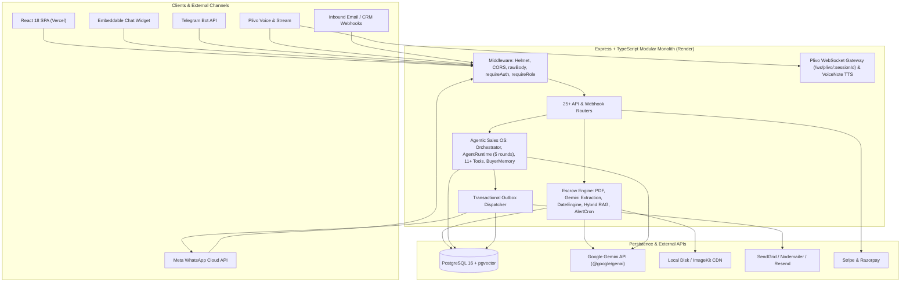

# 01 — System Architecture & Component Interaction

## 1. Architectural Style
Eigen Estate is a **Modular Monolith** (single Express backend process + single React SPA) backed by PostgreSQL:
- **Why Modular Monolith?** Shared Prisma client, atomic `prisma.$transaction()` across Leads/Deals/Outbox/Wallets, zero network hop between services, and simple deployment on Render + Vercel.
- **Trade-off:** Background daemons (`alertCron`, `telegramBot`) and in-memory `rateLimit` run inside the same Node.js process, meaning horizontal scaling to multiple instances requires extracting cron/outbox workers and moving rate limits to Redis.

---

## 2. System Architecture Diagram



---

## 3. Component Interaction & Execution Flow

### Server Startup (`backend/src/index.ts`)
1. `dotenv/config` loads environment variables.
2. `assertSecurityConfig()` validates `JWT_SECRET` ($\ge 32$ chars, not in `KNOWN_WEAK_SECRETS`) and blocks `ENABLE_DEMO_LOGIN=true` in `production`.
3. `createApp()` wires middleware and routes.
4. `app.listen(PORT)` starts HTTP server (skipped when `NODE_ENV === 'test'`).
5. Background systems attach:
   - `initAlertCron()` (`node-cron`)
   - `attachPlivoStreamGateway(server)` (`ws` WebSocket server)
   - `initTelegramBot()`
6. `SIGTERM` / `SIGINT` triggers `gracefulShutdown()` (idempotent, stops cron & bot, drains HTTP, disconnects Prisma, 10s emergency exit timer).

### Why `req.rawBody` Matters
In `backend/src/app.ts`:
```ts
express.json({
  limit: '1mb',
  verify: (req, _res, buf) => {
    (req as express.Request).rawBody = Buffer.from(buf);
  },
})
```
Webhook providers compute HMAC-SHA256 signatures over the exact raw HTTP body bytes. Re-stringifying `req.body` can alter key order or whitespace, breaking verification. Capturing `req.rawBody` during `verify` preserves the exact signed bytes.

---

## 4. Non-Functional Requirements & How They Are Addressed
- **Multi-Tenant Isolation:** Every service validates `requireOrgId(orgId)` (`backend/src/utils/tenant.ts`) and filters Prisma queries by `organizationId`.
- **Reliability & Idempotency:** `OutboxJob` enforces unique `messageId` and `idempotencyKey`; `WebhookEvent` tracks inbound webhook deliveries.
- **Security:** `helmet()`, strict CORS allowlist, `scrypt` + `timingSafeEqual`, stateful `sessionVersion` JWT revocation, magic-byte/MIME upload checks, prompt-injection delimiters (`<<DOC_DATA>>`).
- **Observability:** Structured `logger`, `AuditLog` for compliance, `AgentRunTrace` for AI tool calls, and `ProviderCostEvent` for Gemini/telephony COGS.
