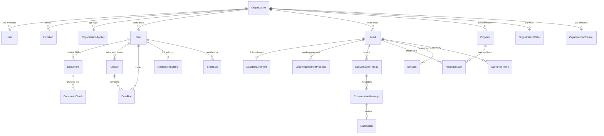

# 04 — Database Engineering

## 1. Database Selection & Connection Management
- **Database:** PostgreSQL 16 (via `pgvector/pgvector:pg16` in `docker-compose.yml`).
- **ORM:** Prisma ORM `5.22.0` (`backend/prisma/schema.prisma`).
- **Connection Pooling (`backend/src/utils/prisma.ts`):** Uses a `globalThis.prisma` singleton pattern so hot-reloading in dev (`tsx watch`) does not exhaust PostgreSQL connection pools.
- **Migrations vs `db push`:** Versioned migrations live in `backend/prisma/migrations/`. Note: `README.md` mandates `prisma migrate deploy` in production, whereas `render.yaml` currently has `npx prisma db push --accept-data-loss` (an important config discrepancy to flag).

---

## 2. Entity Relationship Diagram (Core Models)

---

## 3. Key Schema & Consistency Patterns
1. **Composite Tenant Uniqueness & Indexing:**
   - `Lead` has `@@unique([organizationId, email])` and `@@unique([organizationId, phone])`, plus `@@index([organizationId, status])` and `@@index([organizationId, stage])`. Two different brokerages can have the same buyer email without colliding, while duplicate leads within one brokerage are prevented at the DB level.
2. **Atomic Transactions (`prisma.$transaction`):**
   - `registerOrganization()`: Atomically creates `Organization`, `User`, `OrganizationChannel`, and `OrganizationWallet`.
   - `acceptInvitation()`: Atomically claims `Invitation` (`updateMany` with `acceptedAt: null`) and links `User` (`organizationId: null` guard + `sessionVersion: { increment: 1 }`).
   - `queueMessageDispatch()` (`outboxDispatcher.ts`): Atomically sets `ConversationMessage.deliveryStatus = 'QUEUED'` and creates `OutboxJob`.
3. **Deduplication Constraints:**
   - `OutboxJob.messageId` is `@unique` (prevents duplicate message sends).
   - `EmailLog` is queried by `{ deadlineId, template }` before sending an alert.
4. **Vector & Caching Reality Check:**
   - **Redis:** Not implemented. Caching on the frontend uses in-memory `swrCache.ts`; backend rate limiting uses an in-memory `Map`.
   - **Vector DB:** Although Postgres runs `pgvector:pg16`, `DocumentChunk.embedding` is currently scored in Node.js memory via `cosineSimilarity()` in `retrieval.service.ts` rather than SQL `pgvector` `<=>` HNSW indexes. This works for deal-scoped chunks (`dealId + organizationId`) but would need native `pgvector` SQL indexing for cross-deal semantic search at scale.
