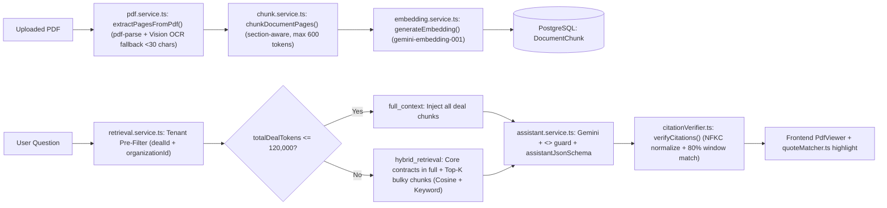

# 06 — RAG (Retrieval-Augmented Generation) Pipelines

## 1. Why RAG?
LLMs have static training cutoffs and cannot see private brokerage contracts. Fine-tuning bakes static knowledge into weights (expensive, hard to update, leaks across tenants). **RAG** injects the exact tenant-scoped contract pages at query time with verbatim citations.

---

## 2. Actual RAG Pipeline in Eigen Estate

---

## 3. Stage-by-Stage Code Trace
1. **Page Extraction (`backend/src/services/pdf.service.ts`):**
   - `extractPagesFromPdf()` extracts text per page preserving line breaks via `transform[5]` Y-coordinates. Pages with `< 30` chars trigger Gemini Vision OCR fallback (`source: 'ocr'`).
2. **Section-Aware Chunking (`backend/src/services/chunk.service.ts`):**
   - `chunkDocumentPages(pages, maxChunkTokens = 600)` splits on paragraph breaks (`\n\s*\n+`), detects real-estate headings (`SECTION_HEADING_REGEX`), flushes when a new section starts (`>= 150` tokens) or when adding a paragraph exceeds `600` tokens.
3. **Tenant-Isolated Retrieval (`backend/src/services/retrieval.service.ts`):**
   - Verifies `Deal` belongs to `organizationId` (`404` otherwise).
   - Loads `DocumentChunk` strictly scoped by `{ dealId, organizationId }`.
   - **Mode 1 (`full_context`):** If total tokens $\le 120,000$, returns all chunks (zero retrieval loss).
   - **Mode 2 (`hybrid_retrieval`):** Keeps `PURCHASE_AGREEMENT`, `COUNTER_OFFER`, and `ADDENDUM` in full (so addenda overrides are never missed), and scores non-core bulky docs using `cosineSimilarity()` + keyword hits.
4. **Prompt Augmentation & Anti-Injection (`backend/src/services/assistant.service.ts`):**
   - Wraps retrieved text in `<<DOC_DATA>>...<</DOC_DATA>>` and instructs Gemini to ignore any instructions inside document text.
   - Enforces `overrides` array when an addendum modifies the base purchase agreement.
5. **Citation Verification (`backend/src/services/citationVerifier.ts`):**
   - `normalizeTextForMatching()` applies NFKC normalization, smart-quote replacement, un-hyphenates line breaks (`inspec-\ntion` → `inspection`), and checks `isQuotePresentOnPage()` (exact or 80% window for quotes > 60 chars).
   - Drops unverified citations and renumbers `[^n]` footnotes in the answer.

---

## 4. Known Gaps to Mention Honestly
- **No BM25:** Keyword scoring uses simple substring hit counting, not TF-IDF/BM25.
- **In-Memory Vector Scoring:** Cosine similarity runs in a JS loop in `retrieval.service.ts` rather than SQL `pgvector` `<=>` HNSW indexes.
- **No Cross-Encoder Reranker:** Uses single-stage hybrid scoring.
