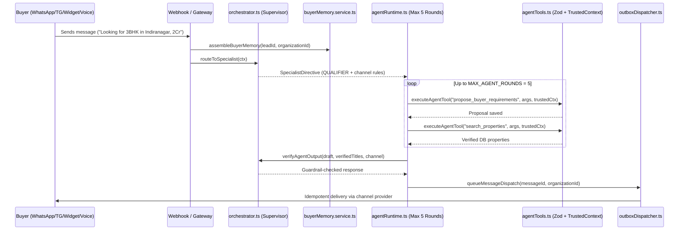

# 08 — Advanced AI Pipelines & Sequence Diagrams

## 1. Omnichannel Agentic Execution Sequence

---

## 2. Transactional Outbox Pattern (`backend/src/services/messaging/outboxDispatcher.ts`)
- **Problem:** Sending an external WhatsApp/Email inside a DB transaction can cause split-brain (message sent, DB rolls back; or DB commits, network fails).
- **Solution:** `queueMessageDispatch()` checks `OutboxJob` by `messageId`, then runs `prisma.$transaction()` to atomically set `ConversationMessage.deliveryStatus = 'QUEUED'` and insert `OutboxJob` with `idempotencyKey = "dispatch-" + messageId`. Retries use bounded exponential backoff.

## 3. Live Voice & Neural TTS Pipelines
- **Plivo Voice (`backend/src/services/telephony/plivoStreamGateway.ts`):** Handles `/ws/plivo/:sessionId` bidirectional audio streaming and `/api/webhooks/plivo` call lifecycle (`VoiceCallSession`).
- **Voice Notes (`backend/src/services/voice/voiceNote.service.ts` & `transcription.service.ts`):** Uses `msedge-tts` for neural voice synthesis on Telegram and transcribes incoming buyer voice notes.
- **Human Takeover:** When an advisor takes over a thread (`ConversationThread.isHumanTakeover = true`), `agentRuntime` suppresses autonomous replies so human and AI never collide.
