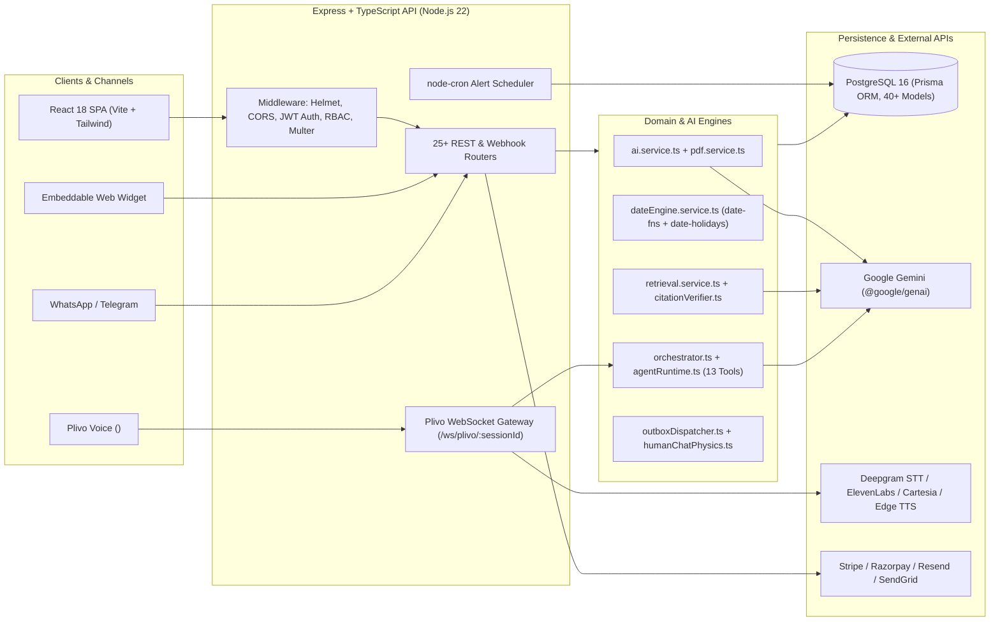

# 05 — Technical Architecture Explanation (Eigen Estate)

> **Purpose:** Use this deep-dive reference when technical mentors, senior architects, or faculty ask *how* Eigen Estate is built under the hood.

---

## 1. High-Level System Architecture

---

## 2. Backend Architecture (`backend/src/`)

- **Entry & Lifecycle (`index.ts`):**
  - Calls `assertSecurityConfig()` at startup—refusing to boot if `JWT_SECRET` is missing, `< 32` chars, or a known weak secret, or if `ENABLE_DEMO_LOGIN=true` in production.
  - Starts Express HTTP server, initializes `initAlertCron()`, attaches `attachPlivoStreamGateway(server)` on `/ws/plivo/:sessionId`, and starts `initTelegramBot()`.
  - Implements idempotent `gracefulShutdown()` on `SIGTERM`/`SIGINT` (stops cron/Telegram, drains HTTP server, disconnects Prisma with a 10s emergency timeout).
- **App & Middleware (`app.ts`, `middleware/`):**
  - `helmet()` security headers, `app.disable('x-powered-by')`, explicit CORS allowlist (with `.vercel.app` / `.onrender.com` support).
  - `express.json({ limit: '1mb', verify: ... })` preserves `req.rawBody` so webhook HMAC signatures are verified over exact received bytes.
  - `requireAuth`, `requireRole(...roles)`, `requirePlatformAdmin` enforce JWT + RBAC.

---

## 3. Database Architecture (`backend/prisma/schema.prisma`)

PostgreSQL 16 managed via Prisma ORM with versioned migrations (`backend/prisma/migrations/`):

- **Tenant Root:** `Organization` (`subscriptionTier`, `subscriptionStatus`, `stateJurisdiction`, `isSuspended`).
- **Auth & Access:** `User` (`googleId`, `role`, `sessionVersion`), `Invitation` (SHA-256 `tokenHash`), `OrganizationApiKey` (SHA-256 `keyHash`).
- **Escrow & Contracts:** `Deal` → `Document` → `DocumentChunk` (`pageNumber`, `chunkIndex`, `sectionTitle`, `tokenCount`, `source: text|ocr`, `embedding: Json?`), `ContingencyClause` → `Deadline` (`computedDate`, `confirmedDate`, `dayType`, `status`), `TransactionTask`, `TaskProposal`, `NotificationSetting`, `EmailLog` (`@@unique([deadlineId, template])`).
- **Omnichannel CRM & Agentic AI:** `Lead` (`@@unique([organizationId, email])`, `@@unique([organizationId, phone])`) → `LeadRequirement`, `LeadRequirementProposal`, `Property`, `PropertyMatch`, `SiteVisit`, `ConversationThread` → `ConversationMessage` → `OutboxJob`, `Campaign`, `VoiceCallSession`, `AgentRunTrace`.
- **Billing & Governance:** `OrganizationWallet` → `WalletLedgerEntry`, `ProviderCostEvent` (COGS tracking in INR), `PlatformConfig` (TTS/LLM failover config), `AuditLog`, `AdminAuditLog`.

---

## 4. Contract Extraction & Deterministic Date Engine

1. **Upload (`routes/documents.ts`):** `multer` receives PDF → `storeFile()` → creates `Document` + `AuditLog` (`DOCUMENT_UPLOADED`).
2. **Parallel Extraction:**
   - `extractClausesFromPdf()` (`ai.service.ts`) extracts text via `pdf-parse`; if `< 50` chars (scanned PDF), sends base64 PDF binary to Gemini Vision. Uses `responseJsonSchema` + `temperature: 0` + Zod validation + candidate model fallback.
   - `extractTransactionTasksFromPdf()` runs in parallel to extract closing milestones.
3. **Deterministic Date Engine (`dateEngine.service.ts`):**
   - Never trusts an LLM for calendar math.
   - `calendar` days: `addDays(startDate, numberOfDays)`.
   - `business` days: iterates day-by-day using `date-fns` (`isWeekend`) and `date-holidays` (`new Holidays(country, state)`) to skip weekends and state-specific statutory holidays.
4. **HITL & Alerts:** Deadlines start as `PENDING`. After user confirmation on `ReviewPage`, `alert.service.ts` (`node-cron`) evaluates `3d`, `1d`, `dayOf`, and `missed` windows and logs each send in `EmailLog` (deduplicated by `[deadlineId, template]`).

---

## 5. Hybrid RAG & Citation Verifier

1. **Page-Aware Chunking (`chunk.service.ts`):** `chunkDocumentPages()` splits pages on paragraph boundaries while detecting section headers (`SECTION_HEADING_REGEX`) and capping chunks at `maxChunkTokens = 600` without splitting mid-sentence.
2. **Tenant Pre-Filtering (`retrieval.service.ts`):** Verifies `deal` belongs to `organizationId`, then loads `DocumentChunk` rows scoped by `{ dealId, organizationId }`.
3. **Two-Mode Retrieval:**
   - **Full Context Mode:** If `totalDealTokens <= 120000` (`ASSISTANT_FULL_CONTEXT_TOKENS`), all chunks are passed to Gemini so cross-page addendum overrides aren't missed.
   - **Hybrid Mode:** Core contracts (`PURCHASE_AGREEMENT`, `COUNTER_OFFER`, `ADDENDUM`) are kept in full; bulky documents are embedded via `gemini-embedding-001` and scored in-memory with `0.7 * cosineSimilarity + 0.3 * keywordScore`, taking top-K (`6`) plus `page ± 1` neighbor expansion.
4. **Prompt Injection Guard (`assistant.service.ts`):** Wraps untrusted document text in `<<DOC_DATA>>...<</DOC_DATA>>` delimiters.
5. **Citation Verifier (`citationVerifier.ts`):** Normalizes Unicode (`NFKC`), smart quotes, and line-break hyphenations (`inspec-\ntion` → `inspection`), verifies verbatim presence (or 80% continuous window for >60-char quotes) against retrieved chunks, validates `deadlineId`s against the DB, and strips unverified citations + renumbers `[^n]` footnotes.

---

## 6. Multi-Agent Orchestrator & Voice Gateway

- **Supervisor (`orchestrator.ts`):** `routeToSpecialist()` checks `isOptOutOrDnd()`, `isExplicitHumanRequest()`, and intent regexes to dispatch `QUALIFIER`, `MATCHER`, `CLOSER`, `DOCS_RAG`, or `ESCALATION` with channel-specific formatting rules (`VOICE_CALL` <35 words, `WEB_WIDGET` <65 words, `WHATSAPP`/`TELEGRAM` <60 words).
- **Bounded Loop (`agentRuntime.ts`):** `MAX_AGENT_ROUNDS = 5` across 13 Zod-validated tools (`agentTools.ts`), followed by `verifyAgentOutput()` guardrails and `AgentRunTrace` persistence.
- **Voice (`plivoStreamGateway.ts`):** Bidirectional WebSocket (`/ws/plivo/:sessionId`) handling 8kHz mu-law audio, barge-in cancellation, Deepgram/Gemini STT, and automatic TTS failover (`eleven_flash_v2_5` → `cartesia_sonic` → `edge_neural` via `ffmpeg`).
