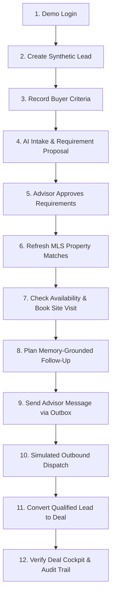
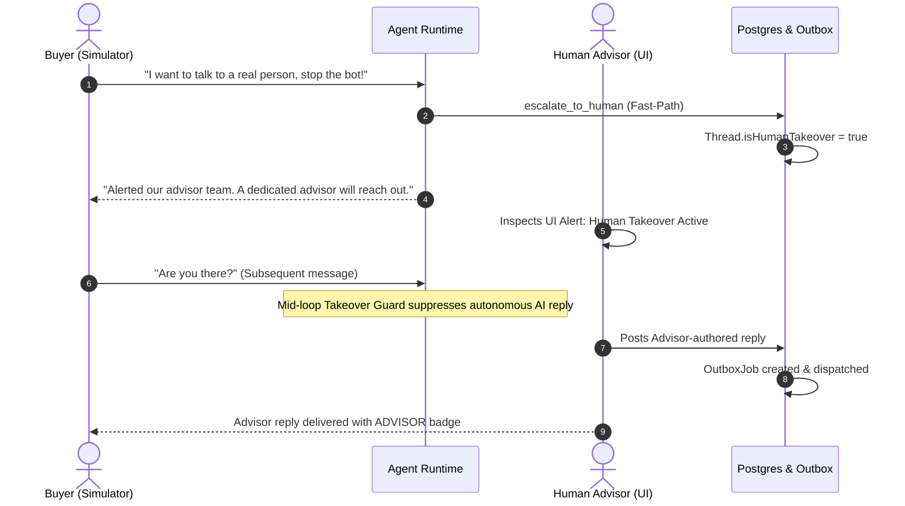

# End-to-End Test Scenarios & Multi-User Journeys

**Repository:** `/Users/badal11/Desktop/Real_Estate_Contigency`  
**Application URLs:**  
- **Frontend:** [http://localhost:3000](http://localhost:3000)  
- **Backend API:** [http://localhost:3001](http://localhost:3001)  
**Document Status:** Complete Phase 4 E2E Test Scenarios  

---

## Journey 1: Normal Buyer-to-Deal Journey

This scenario tests the canonical happy path from fresh inbound buyer inquiry through AI sales-agent engagement, qualification, tour coordination, advisor messaging, and contract deal conversion.

### Prerequisites & Test Actors
- **Actor:** Sarah Jenkins (Demo Advisor, `agent.demo@contingencycopilot.com`, Role: `AGENT`)
- **Tenant:** `demo-sandbox-org` ("Demo Sandbox Brokerage")
- **Browser:** Any modern Chromium, Firefox, or Safari browser window

---

### Step-by-Step Execution Plan



#### Step 1: Log In as Authorized Advisor
1. Navigate to `http://localhost:3000/login`.
2. Click **"Enter Demo Sandbox (Advisor Role)"**.
3. **Verification:** Browser lands on `http://localhost:3000/leads`. The top-right profile header displays Sarah Jenkins.

#### Step 2: Ingest Synthetic Buyer Lead
1. Click **"+ New Lead"** in the top right corner.
2. In the modal, enter:
   - Full Name: `Elena Rostova`
   - Email: `elena.rostova.test@contingencycopilot.internal`
   - Phone: `+1-512-555-0188`
   - Initial Inquiry: `Looking for a luxury 3BHK penthouse or condo in Downtown Austin near Lady Bird Lake. Budget is $950,000. Need to move in 45 days.`
3. Click **"Create Lead & Run Qualification"**.
4. **Verification:** Green alert banner confirms creation. In the leads table, Elena Rostova appears with status `NEW`. Click on her row to open `/leads/:id`.

#### Step 3: Self-Claim Lead Ownership
1. On the lead cockpit (`/leads/:id`), observe the top-bar status: "Unassigned Pool".
2. Click **"Claim Lead"**.
3. **Verification:** Status chip flips to "Assigned to You". The action button updates to "Release Lead".

#### Step 4: AI Conversation Intake & Requirement Proposal
1. In the blue box labelled *"Customer Inquiry Simulator (Development Only)"*, enter:  
   `"Hi, I am ready to tour penthouses in Downtown Austin this Friday at 3:00 PM. My max budget is $950k."`
2. Click **"Simulate Customer Send"**.
3. **Verification:** Customer message appears in the chat thread. The AI thinking indicator activates. AI responds with property guidance and generates an interactive **Requirement Proposal** card in the chat showing:
   - Budget: `$950,000`
   - Bedrooms: `3`
   - Location: `Downtown Austin`

#### Step 5: Advisor Reviews & Approves Requirements
1. On the Requirement Proposal card, click **"Approve Proposal"**.
2. **Verification:** Proposal badge updates to green *"Approved by Advisor"*. In the left-hand column under *"Buyer Requirements & Criteria"*, the Max Budget field automatically updates to `$950,000` and Location to `Downtown Austin`.

#### Step 6: Search & Refresh Property Matches
1. Scroll to the *"Deterministic Property Match Ranking"* card.
2. Click **"Refresh Property Matches"**.
3. **Verification:** Match engine evaluates inventory against approved criteria. Match cards display match scores (e.g. 92% Budget Match, Location Match) with price and bedroom details.

#### Step 7: Check Availability & Book Site Visit
1. In the left column under *"Site Visits & Walkthrough Tours"*, click **"Schedule Visit"**.
2. In the modal:
   - Pick Property: Select any matched property or enter `Downtown Austin Penthouse Tour`
   - Start Date & Time: Select upcoming Friday at 3:00 PM
   - Duration: 60 minutes
   - Meeting Location: `Building Lobby Concierge`
   - Notes: `Buyer confirmed interest via simulator transcript.`
3. Click **"Check Advisor Availability"**.
4. Confirm green message: *"Advisor is available during this time slot"*.
5. Click **"Confirm & Schedule Tour"**.
6. **Verification:** Modal dismisses. The visit card appears under "Scheduled" with countdown timer and meeting details.

#### Step 8: Persistent Buyer Memory & Follow-Up Planning
1. Scroll to the *"Persistent Buyer Memory & Follow-Up Engine"* card.
2. Observe:
   - Authoritative DB Facts: Budget $950k, 3 Beds.
   - Extracted Memory Facts: Preference for Lady Bird Lake view, timeline 45 days.
   - Next Best Action Recommendation: Proposes follow-up outreach.
3. Click **"Plan Follow-Up"**.
4. **Verification:** Generates a new task in the tasks list and queues a suggested outreach draft in the conversation thread.

#### Step 9: Send Advisor Outbound Message
1. In the advisor message composer at the bottom of the conversation thread, type:  
   `"Hi Elena, I've confirmed our private tour for this Friday at 3:00 PM at the Downtown Austin building lobby. Look forward to showing you the penthouse!"`
2. Click **"Send Message as Advisor"**.
3. **Verification:** Message renders in chat with purple background and `ADVISOR` badge.

#### Step 10: Verify Outbound Dispatch & Delivery Status
1. In the left column under *"Outbound Messages & Delivery Status"*, observe the new outbox card.
2. **Verification:** Message status displays `SENDING` or transitions to `SENT` / `DELIVERED`. Provider reference indicates simulated send with masked email: `el***@contingencycopilot.internal`.

#### Step 11: Convert Qualified Lead to Deal
1. In the top navigation bar of the lead cockpit, click the purple **"Convert to Deal"** button.
2. In the modal:
   - Property Address: `100 Congress Ave, Unit 2801, Austin, TX 78701`
   - Buyer Name: `Elena Rostova`
   - Seller Name: `Austin Skyline Holdings LLC`
   - Acceptance Date: Select today's date
   - If requested, check **"Request Manager Eligibility Override"** and enter: *"Buyer tour scheduled and pre-approval letter verified."*
3. Click **"Confirm & Convert to Deal"**.
4. **Verification:** Modal displays conversion animation, confirms success, and navigates browser to `http://localhost:3000/deals/:newDealId`.

#### Step 12: Verify Deal Cockpit & Audit Trail
1. On the newly created Deal page (`/deals/:newDealId`), verify:
   - Purchase agreement header displays `100 Congress Ave, Unit 2801`.
   - Buyer: `Elena Rostova`, Seller: `Austin Skyline Holdings LLC`.
   - Contingency status reflects `PENDING_DOCUMENT_UPLOAD`.
2. Click **"Audit Trail"** in the left sidebar (`/audit`).
3. Verify audit log contains full historical sequence:
   - `LEAD_CREATED`
   - `LEAD_CLAIMED`
   - `REQUIREMENTS_PROPOSAL_APPROVED`
   - `SITE_VISIT_SCHEDULED`
   - `MESSAGE_DISPATCH_QUEUED`
   - `LEAD_CONVERTED_TO_DEAL`

---

## Journey 2: Human Takeover & AI Suppression

This scenario verifies that when a human advisor takes over a conversation—or when a buyer explicitly demands a human—the automated AI sales agent immediately ceases responses, preserves context, and routes control to the human advisor.



### Step-by-Step Execution Plan

#### Step 1: Open an Active Lead Thread
1. Open any active lead detail page at `/leads/:id`.
2. Verify the top-bar toggle: **"Human Takeover"** is currently OFF (grey).

#### Step 2: Trigger Explicit Escalation via Customer Message
1. In the Customer Simulator, send:  
   `"Stop bot. I need to speak to a human manager immediately about closing costs."`
2. Click **"Simulate Customer Send"**.
3. **Verification:**  
   - Fast-path regex triggers without LLM delay.
   - AI sends handoff notification: *"I understand and have alerted our advisor team. A dedicated human advisor has been notified..."*.
   - Amber alert banner appears above the chat: *"Human Takeover Active — Automated AI replies are paused"*.
   - The top-bar **"Human Takeover"** toggle automatically switches to ON (amber).

#### Step 3: Verify AI Response Suppression
1. With Human Takeover active, send another customer inquiry in the simulator:  
   `"Hello? Is anyone there? Can you answer my question?"`
2. Click **"Simulate Customer Send"**.
3. **Verification:**  
   - Customer message is recorded in the chat history.
   - **NO autonomous AI reply is generated.** AI response is strictly suppressed by the `agentRuntime.ts` mid-loop takeover guard.
   - No unwanted draft or auto-response is generated.

#### Step 4: Advisor Sends Genuine Response
1. In the advisor reply composer at the bottom, type:  
   `"Hello, this is Sarah Jenkins, the lead advisor for this listing. I am reviewing your closing cost questions right now. Let's discuss."`
2. Click **"Send Message as Advisor"**.
3. **Verification:**  
   - Message displays with prominent purple border, advisor name, and `ADVISOR` badge.
   - Message is enqueued in the outbox and dispatched.

#### Step 5: Resume AI Autopilot
1. Click the top-bar toggle **"Human Takeover"** to toggle it OFF, or click **"Resume AI Autopilot"** in the thread banner.
2. **Verification:**  
   - Amber banner dismisses.
   - Subsequent customer messages re-enable AI assistance.

---

## Journey 3: Role Authorization & Multi-Tenant Isolation

This scenario verifies that:
1. `AGENT` users are restricted from privileged actions (e.g. creating properties or inspecting other advisors' action queues).
2. Users in Organization A cannot view, query, modify, or leak data belonging to Organization B.

### Test Setup
- **Org A:** `demo-sandbox-org` (User: `agent.demo@contingencycopilot.com`, Role: `AGENT`)
- **Org B:** `cmuyc3rxl0001xj888pzcoyop` (User: `riklestork@gmail.com`, Role: `OWNER`)

### Step-by-Step Execution Plan

#### Test 3.1: AGENT Property Creation Restriction
1. Log in via Demo Sandbox as Sarah Jenkins (`AGENT`).
2. Navigate to `http://localhost:3000/properties`.
3. Locate the top-right button: **"Add Listing (Owner Only)"**.
4. **Verification:** Button is disabled.
5. In browser developer console or terminal, execute an unprivileged creation request:
   ```bash
   curl -s -X POST http://localhost:3001/api/properties \
     -H "Authorization: Bearer <SARAH_JWT>" \
     -H "Content-Type: application/json" \
     -d '{"title":"Hacked Listing","address":"1 Fake Way","city":"Austin","price":100000,"bedrooms":1,"bathrooms":1,"propertyType":"CONDO"}'
   ```
6. **Verification:** Backend responds with HTTP 403 Forbidden:
   `{"error":{"message":"You do not have permission to perform this action"}}`

#### Test 3.2: Multi-Tenant Lead Isolation
1. Obtain an ID of a lead belonging to Org B (or create one in Org B).
2. While logged in as Sarah Jenkins in Org A, attempt to directly load the URL: `http://localhost:3000/leads/<ORG_B_LEAD_ID>`.
3. **Verification:**  
   - The UI displays an error state: *"Lead not found or access denied"*.
   - Backend returns HTTP 404 Not Found (strictly preventing information leakage regarding whether the ID exists in another tenant).

#### Test 3.3: Action Queue Advisor Boundary
1. While logged in as Sarah Jenkins (`cmv3myq0d0001jyqwtnud288e`), call the action queue endpoint requesting another advisor's queue:
   ```bash
   curl -s "http://localhost:3001/api/tasks/action-queue?advisorId=other-advisor-id" \
     -H "Authorization: Bearer <SARAH_JWT>"
   ```
2. **Verification:** Backend responds with HTTP 403 Forbidden:
   `{"error":{"message":"Advisors cannot inspect other advisors’ action queues"}}`

---

## Journey 4: Failure Recovery & Edge Case Resilience

This scenario verifies that the application recovers gracefully from external provider failures, invalid inputs, and race conditions without data corruption.

### Test 4.1: Missing AI Provider / Network Failure
1. **Condition:** When `GEMINI_API_KEY` is not set or network request to Google GenAI fails.
2. **Action:** Send a message in the Customer Simulator.
3. **Verification:**  
   - Application does NOT crash or return a 500 error.
   - `agentRuntime.ts` activates its deterministic fallback contract: returns a polite receipt acknowledgment and suggests default follow-ups.
   - Lead conversation thread remains healthy.

### Test 4.2: Duplicate Lead-to-Deal Conversion Protection
1. **Condition:** A lead has already been successfully converted to an active deal.
2. **Action:** Navigate back to the converted lead page and attempt to submit the "Convert to Deal" form again.
3. **Verification:**  
   - Backend returns HTTP 409 Conflict: `{"error":{"message":"This lead has already been converted to an active deal"}}`.
   - UI catches the error and displays an alert message without creating a duplicate Deal record.
   - Original Deal and Lead relationships remain intact.

### Test 4.3: Outbound Delivery Failure & Manual Retry
1. **Condition:** Outbox message dispatch fails due to an invalid email format or transient provider error.
2. **Action:** Create a lead with invalid email format (or simulate dispatch failure).
3. **Verification:**  
   - Outbox job status transitions to `FAILED`.
   - On the lead cockpit under *"Outbound Messages & Delivery Status"*, the message displays a red `FAILED` badge and a red **"Retry Dispatch"** button.
   - Clicking **"Retry Dispatch"** triggers `POST /api/leads/:id/conversations/messages/:msgId/retry`.
   - Dispatcher increments attempt count and re-executes safely.

### Test 4.4: Conflicting Site Visit Booking
1. **Condition:** Advisor already has a scheduled tour on Friday from 2:00 PM to 3:00 PM.
2. **Action:** Open "Schedule Visit" modal and attempt to book another visit for the same advisor on Friday from 2:30 PM to 3:30 PM.
3. **Verification:**  
   - Clicking **"Check Advisor Availability"** detects the overlapping 30-minute interval.
   - UI displays an amber warning banner: *"Advisor has a conflicting booking during this time slot"*.
   - Prevents double-booking.
