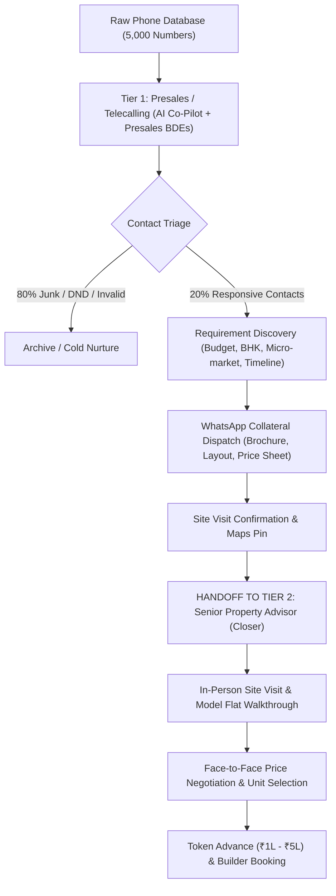

# AI Real Estate Sales Operating System: Product Architecture & Operations Review

**Date**: October 2026  
**Target Market**: Indian Primary Real Estate (Bengaluru, Pune, Hyderabad, Mumbai-MMR, NCR)  
**System Classification**: AI Sales Operating System (Presales Qualifier & Senior Advisor Co-Pilot)

---

## 1. Executive Verdict & Core Positioning

### 1.1 The Business Problem
Indian real estate developers and channel partner brokerages operate in a high-ticket, high-emotion market (₹80 Lakhs to ₹5+ Crores).
- Cold phone databases of thousands of segmented contacts are acquired or purchased.
- 80% to 90% of raw contacts are dead, switched off, invalid, or uninterested.
- Senior Property Advisors (earning ₹60,000 to ₹1,50,000/month + commission) burn out when forced to dial 150 cold numbers a day.
- Inbound inquiries from Meta Ads and property portals suffer from 4 to 24-hour response lag, causing an 80% drop in lead conversion.

### 1.2 The Product Role
The system is **NOT** an AI replacement for property advisors. It is an **AI Presales Co-Pilot and Sales Acceleration Engine**:
- **AI Role**: Speed-to-lead qualification (<45s), automated WhatsApp collateral dispatch (brochures, floor plans), criteria extraction (budget, BHK, micro-market, timeline), and calendar-synchronized site visit scheduling.
- **Human Advisor Role**: Personal relationship, the physical in-person model flat walkthrough, emotional objection handling, price/payment milestone negotiation, and deal closure.

---

## 2. Real-World Indian Sales Operations Workflow

Indian primary real estate operates on a strict two-tier sales hierarchy:

---

## 3. Human Advisor vs. AI Co-Pilot 10-Stage Division of Labor

| Stage | Sales Action | AI Co-Pilot Role | Senior Property Advisor (Human) Role |
|---|---|---|---|
| **1. Cold Contact** | Contact raw city numbers | Automated 1-click preview dialer / voice pre-qualification; logs outcome (`CONNECTED`, `BUSY`, `NO_ANSWER`). | Prioritizes warm inbound referrals and high-intent leads. |
| **2. Discovery** | Extract budget, BHK, location, timeline | Listens, transcribes call notes, extracts structured JSON (`₹1.8 Cr`, `3BHK`, `Whitefield`, `Ready-to-move`). | Probes family priorities (Vastu, schools, commute) and builds initial rapport. |
| **3. Qualify** | Genuine buyers vs. casual explorers | Assigns priority score (`HIGH`, `MEDIUM`, `LOW`) based on budget clarity and readiness. | Evaluates buyer seriousness and decides on physical visit allocation. |
| **4. Match** | Match with company inventory | Deterministic SQL filtering + soft preference scoring against developer inventory. | Validates property fit based on developer track record and construction quality. |
| **5. Suggest Alternatives** | When exact property is unavailable | Recommends adjacent micro-markets (e.g. Sarjapur -> Varthur / Gunjur). | **Human Salesmanship**: Explains why the alternate location is a better long-term investment. |
| **6. Share Collateral** | WhatsApp brochures, floor plans | Dispatches high-res PDF brochure and cost sheet via WhatsApp within **3 seconds** branded with advisor details. | References collateral while speaking with client: *"I just sent the floor plan to your WhatsApp, Mr. Sharma."* |
| **7. Follow-Up** | Overcome objections, nurture warm leads | Automated follow-up reminders; maintains complete interaction memory across touchpoints. | Calls buyer to resolve deep personal objections (legal title, bank loan sanctions). |
| **8. Arrange Site Visit** | Schedule the physical visit slot | Checks advisor's live calendar, sends Google Maps pin, gate pass, and 2-hour pre-visit WhatsApp reminder. | Confirms personal schedule and locks the meeting time. |
| **9. MEET & EXPLAIN** | **100% In-Person Site Visit** | **Advisor Mobile Pocket Dossier**: Pings advisor 15 mins prior with buyer summary, budget limit, and objection history. | **100% Human Advisor**: • Greets family with coffee. • Shows model flat, finishes, ventilation, room dimensions. • Shows clubhouse, sports amenities. • Builds emotional trust with spouse and parents. |
| **10. Close & Negotiate** | Final pricing, unit selection, booking | Prepares payment milestone schedule (CLP 20:80) and draft booking forms. | **100% Human Advisor**: • Sits across the desk with developer sales director. • Negotiates floor-rise, PLC, and car-park charges. • Collects booking cheque (₹1L–₹5L) and closes deal. |

---

## 4. Codebase Audit: Features to Keep, Change, and Remove

### 4.1 What to Keep
- **`agentRuntime.ts` Conversational Rules**: Bounded 5-round loop, punchy 2-3 sentence replies, no robotic promotional monologues.
- **`siteVisit.service.ts`**: Conflict-safe calendar slot management, advisor assignment (`assignedUserId`), and outcome tracking (`COMPLETED`, `NO_SHOW`).
- **`verifyBuyerVisitConsent`**: Server-side verification of genuine customer consent before locking visits.
- **Human Takeover Mechanism (`HUMAN_TAKEOVER_TOGGLED`)**: 1-click advisor takeover of active WhatsApp/voice conversations.

### 4.2 What to Change
- **`propertyMatch.service.ts`**: Remove USD currency formatting (`$1.5M`); replace with Indian currency formatting (`₹1.5 Cr`, `₹85 L`). Implement micro-market adjacency logic.
- **`campaigns.ts`**: Replace in-memory array state (`activeCampaigns`) with database-backed batch queue.
- **Telephony Credentials**: Switch from sandbox simulation mode to live Twilio/Plivo production credentials.

### 4.3 What to Remove (Legacy US Contingency Baggage)
- Drop `ContingencyClause`, `DocType: HOA_DISCLOSURE`, `TITLE_COMMITMENT`, and 14-day escrow cancellation deadline tracking. These are irrelevant to Indian primary real estate.
- Drop ElevenLabs voice note cloning over WhatsApp; focus on clean text, PDF collateral, and location pins.

---

## 5. Commercial Value Metrics for Real Estate Brokerages

1. **Speed to Lead**: Reduced from 4–12 hours to **under 45 seconds** on WhatsApp.
2. **Site Visit Turnout Rate**: Increased from industry average of 35% to **65%+** via automated Maps pins, gate entry passes, and 2-hour WhatsApp reminders.
3. **Advisor High-Value Time**: Shifted from 70% cold calling / 30% on-site to **10% CRM / 90% on-site conducting visits and closing bookings**.
4. **Cost Per Qualified Visit (CPV)**: Decreased by 40% through automated presales triage.

