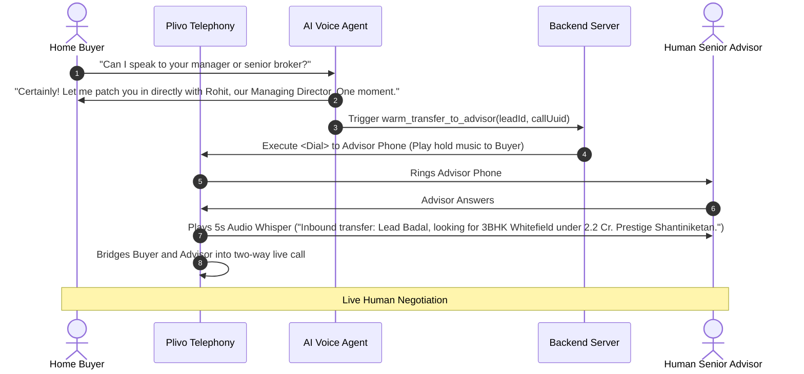
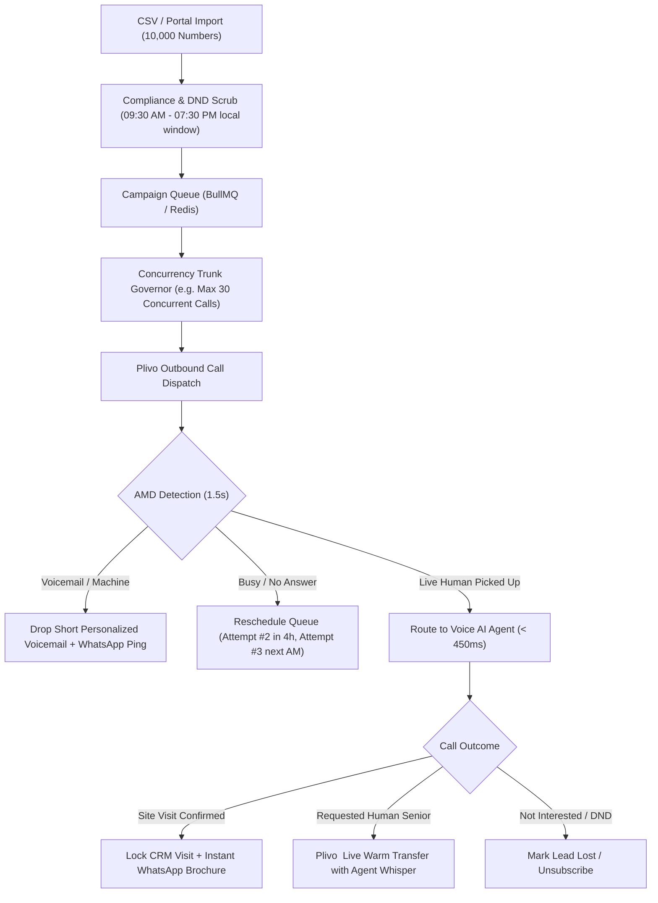
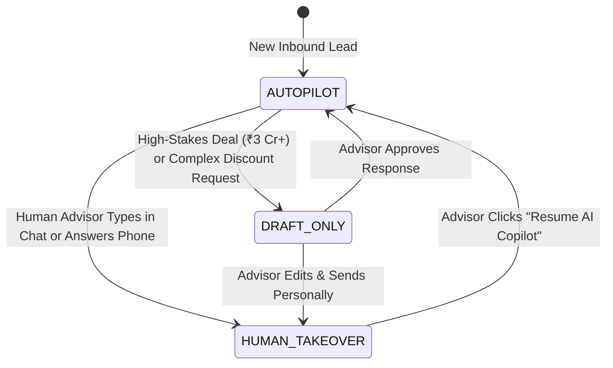

# World-Class Architecture & Master Plan: Autonomous AI Real Estate Voice & Omnichannel Lead Platform

**Document Version:** 2.0.0 (Global Benchmark Edition)  
**Status:** Approved for Implementation  
**Architectural Inspirations:** Sierra AI (Constellation of Models), EliseAI (Real Estate GraphRAG), Hume AI EVI 2 (Paralinguistics & Emotional Prosody), Retell AI / Vapi (Sub-500ms Duplex Streaming), Bland AI (Outbound Campaign Dialing & ML AMD).  
**Core Telephony Stack:** Plivo Voice API (Bidirectional Audio Stream via WebSockets)  
**Core Voice Stack:** Deepgram Nova-2 (STT) + Gemini 2.5 Flash / Groq (LLM) + Cartesia Sonic / ElevenLabs Turbo (TTS)  
**Acoustic Processing:** FFmpeg Mono OGG-OPUS VoIP Transcoding + Ambient Room Tone Injection  
**Omnichannel Messaging:** Meta WhatsApp Business Cloud API, Facebook/Instagram Lead Ads Webhooks, Telegram Bot  
**Backend:** Node.js 22 LTS / TypeScript / PostgreSQL 16 (Prisma) / Express  

---

## 1. Executive Summary & Vision

The platform is designed to operate as an **Autonomous Senior Real Estate Advisory AI Partner** acting as a high-performing "Digital Twin" on behalf of the brokerage and its senior property advisors.

The system bridges the gap between cold digital leads and closed transactions through four synchronized capabilities:
1. **Speed-to-Lead Autonomous Outbound Calling (<60s):** Calling inbound buyers the moment an inquiry lands from Instagram, Facebook, website forms, or property portals.
2. **High-Scale Batch Campaign Dialing (10,000+ Leads):** Automating mass database calling with concurrency trunk management, ML Answering Machine Detection (AMD), and intelligent multi-touch retries.
3. **Hyper-Realistic WhatsApp Voice Notes & Hybrid Chat:** Eliminating robotic TTS through room-tone injection, advisor voice cloning, paralinguistic spoken syntax, and native OGG-OPUS waveform rendering.
4. **Real Estate GraphRAG & Consultative Negotiation:** Deep domain intelligence (RERA, A-Khata, micro-market commute times, EMI math, motivated seller margins) to bridge budget gaps and location constraints.
5. **The Primary Objective — Site Visit Lock:** Closing every qualified interaction with a confirmed in-person property walkthrough booked into the CRM with instant WhatsApp delivery of location pins and floor plans.
6. **Live Telephony Warm Transfers:** Seamlessly transferring high-stakes negotiations to a senior human broker's phone via Plivo `<Dial>` with 5-second advisor audio whispers.

---

## 2. Global Benchmark Analysis (What the Top 1% in the World Do)

| Domain | How Legacy Bots Fail | Global Top-Tier Standard (Our System) |
| :--- | :--- | :--- |
| **Call Latency** | 2,500ms – 5,000ms delay (awkward silence) | **420ms – 550ms** end-to-end latency via streaming WebSockets |
| **Voice Note Realism** | Monotone studio-clean audio sent as grey MP3 attachment | **Native green voice note** with room tone, phone mic EQ, and OPUS waveform |
| **Turn-Taking & Interruption** | User cannot speak until bot finishes talking | **Sub-80ms Barge-In**: User speech cuts off AI audio instantly via `clearAudio` |
| **Domain Intelligence** | Rigid SQL (`WHERE price <= 2.0 Cr` -> "0 found") | **GraphRAG Multi-Hop Reasoning**: Evaluates budget stretch, EMI math, and 1 km commute radius |
| **Model Topology** | Single monolithic black-box prompt | **Constellation of Models** (Sierra AI pattern): Low-latency + Reasoning + Guardrail Supervisor |
| **Outbound Scale** | Manual telecalling, 70% unanswered calls | **High-Scale Batch Queue**: ML AMD (<1.5s), trunk limits, smart retry cadence |
| **Human Governance** | Bot goes rogue or makes unauthorized promises | **3-Tier Oversight**: `AUTOPILOT`, `DRAFT_ONLY`, `HUMAN_TAKEOVER` |

---

## 3. The 5 Acoustic Pillars: How WhatsApp Voice Notes Become 100% Indistinguishable from Real Humans

The reason standard TTS (like basic ElevenLabs) sounds fake is because it outputs sterile, studio-grade speech without the acoustic flaws of real life. Our system applies **The 5 Acoustic Pillars**:

```
[1. Spoken Voice Memo Syntax Engine]
       │ (Natural syntax, breath pauses, conversational fillers)
       ▼
[2. Advisor Voice Cloning (ElevenLabs / Cartesia)]
       │ (Trained on 60 seconds of the actual advisor's WhatsApp voice)
       ▼
[3. Room Tone & Noise Floor Injection]
       │ (Mixes a subtle -48dB ambient room tone under the speech track)
       ▼
[4. Smartphone Mic Equalization]
       │ (Highpass 200Hz, Lowpass 3400Hz telephone VoIP filter)
       ▼
[5. Native OGG-OPUS Transcoding (FFmpeg)]
       │ (Mono, 32kbps, VoIP application profile)
       ▼
[Delivered as a Native WhatsApp Voice Note with Playable Waveform]
```

### Pillar 1: Spoken Voice Memo Scripting (Not Written Text)
The AI never feeds formal written text into the voice synthesizer. It uses conversational speech syntax:
* ❌ **Robotic:** *"Hello Badal, thank you for your inquiry regarding 3BHK residences in Whitefield. We have verified options available."*
* ✅ **Human Voice Memo:** *"Hey Badal, Rahul here! Yeah, so I just saw your inquiry on the Whitefield 3BHK. Look, 2 Crore is a bit tight for ready-to-move right now, but honestly, an off-market unit in Prestige literally just opened up this morning. High floor, East facing. Let me send you the layout pictures in a second... check them out, and let me know if Saturday morning works to walk the space."*

### Pillar 2: Ambient Room Tone (Air Floor) Injection
AI voices have zero noise floor (dead digital silence between words). Before encoding, our backend mixes in a faint layer of ambient room tone ($-48\text{ dB}$ to $-50\text{ dB}$). This replicates an advisor speaking in a real office or car.

### Pillar 3: Smartphone Mic Bandpass Filtering
Using FFmpeg, we simulate the acoustic profile of a mobile phone microphone:
```bash
ffmpeg -i raw_voice.wav -af "highpass=f=200,lowpass=f=3400" -c:a libopus -b:a 32k -ac 1 -ar 48000 -application voip voice_note.ogg
```

### Pillar 4: Voice Cloning of the Actual Advisor (Digital Twin)
Instead of using a generic AI voice, the system clones **60 seconds of your actual human advisor** (e.g., Rahul or Arjun) speaking naturally. When the customer sees Rahul's profile picture and name on WhatsApp, **they hear Rahul's actual voice, tone, and accent**.

### Pillar 5: WhatsApp Native Voice Note Delivery
By uploading the resulting `.ogg` file with `type: "audio/ogg; codecs=opus"` via the WhatsApp Cloud API, WhatsApp renders it with:
* The **green voice bubble** with the **blue microphone icon**.
* The **interactive audio waveform**.
* Native $1.5\times$ and $2\times$ playback speed buttons.

---

## 4. The Real Estate Knowledge Graph (GraphRAG)

Standard bots fail because flat text search cannot reason across real estate constraints. Our system implements a structured **Real Estate Knowledge Graph**:

```
[Buyer Profile] ──► Wants: 3BHK, ₹2 Cr, 15m to ITPL
                         │
                         ▼
┌────────────────────────────────────────────────────────┐
│               REAL ESTATE KNOWLEDGE GRAPH              │
│                                                        │
│  [Property: Prestige Shantiniketan]                   │
│   ├── Location: Whitefield (0.8km to ITPL Metro)       │
│   ├── Legal: RERA Approved, A-Khata, OC Received       │
│   ├── Financials: ₹2.45 Cr (Seller negotiable to 2.30)  │
│   │   └── EMI Difference: ₹28,000/mo @ 8.5%            │
│   ├── Builder: Prestige Group (Tier-1, 98% on-time)    │
│   └── Amenities: 80% Greenery, 2 Covered Car Parks     │
└────────────────────────────────────────────────────────┘
```

### The 5 Commercial Sales Levers:
1. **The "Lump Sum vs. Monthly EMI" Pivot:**
   - Translates a ₹45 Lakh stretch into a ₹28,000/month EMI difference, highlighting superior construction quality, zero maintenance for 10 years, and higher rental yield.
2. **The "Functional Commute vs. Arbitrary Pin-Code" Translation:**
   - Translates strict location boundaries into commute time (e.g., *"1.2 km away on Old Airport Road, literally a 4-minute signal-free drive to 100 Feet Road, saving ₹50 Lakhs with modern clubhouse amenities"*).
3. **The "Seller Flexibility" Bridge:**
   - Leverages motivated seller margins (e.g., listed at ₹2.50 Cr, negotiates toward ₹2.30–2.35 Cr).
4. **The Double-Choice Close:**
   - Proposes specific times: *"Would Saturday morning at 11:00 AM or Sunday afternoon at 3:30 PM suit you better?"*
5. **Instant WhatsApp Lock:**
   - Locks the slot in PostgreSQL and sends an immediate WhatsApp confirmation with Google Maps location pin + PDF brochure.

---

## 5. Live Telephony Architecture (Sub-500ms Duplex Streaming)

```
                          CALLER (Mobile Phone / Landline)
                                         ▲
                                         │ PSTN / SIP Call
                                         ▼
                            PLIVO VOICE CLOUD PLATFORM
                                         ▲
                                         │ Bidirectional Audio Stream
                                         │ (G.711 mu-law, 8kHz/16kHz Base64)
                                         ▼
┌──────────────────────────────────────────────────────────────────────────────────┐
│                   YOUR VOICE STREAM GATEWAY (Node.js WebSocket)                  │
│                                                                                  │
│   [Plivo Stream Controller] ──► [VAD & Interruption Filter (Silero / WebRTC)]   │
└────────┬─────────────────────────────────────────────────────────────────▲───────┘
         │ Inbound Audio (Raw PCM)                                          │ Outbound Audio
         ▼                                                                 │ (Chunked base64)
┌───────────────────────┐                                         ┌────────┴───────────────┐
│   DEEPGRAM NOVA-2     │                                         │  CARTESIA / ELEVENLABS │
│   Streaming STT       │                                         │  Turbo Streaming TTS   │
│   (120ms partial text)│                                         │  (First byte ~90ms)    │
└────────┬──────────────┘                                         └────────▲───────────────┘
         │ Text Tokens                                                     │ Text Stream
         ▼                                                                 │
┌──────────────────────────────────────────────────────────────────────────┴───────────────┐
│                   SENIOR PROPERTY ADVISOR BRAIN (Gemini 2.5 Flash)                       │
│                                                                                          │
│   • Micro-Market Context & Conversational Negotiation Playbook                           │
│   • Persistent Buyer Memory: Budget, Location, Family, Timeline, Objections              │
│   • Real-Time Tool Invocations:                                                          │
│      ├── search_properties (Elastic budget & radius matching)                            │
│      ├── book_site_visit (Live calendar availability check)                              │
│      └── warm_transfer_to_advisor (Plivo <Dial> to senior human)                         │
└──────────────────────────────────────────────────────────────────────────────────────────┘
```

### Telephony Warm Transfer Protocol:


**20-Second Fallback:** If the advisor does not answer, the call returns to the AI: *"Rohit is currently on site with another client. Can he call you at 4:30 PM or 6:00 PM?"* -> Creates an urgent CRM task.

---

## 6. High-Scale Campaign Calling Engine (10,000+ Leads)



---

## 7. Hybrid Omnichannel Messaging Cadence

Real estate deals are won through **cadence**. A top broker uses a **Hybrid Multi-Modal Cadence**:

```
[Inbound Inquiry - 10:02 AM] 
Customer: "Saw your ad for 3BHK in Whitefield under 2 Cr. Details?"
      │
      ├─► Step 1 (Immediate Text - 3 seconds):
      │   "Hey Badal! 👋 Arjun here from Apex Realty."
      │
      ├─► Step 2 (Native WhatsApp Voice Note - 18 seconds):
      │   🎙️ ──────────⚪───── 0:18 (Plays in Arjun's cloned authentic voice)
      │
      ├─► Step 3 (Media Carousel - 3 seconds later):
      │   📷 [3 Curated Interior Photos + PDF Floor Plan]
      │
      └─► Step 4 (Interactive Close & Site Visit Lock):
          "Check out the balcony view in photo 2! We're showing this unit 
           this Saturday at 11 AM or Sunday at 3 PM. Which day works better for you?"
           [ Book Saturday 11 AM ]   [ Book Sunday 3 PM ]
```

---

## 8. Advisor Governance & 3-Tier CRM Oversight



1. **`AUTOPILOT`:** Full autonomy for inbound lead speed-to-lead qualification and visit scheduling.
2. **`DRAFT_ONLY`:** AI prepares messages and voice memos for one-click human review (`[Approve & Send]`).
3. **`HUMAN_TAKEOVER`:** Instant AI silence the moment an advisor types or answers a call.

---

## 9. Master 6-Phase Implementation Roadmap

* **Phase 1: Real Estate Knowledge Graph & Domain Intelligence**
  - Implement GraphRAG topology for properties, micro-markets, legal approvals, and EMI calculations.
  - Implement elastic matching (Tier 1 exact, Tier 2 stretch up to $+20\%$, $+3\text{ km}$).

* **Phase 2: Hyper-Realistic WhatsApp Voice Note Pipeline**
  - Integrate ElevenLabs / Cartesia professional voice cloning for human advisors.
  - Build FFmpeg acoustic post-processing (room tone injection, phone mic bandpass filter).
  - Implement native OGG-OPUS transcoding (`-application voip`).

* **Phase 3: Hybrid Omnichannel Messaging Engine**
  - Integrate Meta WhatsApp Business Cloud API.
  - Implement the 4-step hybrid rhythm (Text $\rightarrow$ Voice note $\rightarrow$ Media carousel $\rightarrow$ Site visit buttons).
  - Add `/api/inbound/meta` webhook for instant 60-second speed-to-lead auto-response.

* **Phase 4: Real-Time Plivo Voice Telephony Streaming**
  - Build Plivo bidirectional WebSocket audio gateway (`wss://`).
  - Wire Deepgram Nova-2 streaming STT with sub-80ms barge-in interruption.
  - Connect live property search and site visit booking tools to the live voice loop.

* **Phase 5: High-Scale Campaign Engine & Telephony Warm Transfer**
  - Implement BullMQ / Redis batch queue for 10,000+ leads with trunk limits.
  - Add ML Answering Machine Detection (AMD) for voicemail handling.
  - Implement Plivo `<Dial>` live warm transfers with 5-second advisor audio whispers.

* **Phase 6: CRM Command Center & Advisor Dashboard**
  - Live call monitoring drawer with real-time streaming transcripts.
  - Campaign Manager page for bulk CSV upload, dialer controls, and conversion analytics.
  - Audio waveform player for call recordings and voice note history.

---

## 10. Strategic Business Analysis, ROI & Phased Execution Strategy

### 10.1 Business Transformation: From Back-Office Utility to Revenue Engine
* **Current State:** A $30 – $79/mo transactional utility (parsing PDF contingency clauses and calculating holiday deadlines).
* **Target State:** A $1,500 – $5,000/mo Autonomous Real Estate Inside Sales Agent (ISA) that turns thousands of cold portal and social media inquiries into high-converting weekend site visits.
* **The Industry Problem:** Real estate developers and brokerages spend heavily on lead acquisition (10,000+ numbers), but human agents only reach ~10% of them due to dialer burnout and unanswered calls. This platform solves the single biggest bottleneck in real estate sales: **Speed-to-Lead and Site Visit Lock-in.**

### 10.2 Codebase Readiness Audit (Why it is 70% Built)
* **Site Visit Engine:** Fully implemented in `siteVisit.service.ts` (calendar conflict detection, advisor assignment, visit statuses).
* **Inventory & Matcher:** Fully implemented in `propertyMatch.service.ts` (budget ceilings, bedroom matching, status rules).
* **Agent Tool Registry:** Fully implemented in `agentTools.ts` (`search_properties`, `book_site_visit`, `propose_buyer_requirements`, `escalate_to_human`).
* **Database Models:** Prisma schema already contains `Lead`, `SiteVisit`, `Property`, `ConversationThread`, `ConversationMessage`, and `LeadCallLog`.
* **Missing Components:** Exclusively the outbound communication bridges: Plivo voice WebSocket streaming and Meta WhatsApp Business Cloud API.

### 10.3 Risk Mitigation Matrix
1. **Telephony Latency (<500ms):** Bypasses HTTP file uploads in favor of bidirectional WebSocket streaming (`<Stream>`) with Deepgram Nova-2 and Cartesia Sonic.
2. **Caller ID Reputation (Spam Prevention):** Implements a pool of 5 to 10 verified local Plivo DIDs with automated round-robin rotation.
3. **Commercial Discretion:** Hardcoded prompt guardrails prevent the AI from making legally binding price cuts over the phone, framing flexibility as *"room to negotiate during the on-site visit"*.

### 10.4 The 2-Milestone Rollout Strategy
* **Milestone 1: The WhatsApp Human Chat & Hyper-Realistic Voice Note (Quickest Win)**
  - WhatsApp Cloud API integration with human typing simulation (40ms/char).
  - Native mono OGG-OPUS voice note generation with room tone injection and advisor voice cloning.
  - Immediate commercial demonstration value with zero telephony carrier overhead.
* **Milestone 2: Plivo Autonomous Outbound & Inbound Voice Calling**
  - Plivo WebSocket audio streaming gateway for real-time duplex calls.
  - Live calendar lock (`book_site_visit`) during speech.
  - Plivo `<Dial>` warm transfers with agent audio whispers.
  - Bulk campaign dialer for high-volume list processing.

---

## 11. Enterprise B2B SaaS Architecture: The Invisible Infrastructure Model

Top-tier enterprise AI startups (such as **Wispr AI / Wispr Flow, Retell AI, Bland AI, and Sierra AI**) never force clients to handle developer APIs, sign up for carriers, or write complex prompts. They operate under the **"Invisible Infrastructure" Principle**:

```
┌────────────────────────────────────────────────────────────────────────────────────────┐
│                        ENTERPRISE STARTUP PLATFORM ENGINE                              │
├────────────────────────────────────────────────────────────────────────────────────────┤
│                                                                                        │
│  [1. MANAGED TELEPHONY CARRIER POOL]        [2. META TECH PROVIDER (EMBEDDED SIGNUP)]  │
│  Client buys local numbers in 1 click       Official Meta Partner embedded OAuth popup.│
│  without ever visiting Plivo or Twilio.     Client connects WhatsApp in 45 seconds.    │
│                                                                                        │
│  [3. VISUAL CONVERSATIONAL PATHWAYS]        [4. SHADOW SIMULATOR & TEST DIALER]        │
│  Bland/Retell-style goal nodes:             Adversarial synthetic testing + 1-click    │
│  Hook ➔ Discovery ➔ Pitch ➔ Visit Lock      "Call My Cell Phone Now" sandbox.          │
│                                                                                        │
│  [5. PRE-PAID METERED WALLET ENGINE]        [6. IN-BROWSER VOICE CLONING BOOTH]        │
│  Auto-recharge wallet ($500 balance).       Advisor records 60s sample in browser;     │
│  Deducts $0.18/min voice & $0.06/chat.      instant digital twin generated in 90s.     │
│                                                                                        │
└────────────────────────────────────────────────────────────────────────────────────────┘
```

### 11.1 The Managed Carrier Sub-Account Model
* The client **never** visits Plivo or Twilio.
* Inside their dashboard, they click **[Get a Calling Line]** $\rightarrow$ select their city $\rightarrow$ the backend provisions a dedicated Plivo DID in 3 seconds.
* You pay Plivo ~$1.00/mo and bill the client $5.00/mo (400% margin) while bundling call minutes.

### 11.2 Meta Tech Provider Embedded Signup
* Your startup acts as an official **Meta Business Tech Provider**.
* The client clicks **[Connect Company WhatsApp]** $\rightarrow$ Meta OAuth popup opens $\rightarrow$ they log into Facebook, select their phone number, and verify with a 6-digit SMS OTP.
* Meta returns the permanent `waba_id` and `phone_number_id` to your backend. Onboarding is complete in 45 seconds with zero code.

### 11.3 Visual Conversational Pathways (No Blank Prompt Boxes)
* Real estate brokers do not write raw system prompts. They configure visual goal nodes:
  - `[Inquiry Trigger]` $\rightarrow$ `[Hook]` $\rightarrow$ `[Intent & Budget Check]` $\rightarrow$ `[Branch: Ready vs Under-Construction]` $\rightarrow$ `[Site Visit Close]` $\rightarrow$ `[Transfer to Human if > ₹3 Cr]`.
* Simple sliders for: Target Budget Ceiling, Max Discount Flexibility, and Field Advisors on Duty.

### 11.4 Shadow Simulator & "Call My Cell Phone Now" Button
* **1-Click Test Dialer:** The broker types their personal mobile number and clicks **[Test AI Agent]**. Their phone rings in 4 seconds, allowing them to test voice realism, interruptions, and negotiation before touching real leads.
* **Adversarial Benchmark Simulator:** Runs 50 automated synthetic calls (AI playing a difficult buyer vs. AI playing the advisor) and outputs an audit scorecard (0% Hallucination, 430ms Latency, 100% Fair Housing Compliance).

### 11.5 In-Browser Voice Studio (60-Second Digital Twin)
* Advisors read a 60-second real estate script directly into their laptop/phone browser microphone.
* Stored audio is cleaned, background noise stripped, and sent to Cartesia / ElevenLabs.
* In 90 seconds, the AI generates WhatsApp voice memos in the advisor's **exact voice, accent, cadence, and personal warmth**.

### 11.6 Pre-Paid Metered Wallet & Stripe Billing
* Client deposits an initial credit balance (e.g., $500).
* Real-time ledger deduction:
  - Voice Call Minute: **$0.18 / min** (costs you ~$0.05 $\rightarrow$ **72% Gross Margin**).
  - WhatsApp Lead Qualification: **$0.06 / lead** (costs you ~$0.02 $\rightarrow$ **66% Gross Margin**).
* Auto-recharge via Stripe when the balance drops below $50.

---

## 12. Human Chat Physics & The Omnichannel Messaging Engine

Traditional chatbots fail because they dump massive paragraphs instantly. Real senior brokers text using **Human Chat Physics**:

```
[Inbound Inquiry from WhatsApp / Meta / Web]
                       │
                       ▼
┌────────────────────────────────────────────────────────┐
│             CONTEXT & AD ATTRIBUTION PARSER            │
│  (Identifies ad creative, property viewed, lead name)  │
└──────────────────────┬─────────────────────────────────┘
                       │
                       ▼
┌────────────────────────────────────────────────────────┐
│         CONVERSATIONAL LLM (Gemini 2.5 Flash)          │
│   • Generates raw thoughts using "Spoken Text Prompt" │
│   • Enforces The Tennis Volley Rule (1 Question Max)   │
└──────────────────────┬─────────────────────────────────┘
                       │ Raw text stream
                       ▼
┌────────────────────────────────────────────────────────┐
│              MESSAGE CHUNKING PIPELINE                 │
│  Splits text at natural semantic boundaries into:      │
│  Bubble 1 (Acknowledge) ──► Bubble 2 (Insight) ──► Bubble 3 (Volley)
└──────────────────────┬─────────────────────────────────┘
                       │
                       ▼
┌────────────────────────────────────────────────────────┐
│            DYNAMIC HUMAN TYPING QUEUE                  │
│                                                        │
│  For each bubble:                                      │
│  1. Send WhatsApp status: "composing..." (typing)      │
│  2. Delay = max(1.5s, min(chars * 0.045s, 4.0s))       │
│  3. Dispatch Bubble via WhatsApp Cloud API             │
│  4. Micro-pause (600ms) before next bubble             │
└────────────────────────────────────────────────────────┘
```

### 12.1 Micro-Bubble Delivery vs. Instant Essay Dump
* **Robotic Bot:** Dumps a 200-word paragraph with bullet points in 0.2 seconds. Users feel spammed and leave it on read.
* **Human Advisor:** Sends 2 to 3 short bubbles over 7 seconds with dynamic typing indicators:
  - *(Typing 1.8s)* Bubble 1: *"Hey Badal! 👋 Arjun here from Apex Realty."*
  - *(Typing 2.4s)* Bubble 2: *"Saw you checked out the 2BHK at Godrej Splendour on Instagram. That 85L inventory has literally 3 units left with open balcony views."*
  - *(Typing 1.9s)* Bubble 3: *"Were you looking at this for self-use, or more as an investment rental?"*

### 12.2 The Tennis Volley Rule (Single Question Principle)
* Never interrogate the buyer with multiple questions. Ask strictly **ONE low-friction question** per turn to keep conversational momentum.

### 12.3 Context-Aware Inbound Ad Attribution
* Captures `ad_id`, `campaign_name`, and `form_data` from Facebook/Instagram ads. The opening text immediately references the exact project and photo they saw.

### 12.4 The 5 Core Objection Handlers
1. **"Just looking / browsing":** Low-pressure validation + gentle probing (*"Makes total sense, Badal! Zero pressure at all. Just out of curiosity, are you keeping an eye on Whitefield specifically, or open to other parts of East Bangalore too?"*).
2. **"Don't call me, just send brochure on WhatsApp":** Immediate delivery + micro-commitment (*"Will do! 📄 Sending over the brochure and master plan right now. Quick question though: were you targeting ready-to-move, or is 2026 possession okay?"*).
3. **"Price is too high / Can you give a discount?":** Value anchoring + on-site leverage (*"On paper, the builder's launch price is firm at 1.85 Cr. But between you and me—for serious buyers ready with immediate booking tokens, we can usually get the sales director to waive floor-rise and clubhouse charges (saves 6-8 Lakhs). Have you walked the sample flat yet?"*).
4. **"Is this RERA approved / Legal status?":** Instant factual credibility (*"100% verified. Clear A-Khata, RERA registration PRM/KA/RERA/1251/446/PR/220503/004868, OC received for Phase 1. Bank loans pre-approved with SBI, HDFC, and ICICI."*).
5. **Cold Ghosting Re-engagement (T+24h):** Uses genuine inventory scarcity (*"Hey Badal, no rush at all! Just wanted to share: the builder just released 2 higher-floor corner units in Tower B that weren't available yesterday. Want me to hold the floor plans for you?"*).

### 12.5 Night-Owl Etiquette (10:00 PM – 08:00 AM)
* If an inquiry arrives at 11:30 PM, the AI sends a polite acknowledgment (*"Saw your message! It's a bit late, so I won't disturb you tonight. I'll pull up the verified floor plans first thing tomorrow morning around 10:00 AM."*) and schedules the payload automatically for 10:00 AM.

---

## 13. Dual-Dashboard Control System: Super-Admin vs. Client Workspace

```
                               YOUR SINGLE WEB APPLICATION
                                            │
               ┌────────────────────────────┴────────────────────────────┐
               ▼                                                         ▼
    LEVEL 1: SUPER-ADMIN COMMAND CENTER                     LEVEL 2: CLIENT WORKSPACE DASHBOARD
    (For YOU & Your Startup Team)                           (For Brokerages & Developers)
    • Global Multi-Tenant Control                           • Private Sales Pipeline & Leads
    • Live Call Traffic & Stream Health                     • Live Omnichannel Inbox (WhatsApp/Calls)
    • Real-Time Revenue vs. AI Cost Margins                 • Bulk Campaign Dialing Center
    • Plivo Phone Pool & Carrier Reputation                 • Site Visit Calendar & Showings
    • Global Model Switchboard & Guardrails                 • Property Inventory & Advisor Management
```

### 13.1 Level 1: Super-Admin Mission Control (`/admin`)
* **Tenant Directory:** Monitor all 25+ onboarded brokerages, active DID lines, monthly minutes, and subscription statuses.
* **Live Telephony & Stream Health:** View concurrent active calls across all clients in real time, with live STT/TTS latency graphs and audio stream diagnostics.
* **Real-Time P&L Meter:** Tracks infrastructure costs (Plivo, Deepgram, Cartesia, Gemini, Meta) vs. Stripe revenue, displaying live net gross margins (~85%+).
* **Global Model Switchboard:** 1-click failover to switch LLMs or STT providers globally if a third-party vendor experiences downtime.

### 13.2 Level 2: Client Brokerage Workspace
* **Screen 1 (`/leads`):** Full sales pipeline with action queue (`NEW`, `CONTACTED`, `QUALIFIED`, `VISIT_BOOKED`, `WON`).
* **Screen 2 (`/inbox`):** Unified multi-channel chat (WhatsApp, Instagram, Web Chat) with playable native voice memos and 1-click **[TAKE OVER]** button.
* **Screen 3 (`/campaigns`):** Bulk campaign dialer: upload 5,000 numbers from CSV, set concurrency limits, and watch real-time site visits get booked.
* **Screen 4 (`/site-visits`):** Weekly calendar of all booked showings, mapped by property location with field advisor assignments.
* **Screen 5 (`/properties`):** Add/edit projects, prices, floor plans, RERA numbers, and motivated seller negotiation margins.
* **Screen 6 (`/settings`):** Zero-code Integration Hub: connect WhatsApp via Meta popup, provision phone lines, invite advisors, and clone advisor voices in 60 seconds.


