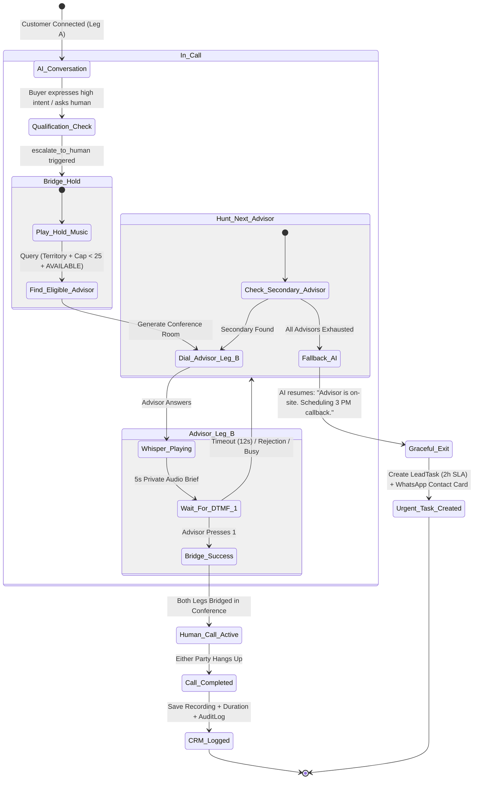

# Technical & Architectural Audit: Centralized Cloud Telephony & Intelligent Advisor Handover

**Date**: October 2026  
**Scope**: Voice Telephony, Virtual Numbers, Multi-Advisor Routing, Live Warm Transfer, Audio Whisper, and Failover State Machine  
**Target Scale**: 10 to 100 Senior Property Advisors  
**Jurisdiction**: India (TRAI / DoT OSP Regulations)

---

## 1. Executive Audit Summary: Reality vs. Simulation

```
┌─────────────────────────────────────────────────────────────────────────────────────────────────┐
│                                 TELEPHONY & HANDOVER AUDIT SCORECARD                            │
├────────────────────────────┬─────────────────────────────┬──────────────────────────────────────┤
│ CAPABILITY                 │ CURRENT STATUS              │ EVIDENCE IN CODEBASE                 │
├────────────────────────────┼─────────────────────────────┼──────────────────────────────────────┤
│ 1. Virtual Numbers (DID)   │ ❌ MISSING                  │ No DID model or User phone mapping   │
│ 2. Call Logs & CRM Records │ ⚠️ PARTIAL                  │ LeadCallLog exists; no audio/transcript│
│ 3. Territory Routing       │ ❌ MISSING                  │ User model lacks territory/projects  │
│ 4. Active Workload Capping │ ✅ GENUINELY IMPLEMENTED    │ lead.service.ts has 25-lead cap      │
│ 5. Advisor Availability    │ ❌ MISSING                  │ No ONLINE / BUSY / ON_SITE status    │
│ 6. Warm Voice Transfer     │ 🛑 SIMULATED / MOCK         │ voice.ts (/plivo/transfer) is dummy  │
│ 7. Audio Whisper Briefing  │ 🛑 SIMULATED / MOCK         │ Text note only; no audio/TTS stream  │
│ 8. DTMF "Press 1 to Accept"│ ❌ MISSING                  │ Zero Plivo/Twilio DTMF gather logic  │
│ 9. Inbound Sticky Routing  │ ❌ MISSING                  │ Zero inbound voice webhook routes    │
│ 10. Secondary Hunt Group   │ ❌ MISSING                  │ No fallback queue or timeout loop    │
│ 11. WhatsApp Human Takeover│ ✅ GENUINELY IMPLEMENTED    │ isHumanTakeover halts bot completely │
└────────────────────────────┴─────────────────────────────┴──────────────────────────────────────┘
```

---

## 2. Component-by-Component Codebase Audit

### 2.1 `backend/src/api/routes/voice.ts`
* **What it claims**: Outbound speed-to-lead calls (`/plivo/outbound`) and live warm transfers to human brokers with a 5-second audio whisper (`/plivo/transfer`).
* **The Technical Reality**:
  * Lines 46–62 and lines 102–132: The route generates a dummy UUID string (`call-test-...` or `call-outbound-...`), logs a static text entry in `prisma.leadCallLog`, decrements a simulated wallet balance, and returns `{ isSimulated: true }`.
  * **The transfer endpoint (`/plivo/transfer`, lines 136–168)** does **not** call any telephony provider. It does not invoke the Plivo or Twilio SDK, initiates no call legs, creates no conference rooms, generates no audio whisper, and gathers no DTMF. It merely inserts a text note: `"Live warm transfer executed to advisor with 5-second buyer context whisper"` into PostgreSQL.

### 2.2 `backend/src/services/telephony`
* **The Technical Reality**: **The directory is completely empty (`0 bytes, 0 files`)**. There is no carrier abstraction layer, no webhook handler for call state changes (`ringing`, `answered`, `completed`), and no conference bridging service.

### 2.3 `backend/src/services/lead.service.ts`
* **What is genuinely implemented**:
  * Line 23: `DEFAULT_ADVISOR_ACTIVE_LEAD_CAP = 25`.
  * Lines 734–747 (`claimLead`): Real concurrency protection using row-level locking (`SELECT "id" FROM "users" WHERE "id" = ... FOR UPDATE`) preventing an advisor from exceeding 25 active leads.
* **What is missing**:
  * **Territory Matching**: There is no logic matching buyer micro-markets (e.g., Whitefield, Sarjapur, Kharadi, Gachibowli) to advisor territories. An advisor is assigned manually or via an unweighted fallback.
  * **Availability Filtering**: It cannot determine if an advisor is currently on a site visit, on another call, or off-duty.

### 2.4 `backend/src/services/agent/agentRuntime.ts` & `agentTools.ts`
* **What is genuinely implemented**:
  * Lines 54–64: `isExplicitHumanRequest` correctly identifies when a buyer demands a human advisor (*"talk to agent"*, *"speak to manager"*, *"transfer me"*).
  * Lines 1792–2010 (`escalate_to_human`): Creates a structured handoff brief, extracts the buyer's budget, preferred locations, and site visits, creates a `LeadTask` with 2-hour SLA, and updates `thread.isHumanTakeover = true`.
* **The Gap**:
  * This is an **asynchronous handoff** designed for WhatsApp/CRM tasks. There is **zero connection between the AI conversational agent and a live voice call transfer**.

### 2.5 `backend/prisma/schema.prisma`
* **The Missing Data Fields**:
  * `User`: Has no `phone` number (cannot dial the advisor's mobile!), no `virtualExtension`, no `assignedTerritories`, and no `availabilityStatus`.
  * `LeadCallLog`: Has no `recordingUrl`, no `transcript`, no `telephonyProviderCallSid`, no `transferStatus`, and no `recordingDisclosureAcknowledged`.
  * `Organization`: Has no pool of company virtual numbers (DIDs).

---

## 3. Deep-Dive Evaluation of the 11 Intended Workflows

### 3.1 Virtual Numbers & Caller ID Masking
* **Target**: Every advisor communicates through company-controlled virtual numbers; customer sees company caller ID.
* **Current Reality**: Not supported. 
* **Architectural Problem**:
  * If the system initiates an outbound call to an advisor and bridges it to a customer, Indian telecom regulations (TRAI/DoT) require strict Caller Line Identification (CLI) compliance.
  * In Plivo/Twilio, bridging two external PSTN numbers without an Indian Virtual Number (DID) results in either a dropped call or showing the advisor's personal number on the customer's screen.
  * **Fix**: The company must hold a master DID (or pool of DIDs). The customer leg always sees the DID as Caller ID; the advisor leg sees the customer name via CLI or whisper.

### 3.2 Call Recording, Transcription & Disclosures
* **Current Reality**: `LeadCallLog` records direction (`INBOUND`/`OUTBOUND`), outcome (`CONNECTED`/`BUSY`), and duration in seconds.
* **Architectural Problem**:
  * There is no storage or streaming of call audio.
  * Under Indian law (and global compliance), recording without an automated IVR disclosure beep (*"This call is recorded for quality assurance"*) creates legal liability.
  * **Fix**: Telephony XML must inject a 3-second bilingual audio disclosure before bridging.

### 3.3 Micro-Market & Availability Routing
* **Current Reality**: Missing. Leads must be manually claimed or reassigned by an Admin.
* **Architectural Problem**:
  * A 15-advisor firm in Bangalore divides the city: 5 advisors on East (Whitefield/Sarjapur), 5 on North (Hebbal/Yelahanka), 5 on South (Kanakapura/Bannerghatta).
  * Currently, the system has no data structure representing these geographical boundaries.

### 3.4 The Warm Call Transfer, Private Whisper & DTMF Bridging
* **Target**: AI puts customer on hold ➔ dials advisor ➔ plays private whisper ➔ advisor presses 1 ➔ legs are bridged.
* **Current Reality**: **Non-existent in code**.
* **How Plivo/Twilio Actually Requires This to Work**:
  1. The initial call between Customer and Voice Bot is Call Leg A (`call_uuid_customer`).
  2. To transfer, Leg A must be placed into a **temporary dynamic Conference Room** with hold music (`<Conference waitUrl="hold-music.xml">`).
  3. The server triggers an outbound REST call to the Advisor (Leg B, `call_uuid_advisor`).
  4. When Advisor answers, the carrier requests an **Answer XML Webhook**:
     * The webhook returns `<Gather numDigits="1" action="/api/voice/transfer/gather">`.
     * Inside the `<Gather>`, it plays a dynamic Text-To-Speech (TTS) whisper:
       `<Speak>Lead Transfer: Rajesh Sharma, interested in Godrej 3BHK, budget 1.8 Crores. Press 1 to connect.</Speak>`
  5. If Advisor presses `1`:
     * The `/gather` endpoint returns `<Conference>` pointing to the exact same room name as Leg A.
     * Both legs are bridged.
  6. If Advisor presses anything else or hangs up:
     * Leg B terminates; Leg A remains in conference or falls back to AI.

---

## 4. Indian Telecom Compliance & Carrier Reality (TRAI / DoT)

### Why Twilio and Standard US Patterns Fail in India:
1. **PSTN-PSTN Bridging Restrictions**:
   * Under India's Department of Telecommunications (DoT) Other Service Provider (OSP) regulations, bridging two public switched telephone network (PSTN) calls across international internet gateways is heavily restricted.
   * Standard US Twilio accounts **cannot** spoof Indian mobile numbers as Caller ID for outbound calls.
2. **Provider Selection**:
   * For production deployment in India (Bengaluru, Pune, Hyderabad, Mumbai):
     * **Tier 1 (Recommended)**: **Exotel** or **Tata Tele Business Services (TTBS) Smartflo** or **Airtel IQ**. These are licensed Indian Virtual PBX operators that natively support dual-leg bridging, Indian DID masking, and TRAI-compliant DND scrubbers.
     * **Tier 2**: **Plivo (India-registered entity)** with local Indian DIDs.

---

## 5. Failure Modes, Race Conditions & Edge Cases

```
┌────────────────────────────────────────────────────────────────────────────────────────┐
│                               IDENTIFIED FAILURE SCENARIOS                             │
├─────────────────────────┬─────────────────────────────┬────────────────────────────────┤
│ SCENARIO                │ FAILURE MECHANISM           │ REQUIRED ARCHITECTURAL FIX     │
├─────────────────────────┼─────────────────────────────┼────────────────────────────────┤
│ 1. The Zombie Leg       │ Customer hangs up while on  │ Webhook on Leg A termination   │
│                         │ hold listening to music.    │ must immediately abort Leg B   │
│                         │ Advisor answers dead air.   │ dial attempt.                  │
├─────────────────────────┼─────────────────────────────┼────────────────────────────────┤
│ 2. Dual-Advisor         │ System rings Advisor A and  │ Distributed Redis lock on      │
│    Collision            │ Advisor B simultaneously.   │ Lead ID. First to press 1 wins;│
│                         │ Both press 1.               │ second gets "Transfer accepted"│
├─────────────────────────┼─────────────────────────────┼────────────────────────────────┤
│ 3. The 10:58 AM Site    │ Advisor is driving or       │ Real-time calendar pre-check:  │
│    Visit Trap           │ meeting a client on-site.   │ Exclude advisors with a visit  │
│                         │ Phone rings repeatedly.     │ scheduled within +/- 45 mins.  │
├─────────────────────────┼─────────────────────────────┼────────────────────────────────┤
│ 4. Repeat Caller Blind  │ Customer calls back 2 days  │ Inbound webhook checks phone   │
│    Transfer             │ later; routed to stranger   │ against Lead table; routes to  │
│                         │ instead of assigned advisor.│ lead.assignedUserId directly.  │
└─────────────────────────┴─────────────────────────────┴────────────────────────────────┘
```

---

## 6. Required Database Schema Enhancements

To support 10–100 property advisors without concurrency failure, the following schema additions are required:

```prisma
// ─── Advisor Telephony Profile ────────────────────────────────────────────────
enum AdvisorAvailability {
  AVAILABLE
  BUSY_ON_CALL
  ON_SITE_VISIT
  OFF_DUTY
}

enum CallTransferStatus {
  NONE
  INITIATED
  WHISPERING
  ACCEPTED
  TIMEOUT
  REJECTED
  FAILED
}

model User {
  // Existing fields...
  id                  String              @id @default(cuid())
  email               String              @unique
  name                String?
  role                UserRole            @default(AGENT)
  
  // New Telephony & Routing Fields
  phone               String?             // Advisor's physical mobile (+91XXXXXXXXXX)
  virtualExtension    String?             // e.g., "104"
  availabilityStatus  AdvisorAvailability @default(AVAILABLE)
  assignedTerritories String[]            // e.g. ["Whitefield", "Sarjapur", "Kharadi"]
  assignedProjects    String[]            // e.g. ["Godrej Splendour", "Prestige Lavender"]
  maxActiveLeadsCap   Int                 @default(25)
  lastCallAcceptedAt  DateTime?

  callSessions        TelephonySession[]
}

// ─── Active Call Sessions & Bridging State Machine ────────────────────────────
model TelephonySession {
  id                  String             @id @default(cuid())
  organizationId      String
  leadId              String
  advisorId           String?
  
  conferenceRoomId    String             @unique
  customerCallSid     String             @unique
  advisorCallSid      String?            @unique
  
  status              CallTransferStatus @default(INITIATED)
  direction           CallDirection      @default(OUTBOUND)
  recordingUrl        String?
  transcript          String?            @db.Text
  whisperText         String?
  
  startedAt           DateTime           @default(now())
  connectedAt         DateTime?
  endedAt             DateTime?
  durationSeconds     Int?
  
  lead                Lead               @relation(fields: [leadId], references: [id], onDelete: Cascade)
  advisor             User?              @relation(fields: [advisorId], references: [id], onDelete: SetNull)

  @@index([organizationId, status])
  @@index([customerCallSid])
  @@index([advisorCallSid])
}
```

---

## 7. Production-Ready Target Architecture (10–100 Advisors)



---

## 8. Prioritized Implementation Sequence

To replace the simulation stubs with an enterprise-grade live handover system, implement in this strict sequence:

### Step 1: Database Schema Expansion (Prisma Migration)
* Add `phone`, `assignedTerritories`, and `availabilityStatus` to `User`.
* Create `TelephonySession` model to track conference states and dual call legs.

### Step 2: The Telephony Carrier Bridge Adapter (`services/telephony/`)
* Build real carrier integration (Plivo / Exotel / Twilio SDK).
* Implement dynamic XML webhooks:
  * `/api/voice/conference/wait`: Serves branded hold music to customer.
  * `/api/voice/conference/whisper`: Generates dynamic TTS audio whisper to the advisor.
  * `/api/voice/conference/gather`: Handles DTMF `1` press and bridges the conference.

### Step 3: Territory & Availability Matcher (`services/telephony/routing.ts`)
* Implement deterministic candidate scoring:
  $$\text{Score} = (\text{Territory Match} \times 50) + (\text{Availability} \times 30) - (\text{Current Active Leads} \times 2)$$
* Filters out advisors with site visits scheduled within 45 minutes.

### Step 4: Sticky Callback Routing (`/api/voice/inbound`)
* When an inbound call arrives at the virtual number:
  * Look up caller phone in `Lead` table.
  * If assigned and advisor is `AVAILABLE` ➔ route directly to advisor mobile.
  * If unassigned or advisor unavailable ➔ route to Speed-to-Lead AI voice agent.

### Step 5: Call State Machine & Fallback Governor
* Implement timeout monitor (12 seconds per advisor attempt).
* If advisor fails to answer, automatically dial the secondary candidate.
* If all candidates fail, route call back to AI to schedule a structured callback and create an urgent CRM task.

