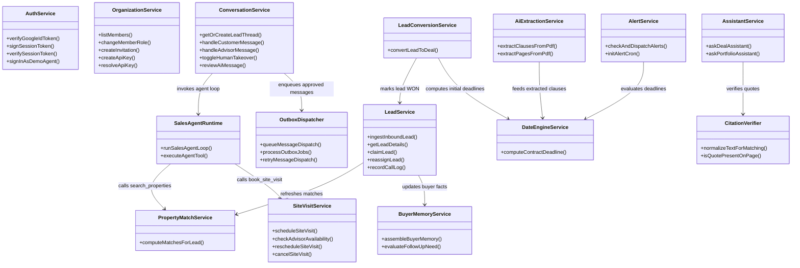

# Component Design Specifications
## Contingency Deadline Copilot & Real Estate AI Platform

**Document Version:** 1.0.0  
**Status:** Baseline Verified  
**Primary Architect:** Principal Software Systems Architect  

---

## 1. High-Level Component Relationship Diagram



---

## 2. Component Design Details

### 2.1 Authentication & Membership Component

#### 2.1.1 Purpose & Scope
Handles user authentication via Google OAuth 2.0, manages organization memberships, enforces invite-only onboarding, and issues stateless JWT session tokens with dynamic revocation checking.

#### 2.1.2 Internal Structure
- **Module:** [`backend/src/services/auth.service.ts`](file:///Users/badal11/Desktop/Real_Estate_Contigency/backend/src/services/auth.service.ts), [`backend/src/services/organization.service.ts`](file:///Users/badal11/Desktop/Real_Estate_Contigency/backend/src/services/organization.service.ts)
- **Middleware:** [`backend/src/middleware/auth.ts`](file:///Users/badal11/Desktop/Real_Estate_Contigency/backend/src/middleware/auth.ts)
- **Data Models:** `User`, `Organization`, `Invitation`, `OrganizationApiKey`

#### 2.1.3 Interfaces & Contracts
```typescript
interface SessionUser {
  id: string;
  email: string;
  name: string | null;
  pictureUrl: string | null;
  organizationId: string;
  role: 'OWNER' | 'AGENT';
}

function verifySessionToken(token: string): Promise<SessionUser>;
function signInWithGoogle(credential: string, inviteToken?: string): Promise<{ token: string; user: SessionUser }>;
function resolveApiKey(rawKey?: string, requiredScope?: string): Promise<{ id: string; organizationId: string } | null>;
```

#### 2.1.4 Business Rules
1. **Invite-Only Enrollment:** New users cannot self-register unless they provide an active, unexpired, single-use invite token hashed with SHA-256 (`Invitation.tokenHash`).
2. **Immediate Revocation:** Token verification queries the database user record and compares `claims.sv === user.sessionVersion`. If an owner demotes or removes a member, `sessionVersion` is incremented, immediately revoking all active sessions across all devices.
3. **Demo Isolation:** Demo login is restricted strictly to non-production environments and creates users only within `demo-sandbox-org`.

---

### 2.2 Lead Management & CRM Component

#### 2.2.1 Purpose & Scope
Provides multi-tenant lead lifecycle ingestion, stage transitions, agent assignment history, call logging, and follow-up task tracking.

#### 2.2.2 Internal Structure
- **Module:** [`backend/src/services/lead.service.ts`](file:///Users/badal11/Desktop/Real_Estate_Contigency/backend/src/services/lead.service.ts), [`backend/src/services/leadTask.service.ts`](file:///Users/badal11/Desktop/Real_Estate_Contigency/backend/src/services/leadTask.service.ts)
- **Routes:** [`backend/src/api/routes/leads.ts`](file:///Users/badal11/Desktop/Real_Estate_Contigency/backend/src/api/routes/leads.ts), [`backend/src/api/routes/leadTasks.ts`](file:///Users/badal11/Desktop/Real_Estate_Contigency/backend/src/api/routes/leadTasks.ts)
- **Data Models:** `Lead`, `LeadRequirement`, `LeadRequirementProposal`, `LeadAssignmentHistory`, `LeadCallLog`, `LeadTask`

#### 2.2.3 Business Rules
1. **Concurrency-Safe Ingestion:** Normalizes email and phone strings. Ingestion executes inside an atomic Prisma upsert / transaction catching PostgreSQL error `P2002` (unique violation) to guarantee that concurrent requests create exactly one lead record.
2. **Role Scoping:** `AGENT` users can only view and manage leads assigned to them or unassigned leads in the pool. `OWNER` users maintain full organizational visibility.
3. **Assignment Audit Trail:** Every reassignment or claim writes an immutable `LeadAssignmentHistory` row recording `previousUserId`, `assignedUserId`, `changedById`, and `reason`.

---

### 2.3 Lead-to-Deal Conversion Component

#### 2.3.1 Purpose & Scope
Executes the atomic conversion of a sales lead into an active purchase contract deal, binding buyer information, property inventory, and notification settings into a single transaction.

#### 2.3.2 Internal Structure
- **Module:** [`backend/src/services/leadConversion.service.ts`](file:///Users/badal11/Desktop/Real_Estate_Contigency/backend/src/services/leadConversion.service.ts)
- **Route:** `POST /api/leads/:id/convert-to-deal`
- **Data Models:** `Deal`, `Lead`, `Property`, `NotificationSetting`, `AuditLog`

#### 2.3.3 Business Rules
1. **One-to-One Invariant:** Enforced by `@unique` constraint on `Deal.leadId`. A lead can only be converted once.
2. **Stage Eligibility:** Leads must be in `QUALIFIED` or `PROPOSAL` stage. Transition from other stages requires an explicit `eligibilityOverride: true` and non-empty `overrideReason`. `LOST` leads can never be converted.
3. **Property Lock:** When a lead is converted with a `propertyId`, the property status is atomically updated from `AVAILABLE` to `UNDER_CONTRACT`.
4. **ACID Transaction:** Deal creation, Lead status update (`WON`), Property status update, NotificationSetting initialization, and AuditLog creation are wrapped in `prisma.$transaction`. Any failure rolls back all mutations completely.

---

### 2.4 Conversational Sales Agent & Buyer Memory Component

#### 2.4.1 Purpose & Scope
Orchestrates autonomous, natural conversational interactions with home buyers across WhatsApp, Web Chat, and Telegram, extracting buyer preferences into persistent memory and booking site visits.

#### 2.4.2 Internal Structure
- **Module:** [`backend/src/services/agent/agentRuntime.ts`](file:///Users/badal11/Desktop/Real_Estate_Contigency/backend/src/services/agent/agentRuntime.ts)
- **Tools:** [`backend/src/services/agent/agentTools.ts`](file:///Users/badal11/Desktop/Real_Estate_Contigency/backend/src/services/agent/agentTools.ts)
- **Memory:** [`backend/src/services/agent/buyerMemory.service.ts`](file:///Users/badal11/Desktop/Real_Estate_Contigency/backend/src/services/agent/buyerMemory.service.ts)

#### 2.4.3 Interfaces & Contracts
```typescript
interface RunSalesAgentParams {
  leadId: string;
  organizationId: string;
  threadId: string;
  customerMessage: string;
  recentMessages?: Array<{ senderType: string; content: string }>;
}

interface SalesAgentResult {
  response: string;
  suggestedFollowUps: string[];
  reasoning: string;
  executedTools: ExecutedToolRecord[];
  exhaustedLimit: boolean;
  suppressed?: boolean;
}
```

#### 2.4.4 Business Rules
1. **Bounded Execution:** Maximum 5 iterative tool execution rounds (`MAX_AGENT_ROUNDS = 5`). If the loop exhausts 5 rounds, it safely terminates and returns a conversational summary.
2. **Authentic Voice Tone:** Rules enforce brief, punchy responses (2–4 conversational sentences, under 60 words), natural opening greetings, zero markdown headers/bullet lists, and single-question handoffs.
3. **Prompt Injection Fencing:** Customer messages are enclosed in `<UNTRUSTED_CONTENT>` delimiters, and system rules prohibit client text from executing role reversals or overriding business policies.
4. **Authentic Buyer Consent for Visits:** Site visits cannot be booked autonomously unless the customer has provided an explicit affirmative confirmation within the last 7 days.

---

### 2.5 Multi-Channel Messaging & Transactional Outbox Component

#### 2.5.1 Purpose & Scope
Guarantees durable, idempotent, decoupled outbound message delivery via email (Resend / SendGrid), enforcing human approval workflows and webhook delivery status tracking.

#### 2.5.2 Internal Structure
- **Module:** [`backend/src/services/conversation.service.ts`](file:///Users/badal11/Desktop/Real_Estate_Contigency/backend/src/services/conversation.service.ts)
- **Outbox Worker:** [`backend/src/services/messaging/outboxDispatcher.ts`](file:///Users/badal11/Desktop/Real_Estate_Contigency/backend/src/services/messaging/outboxDispatcher.ts)
- **Providers:** [`backend/src/services/messaging/messagingProvider.ts`](file:///Users/badal11/Desktop/Real_Estate_Contigency/backend/src/services/messaging/messagingProvider.ts)
- **Data Models:** `ConversationThread`, `ConversationMessage`, `OutboxJob`, `WebhookEvent`

#### 2.5.3 Business Rules
1. **Decoupled Approval & Dispatch:** AI responses generate with `approvalStatus: PENDING_APPROVAL`. Only explicit human or policy approval triggers enqueuing into `outbox_jobs`.
2. **Optimistic Locking:** Outbox workers claim jobs using atomic updates matching `status: PENDING`, updating `status = PROCESSING` and `lockedAt = now()`. Concurrent workers cannot claim the same job.
3. **Bounded Exponential Backoff:** Transient failures retry up to 3 times with exponentially increasing intervals (1s, 2s, 4s). Permanent delivery errors (invalid recipient email) fail immediately without retrying.
4. **Terminal Status Preservation:** Webhook callbacks from email providers cannot downgrade a message from `DELIVERED` to `SENT` or `FAILED`.

---

### 2.6 Property Inventory & Deterministic Matching Component

#### 2.6.1 Purpose & Scope
Provides deterministic real estate inventory querying and compatibility scoring, ensuring that client budget and bedroom hard constraints are never bypassed by soft scoring algorithms.

#### 2.6.2 Internal Structure
- **Module:** [`backend/src/services/propertyMatch.service.ts`](file:///Users/badal11/Desktop/Real_Estate_Contigency/backend/src/services/propertyMatch.service.ts)
- **Route:** `GET /api/leads/:id/matches`, `POST /api/leads/:id/matches/refresh`
- **Data Models:** `Property`, `PropertyMatch`, `LeadRequirement`

#### 2.6.3 Business Rules
1. **Mandatory SQL Hard Filters:** Candidate properties must satisfy `status = AVAILABLE`, `price <= maxBudget`, `bedrooms >= minBedrooms`, and `propertyType = requestedType`.
2. **Deterministic vs AI Confidence:** Differentiates `matchScore` (deterministic mathematical compatibility from 0.0 to 1.0) from `aiExplanationConfidence` (the confidence of the generated conversational explanation).

---

### 2.7 Contract Extraction & Contingency Calculation Component

#### 2.7.1 Purpose & Scope
Extracts legal clauses, deadlines, and obligations from real estate purchase contracts (PDF), and computes exact deadline dates according to jurisdictional holiday and weekend rules.

#### 2.7.2 Internal Structure
- **Extraction:** [`backend/src/services/ai.service.ts`](file:///Users/badal11/Desktop/Real_Estate_Contigency/backend/src/services/ai.service.ts), [`backend/src/services/pdf.service.ts`](file:///Users/badal11/Desktop/Real_Estate_Contigency/backend/src/services/pdf.service.ts)
- **Date Math:** [`backend/src/services/dateEngine.service.ts`](file:///Users/badal11/Desktop/Real_Estate_Contigency/backend/src/services/dateEngine.service.ts), [`dateEngine.js`](file:///Users/badal11/Desktop/Real_Estate_Contigency/dateEngine.js)
- **Data Models:** `Document`, `ContingencyClause`, `Deadline`, `TransactionTask`, `TaskProposal`

#### 2.7.3 Business Rules
1. **PDF Magic Byte Validation:** File uploads must pass magic byte header inspection (`%PDF` / `0x25 0x50 0x44 0x46`).
2. **Text Layer & OCR Fallback:** Pages with sparse text layers (< 30 characters) automatically trigger Google Gemini Vision OCR.
3. **Business vs. Calendar Day Calculation:**
   - `calendar`: Strictly adds $N$ calendar days.
   - `business`: Skips Saturdays, Sundays, and official state/federal public holidays using `date-holidays`.
4. **Task Preservation:** Document re-upload creates `TaskProposal` rows for human review, never destroying existing human-edited `TransactionTask` records.

---

### 2.8 RAG Knowledge Assistant & Citation Verifier Component

#### 2.8.1 Purpose & Scope
Provides legally grounded Q&A across multi-document deal packets, addenda, and disclosures, enforcing zero hallucinations through verbatim substring verification.

#### 2.8.2 Internal Structure
- **Module:** [`backend/src/services/assistant.service.ts`](file:///Users/badal11/Desktop/Real_Estate_Contigency/backend/src/services/assistant.service.ts), [`backend/src/services/retrieval.service.ts`](file:///Users/badal11/Desktop/Real_Estate_Contigency/backend/src/services/retrieval.service.ts)
- **Verification:** [`backend/src/services/citationVerifier.ts`](file:///Users/badal11/Desktop/Real_Estate_Contigency/backend/src/services/citationVerifier.ts)
- **Data Models:** `DocumentChunk`, `AssistantConversation`, `AssistantMessage`

#### 2.8.3 Business Rules
1. **Pre-Filter Tenant Scoping:** Vector similarity queries filter strictly by `organizationId` and `dealId` BEFORE ranking chunk distances.
2. **Dual-Mode Context Injection:**
   - Under 120,000 tokens: Injects the complete text of all deal documents into Gemini's attention window.
   - Over 120,000 tokens: Injects core contracts in full and applies hybrid vector + keyword search for bulky reports.
3. **Verbatim Citation Matching:** Normalizes quotes (Unicode NFKC, smart quotes, line-break hyphenation) and verifies they exist verbatim on the cited page. Imprecise or hallucinated citations are stripped before delivery.
