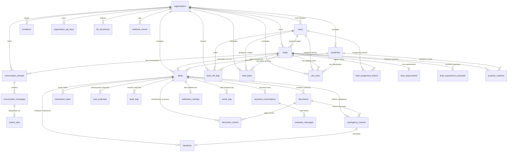

# Data Architecture & Database Design
## Contingency Deadline Copilot & Real Estate AI Platform

**Document Version:** 1.0.0  
**Database Engine:** PostgreSQL 16 with `pgvector` extension  
**ORM:** Prisma Client v5.22.0  
**Status:** Baseline Verified  
**Primary Architect:** Principal Software Systems Architect  

---

## 1. Entity Relationship (ER) Model

---

## 2. Relational Invariants & Table Inventory

The authoritative database schema resides at [`backend/prisma/schema.prisma`](file:///Users/badal11/Desktop/Real_Estate_Contigency/backend/prisma/schema.prisma). All migrations are versioned forward-only under [`backend/prisma/migrations/`](file:///Users/badal11/Desktop/Real_Estate_Contigency/backend/prisma/migrations).

### 2.1 Core Multi-Tenant Tables

#### `organizations`
Root tenancy boundary table.
- **Primary Key:** `id` (CUID string)
- **Columns:** `name` (String), `createdAt` (Timestamp), `updatedAt` (Timestamp)
- **Child Relationships:** Cascade/foreign key references across all business entities.

#### `users`
User identity and organization membership table.
- **Primary Key:** `id` (CUID string)
- **Unique Constraints:** `googleId` (`@unique`), `email` (`@unique`)
- **Foreign Keys:** `organizationId` → `organizations.id` (nullable prior to invite acceptance)
- **Attributes:** `role` (Enum: `OWNER`, `AGENT`), `sessionVersion` (Int, default 0), `lastLoginAt` (Timestamp)
- **Indexes:** `@@index([organizationId])`

#### `invitations`
One-time invitation links for organization membership.
- **Primary Key:** `id` (CUID string)
- **Unique Constraints:** `tokenHash` (`@unique` SHA-256 hash of token)
- **Foreign Keys:** `organizationId` → `organizations.id` (onDelete: Cascade)
- **Attributes:** `email` (String), `role` (UserRole), `expiresAt` (Timestamp), `acceptedAt` (Timestamp), `revokedAt` (Timestamp)
- **Indexes:** `@@index([organizationId, email])`

#### `organization_api_keys`
Hashed API keys for server-to-server lead intake.
- **Primary Key:** `id` (CUID string)
- **Unique Constraints:** `keyHash` (`@unique` SHA-256 hash of key)
- **Foreign Keys:** `organizationId` → `organizations.id` (onDelete: Cascade)
- **Attributes:** `name` (String), `keyPrefix` (String), `scope` (String, default "lead_intake"), `revokedAt` (Timestamp)
- **Indexes:** `@@index([organizationId])`

---

### 2.2 CRM & Lead Domain Tables

#### `leads`
Authoritative real estate lead intake records.
- **Primary Key:** `id` (CUID string)
- **Foreign Keys:** `organizationId` → `organizations.id`, `assignedUserId` → `users.id`
- **Unique Constraints:** 
  - `@@unique([organizationId, email])` — Guarantees no duplicate lead by email within a tenant.
  - `@@unique([organizationId, phone])` — Guarantees no duplicate lead by phone within a tenant.
- **Attributes:** `source` (Enum: `WEBSITE_FORM`, `PORTAL_INQUIRY`, `WHATSAPP`, `EMAIL`, `MANUAL`), `status` (Enum: `NEW`, `CONTACTED`, `QUALIFIED`, `PROPOSAL`, `WON`, `LOST`), `priority` (Enum: `LOW`, `MEDIUM`, `HIGH`, `URGENT`)
- **Indexes:** `@@index([organizationId, status])`, `@@index([email, phone])`

#### `lead_requirements`
Authoritative buyer search criteria.
- **Primary Key:** `id` (CUID string)
- **Unique Constraints:** `leadId` (`@unique`)
- **Attributes:** `minBudget` (Float), `maxBudget` (Float), `preferredLocations` (String[]), `propertyType` (String), `minBedrooms` (Int), `maxBedrooms` (Int), `possessionTimeline` (String), `notes` (Text)

#### `lead_requirement_proposals`
AI-extracted requirements awaiting human approval.
- **Primary Key:** `id` (CUID string)
- **Foreign Keys:** `leadId` → `leads.id` (onDelete: Cascade)
- **Attributes:** `status` (Enum: `PENDING`, `APPROVED`, `REJECTED`, `MODIFIED`), `confidence` (Float), `sourceMessageId` (String), `reviewedBy` (String)
- **Indexes:** `@@index([leadId, status])`, `@@index([organizationId])`

#### `lead_call_logs`
Chronological call activity records.
- **Primary Key:** `id` (CUID string)
- **Foreign Keys:** `leadId` → `leads.id`, `organizationId` → `organizations.id`, `userId` → `users.id`
- **Attributes:** `direction` (Enum: `INBOUND`, `OUTBOUND`), `outcome` (Enum: `CONNECTED`, `NO_ANSWER`, `BUSY`, `CALLBACK_REQUESTED`, `VOICEMAIL`, `WRONG_NUMBER`, `OTHER`), `durationSeconds` (Int), `notes` (Text), `followUpNeeded` (Boolean)
- **Indexes:** `@@index([leadId, calledAt])`, `@@index([organizationId, calledAt])`, `@@index([userId])`

#### `lead_tasks`
Advisor follow-up tasks and reminders.
- **Primary Key:** `id` (CUID string)
- **Foreign Keys:** `leadId` → `leads.id`, `organizationId` → `organizations.id`, `assignedUserId` → `users.id`, `callLogId` → `lead_call_logs.id` (`@unique`), `siteVisitId` → `site_visits.id` (`@unique`)
- **Attributes:** `taskType` (Enum: `CALL`, `MESSAGE`, `SITE_VISIT`, `SEND_DETAILS`, `DOCUMENT_FOLLOW_UP`, `OTHER`), `status` (Enum: `OPEN`, `COMPLETED`, `CANCELLED`), `dueDate` (Timestamp)
- **Indexes:** `@@index([organizationId, status, dueDate])`, `@@index([assignedUserId, status, dueDate])`

#### `site_visits`
Property tour appointments.
- **Primary Key:** `id` (CUID string)
- **Foreign Keys:** `organizationId` → `organizations.id`, `leadId` → `leads.id`, `propertyId` → `properties.id`, `assignedUserId` → `users.id`
- **Attributes:** `startAt` (Timestamp), `endAt` (Timestamp), `status` (Enum: `SCHEDULED`, `COMPLETED`, `CANCELLED`, `NO_SHOW`), `outcomeNotes` (Text), `cancelReason` (String)
- **Indexes:** `@@index([organizationId, status, startAt, endAt])`, `@@index([assignedUserId, status, startAt, endAt])`

---

### 2.3 Messaging & Transactional Outbox Tables

#### `conversation_threads`
Multi-channel customer conversation channels.
- **Primary Key:** `id` (CUID string)
- **Foreign Keys:** `leadId` → `leads.id`, `organizationId` → `organizations.id`
- **Attributes:** `channel` (Enum: `EMAIL`, `WHATSAPP`, `SMS`, `WEB_CHAT`), `state` (Enum: `AUTOPILOT`, `DRAFT_ONLY`, `HUMAN_TAKEOVER`, `PAUSED`, `CLOSED`), `isHumanTakeover` (Boolean)
- **Indexes:** `@@index([leadId])`, `@@index([organizationId])`

#### `conversation_messages`
Individual messages within a conversation.
- **Primary Key:** `id` (CUID string)
- **Foreign Keys:** `threadId` → `conversation_threads.id`
- **Attributes:** `senderType` (Enum: `CUSTOMER`, `AGENT`, `AI`), `content` (Text), `approvalStatus` (Enum: `PENDING_APPROVAL`, `APPROVED`, `REJECTED`, `EDITED`), `deliveryStatus` (Enum: `NOT_APPLICABLE`, `QUEUED`, `SENDING`, `SENT`, `DELIVERED`, `FAILED`, `RETRY_PENDING`), `idempotencyKey` (`@unique`)
- **Indexes:** `@@index([threadId])`, `@@index([providerMessageId])`, `@@index([deliveryStatus])`

#### `outbox_jobs`
Durable outbox jobs for asynchronous message dispatch.
- **Primary Key:** `id` (CUID string)
- **Foreign Keys:** `messageId` → `conversation_messages.id` (`@unique`)
- **Attributes:** `recipientEmail` (String), `payload` (JSON), `status` (Enum: `PENDING`, `PROCESSING`, `COMPLETED`, `FAILED`, `RETRYING`), `attempts` (Int, default 0), `maxAttempts` (Int, default 3), `nextAttemptAt` (Timestamp), `lockedAt` (Timestamp), `lockedBy` (String)
- **Indexes:** `@@index([status, nextAttemptAt])`, `@@index([organizationId])`

#### `webhook_events`
Audit and idempotency log for all external incoming webhooks.
- **Primary Key:** `id` (CUID string)
- **Unique Constraints:** `@@unique([provider, externalEventId])` — Guarantees webhook idempotency.
- **Attributes:** `provider` (String), `eventType` (String), `payload` (JSON), `status` (String), `processedAt` (Timestamp)
- **Indexes:** `@@index([organizationId, provider])`

---

### 2.4 Real Estate Inventory Tables

#### `properties`
Brokerage property inventory.
- **Primary Key:** `id` (CUID string)
- **Foreign Keys:** `organizationId` → `organizations.id`
- **Attributes:** `title` (String), `address` (String), `city` (String), `price` (Float), `bedrooms` (Int), `bathrooms` (Float), `propertyType` (String), `status` (Enum: `AVAILABLE`, `UNDER_CONTRACT`, `SOLD`, `OFF_MARKET`)
- **Indexes:** `@@index([organizationId, price, bedrooms, status])`

#### `property_matches`
Deterministic matches between leads and inventory.
- **Primary Key:** `id` (CUID string)
- **Unique Constraints:** `@@unique([leadId, propertyId])`
- **Attributes:** `matchScore` (Float), `aiExplanationConfidence` (Float), `matchReason` (Text), `failedCriteria` (String[])

---

### 2.5 Deal & Contract Contingency Tables

#### `deals`
Purchase contract transactions.
- **Primary Key:** `id` (CUID string)
- **Unique Constraints:** `leadId` (`@unique`), `inboundAlias` (`@unique`)
- **Foreign Keys:** `organizationId` → `organizations.id`, `leadId` → `leads.id`, `propertyId` → `properties.id`
- **Attributes:** `propertyAddress` (String), `buyerName` (String), `sellerName` (String), `acceptanceDate` (Timestamp), `status` (Enum: `ACTIVE`, `CLOSED`, `CANCELLED`), `timezone` (String, default "America/New_York")
- **Indexes:** `@@index([organizationId])`, `@@index([propertyId])`

#### `documents`
Uploaded contract files and addenda.
- **Primary Key:** `id` (CUID string)
- **Foreign Keys:** `dealId` → `deals.id` (onDelete: Cascade)
- **Attributes:** `filename` (String), `storagePath` (String), `mimeType` (String), `docType` (Enum: `PURCHASE_AGREEMENT`, `COUNTER_OFFER`, `ADDENDUM`, `INSPECTION_REPORT`, `HOA_DISCLOSURE`, `TITLE_COMMITMENT`, `OTHER`), `indexStatus` (Enum: `PENDING`, `INDEXING`, `READY`, `FAILED`)
- **Indexes:** `@@index([dealId])`, `@@index([organizationId])`

#### `document_chunks`
Page-level text slices and embeddings for RAG.
- **Primary Key:** `id` (CUID string)
- **Foreign Keys:** `documentId` → `documents.id`, `dealId` → `deals.id` (onDelete: Cascade)
- **Attributes:** `pageNumber` (Int), `chunkIndex` (Int), `sectionTitle` (String), `content` (Text), `tokenCount` (Int), `source` (Enum: `text`, `ocr`), `embedding` (JSON / vector)
- **Indexes:** `@@index([dealId, documentId])`, `@@index([dealId, pageNumber])`, `@@index([organizationId])`

#### `contingency_clauses` & `deadlines`
Extracted contract obligations and computed deadlines.
- **`contingency_clauses`**: `clauseType` (String), `rawText` (Text), `pageNumber` (Int), `numberOfDays` (Int), `dayType` (Enum: `calendar`, `business`)
- **`deadlines`**: `clauseId` (`@unique`), `label` (String), `computedDate` (Timestamp), `confirmedDate` (Timestamp), `status` (Enum: `PENDING`, `CONFIRMED`, `ACTIVE`, `MISSED`, `COMPLETED`), `confirmedBy` (String)

#### `audit_logs`
System-wide immutable audit trail.
- **Primary Key:** `id` (CUID string)
- **Attributes:** `action` (Enum: 37 audit action types), `entityType` (String), `entityId` (String), `previousValue` (JSON), `newValue` (JSON), `actor` (String), `note` (String)
- **Indexes:** `@@index([organizationId])`

---

## 3. Data Integrity, Consistency & Concurrency Controls

1. **Transactional Invariants:**
   - Lead conversion wraps Deal, Lead status (`WON`), Property status (`UNDER_CONTRACT`), NotificationSetting, and AuditLog in `prisma.$transaction`.
   - Outbox enqueuing updates Message `deliveryStatus: QUEUED` and creates `OutboxJob` inside an atomic transaction.
2. **PostgreSQL Advisory Locks:**
   - The contingency alert cron daemon acquires transaction-level advisory locks (`pg_try_advisory_xact_lock`) to prevent concurrent instances from evaluating the same deadline windows simultaneously.
3. **Optimistic Locking:**
   - `OutboxJob` claiming updates `lockedAt` and `lockedBy` with conditional where clauses (`status: PENDING`, `lockedAt: null`).
4. **Data Retention & Soft Deletion:**
   - Core entities (`leads`, `deals`) use status flags (`LOST`, `CANCELLED`) rather than hard physical deletions to maintain regulatory compliance and audit history.

---

## 4. Proposed Schema Enhancements (Future Roadmap)

1. **Native pgvector Type in Prisma:** Once supported natively by Prisma generators, migrate `document_chunks.embedding` from `Json` to `Unsupported("vector(768)")` for direct SQL `<=>` cosine distance querying without raw SQL queries.
2. **Dedicated Organization Settings:** Extract notification and branding preferences from Deal into an `OrganizationSettings` table.
3. **Partitioning for Audit Logs:** Range-partition `audit_logs` by `createdAt` yearly once scale exceeds 500,000 events.
