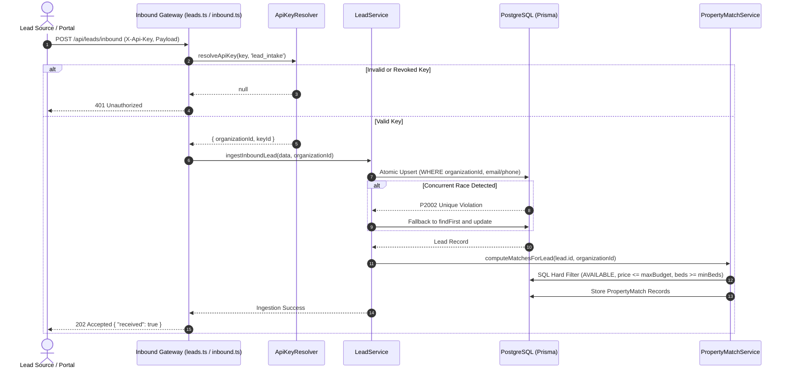
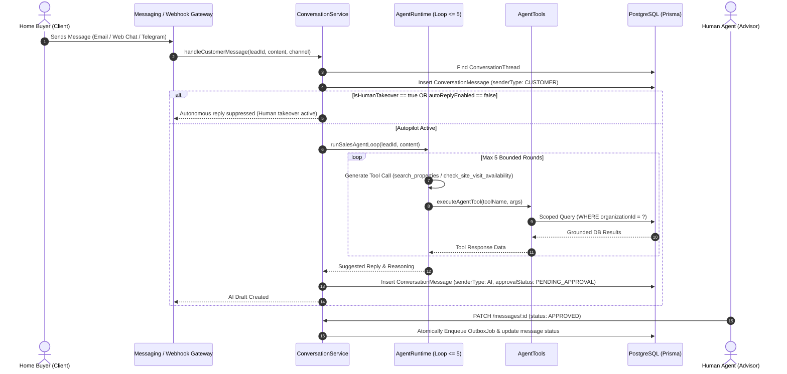
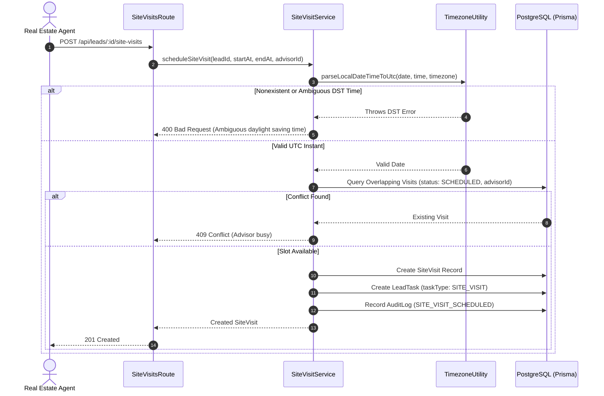
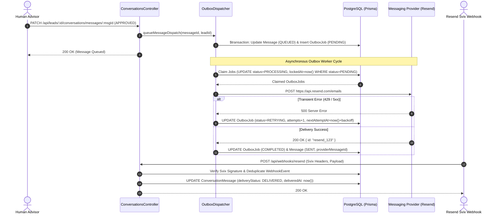
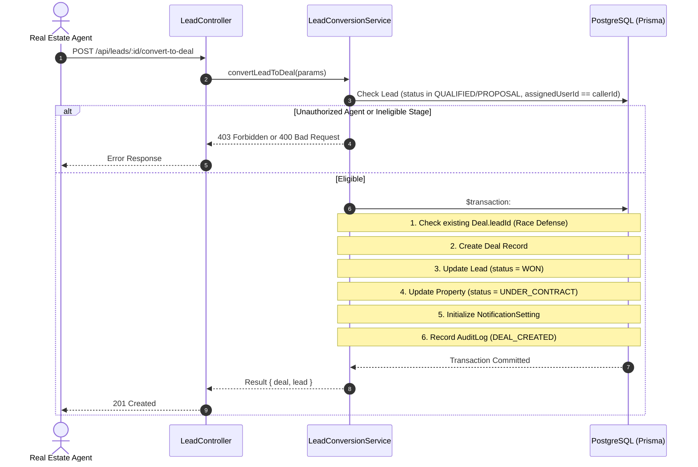
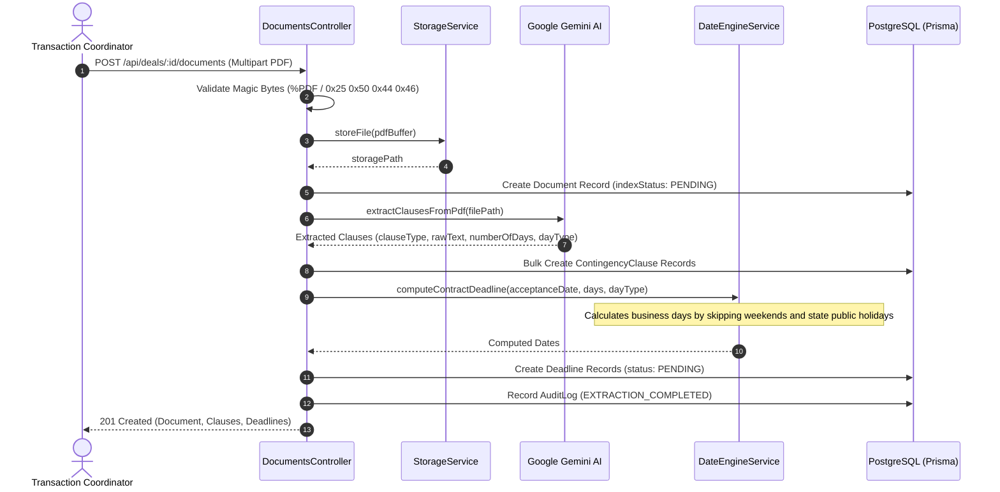
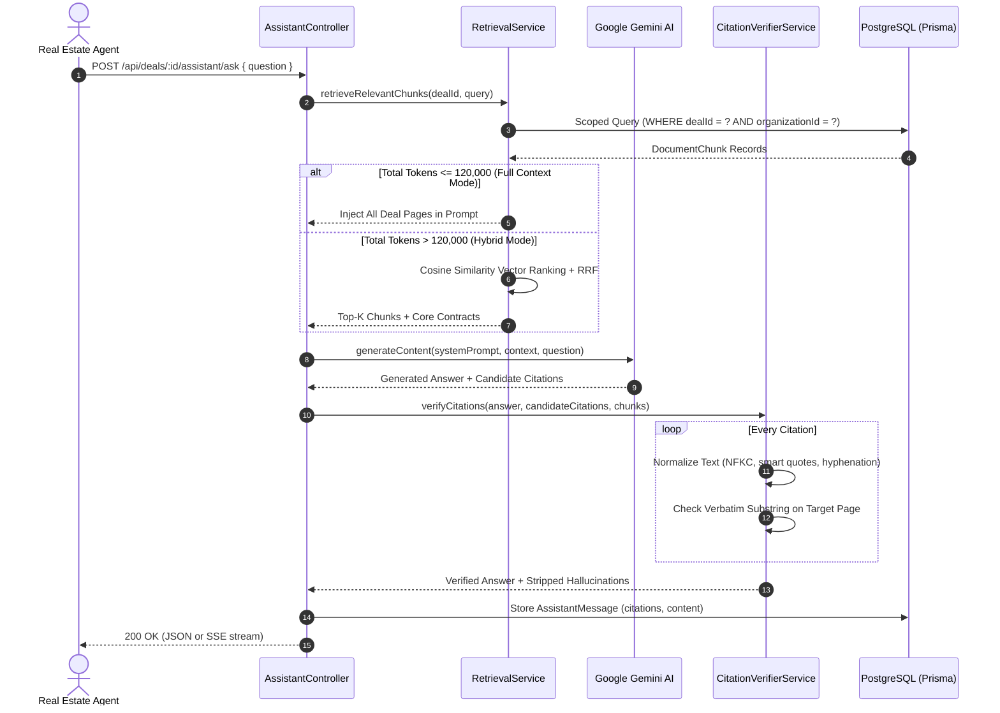
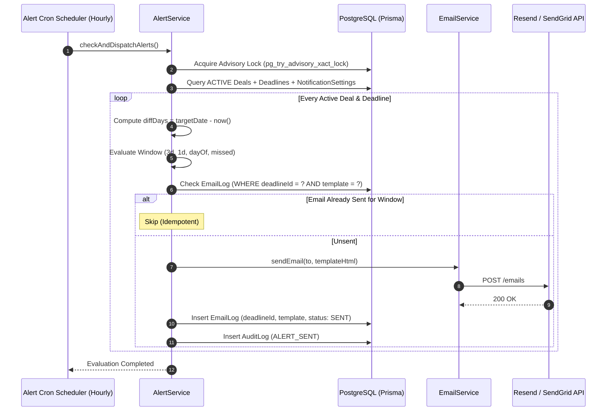

# End-to-End Data Flows & Sequence Workflows
## Contingency Deadline Copilot & Real Estate AI Platform

**Document Version:** 1.0.0  
**Status:** Baseline Verified  
**Primary Architect:** Principal Software Systems Architect  

---

## Workflow 1: Inbound Lead Intake & Ingestion

### Flow Specifications:
- **Trigger:** External real estate portal or form sends lead inquiry.
- **Entry Point:** `POST /api/leads/inbound` or `POST /api/inbound/email`.
- **Validation:** Rate limiter (100 req/min), `X-Api-Key` cryptographic lookup, Zod schema parsing.
- **Database Operations:** Upsert into `leads`, create `lead_requirements`, create `property_matches`, write `audit_logs`.
- **Edge Cases:** Concurrent duplicate submissions trigger PostgreSQL unique index violation `P2002` and safely resolve to an update without duplicating rows.

---

## Workflow 2: Multi-Channel Customer Messaging & AI Copilot Loop

### Flow Specifications:
- **Trigger:** Customer inbound message.
- **Entry Point:** `POST /api/leads/:id/conversations/messages` or Telegram long-polling update.
- **Safety Safeguards:**
  - If `isHumanTakeover = true`, autonomous AI responses are completely suppressed.
  - LLM execution is bounded to `MAX_AGENT_ROUNDS = 5`.
  - AI responses generate with `PENDING_APPROVAL` status, preventing unvetted customer dispatch.

---

## Workflow 3: Site Visit Scheduling & Conflict Resolution

---

## Workflow 4: Outbound Message Dispatch via Transactional Outbox

---

## Workflow 5: Lead-to-Deal Conversion

---

## Workflow 6: PDF Upload, AI Clause Extraction & Deadline Calculation

---

## Workflow 7: AI Knowledge Assistant RAG & Citation Verification

---

## Workflow 8: Automated Deadline Alerts & Notification Cron Dispatch

