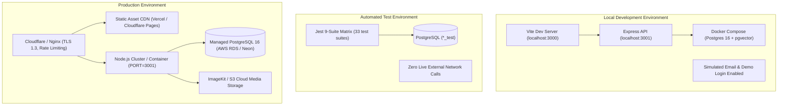
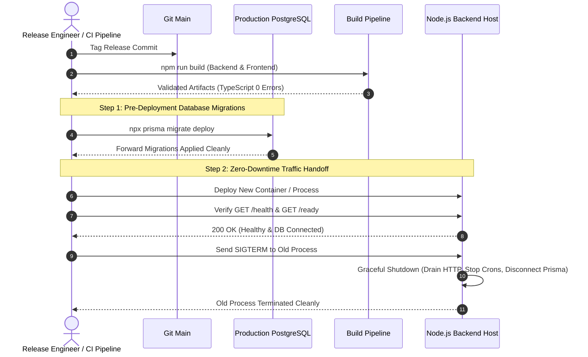

# Deployment, Operations & Runbook Guide
## Contingency Deadline Copilot & Real Estate AI Platform

**Document Version:** 1.0.0  
**Status:** Baseline Verified  
**Primary Architect:** Principal Software Systems Architect  

---

## 1. Environment Topology & Separation



---

## 2. Environment Variables & Configuration Inventory

The system relies strictly on environment variables for configuration. All secret values must be supplied via secret managers (AWS Secrets Manager, Doppler, Vault, or container environment injections). **Plaintext secrets must never be committed to source control.**

| Variable Name | Environment | Sensitivity | Description |
| :--- | :--- | :---: | :--- |
| `NODE_ENV` | All | Low | Environment runtime (`development`, `test`, `production`). |
| `PORT` | All | Low | Backend HTTP listening port (default: `3001`). |
| `DATABASE_URL` | All | **CRITICAL** | PostgreSQL connection string including user, password, host, and database. |
| `TEST_DATABASE_URL`| Test | **CRITICAL** | Connection string for isolated test database (must end in `_test`). |
| `JWT_SECRET` | Backend | **CRITICAL** | Signing secret for session JWTs (minimum 32 characters, enforced at startup). |
| `ENABLE_DEMO_LOGIN`| Dev / Staging| Medium | Enables sandbox login. **Must be false in production.** |
| `APP_URL` | Backend | Low | Base URL for invite links and passwordless emails. |
| `CORS_ORIGIN` | Backend | Medium | Explicit comma-separated origin allowlist for browser clients. |
| `STORAGE_DRIVER` | Backend | Low | Media storage backend (`local` or `imagekit`). |
| `UPLOAD_DIR` | Backend | Low | Path for uploaded PDF files when using `local` storage driver. |
| `IMAGEKIT_PUBLIC_KEY`| Prod | Medium | Public key for ImageKit CDN media storage. |
| `IMAGEKIT_PRIVATE_KEY`| Prod | **HIGH** | Secret key for ImageKit upload authentication. |
| `IMAGEKIT_URL_ENDPOINT`| Prod | Low | CDN endpoint URL for document retrieval. |
| `GOOGLE_CLIENT_ID` | All | Medium | Google Cloud OAuth 2.0 Web Client ID. |
| `GOOGLE_CLIENT_SECRET`| Backend | **HIGH** | Google Cloud OAuth 2.0 Client Secret. |
| `GEMINI_API_KEY` | Backend | **HIGH** | API Key for Google Gemini LLM and embeddings. |
| `GEMINI_MODEL` | Backend | Low | LLM model name (default: `gemini-3.6-flash`). |
| `GEMINI_EMBEDDING_MODEL`| Backend | Low | Vector embedding model (default: `text-embedding-004`). |
| `RESEND_API_KEY` | Backend | **HIGH** | API key for outbound transactional email dispatch via Resend. |
| `RESEND_WEBHOOK_SECRET` | Backend | **HIGH** | Svix HMAC signing secret for Resend delivery event verification. |
| `SENDGRID_API_KEY` | Backend | **HIGH** | API key for SendGrid fallback delivery. |
| `INBOUND_WEBHOOK_SECRET`| Backend | **HIGH** | Shared secret for SendGrid Inbound Parse multipart webhook. |
| `EMAIL_WEBHOOK_SECRET` | Backend | **HIGH** | HMAC-SHA256 signing secret for signed JSON lead intake webhooks. |
| `TELEGRAM_BOT_TOKEN` | Backend | **HIGH** | Bot API token for Telegram conversational copilot. |
| `ALERT_CRON` | Backend | Low | Cron expression for contingency deadline alert evaluation (default: `0 * * * *`). |
| `DEFAULT_TIMEZONE` | Backend | Low | Default fallback timezone (default: `America/New_York`). |

---

## 3. Production Deployment & Release Ordering



### Exact Release Command Sequence:
1. **Apply Migrations:**
   ```bash
   cd backend
   npx prisma migrate deploy
   ```
2. **Build Codebase:**
   ```bash
   # Backend TypeScript compilation
   cd backend && npm run build

   # Frontend Vite production bundle
   cd frontend && npm run build
   ```
3. **Start Process:**
   ```bash
   cd backend && npm start
   ```
4. **Health Check Verification:**
   ```bash
   curl -f http://localhost:3001/health || exit 1
   ```

---

## 4. Health Checks & Observability

### 4.1 Endpoints
- **Liveness Check:** `GET /health`
  - Returns `200 OK`: `{ "status": "ok", "timestamp": "..." }`
  - Used by container orchestrators (Kubernetes, ECS, Railway, Render) to confirm the HTTP server is responsive.
- **Readiness Check (Proposed):** `GET /ready`
  - Executes `prisma.$queryRaw` (SELECT 1) to verify database pool connectivity before admitting traffic.

### 4.2 Logging Standards
- All log lines are emitted via the Winston singleton in `backend/src/utils/logger.ts`.
- Logs include timestamps, log level (`info`, `warn`, `error`), and structured JSON context metadata.
- PII (emails, phone numbers) is masked automatically prior to output.

---

## 5. Scaling & Concurrency Strategy

1. **Horizontal API Scaling:**
   - The Express application is stateless. Multiple backend replicas can be launched behind an AWS Application Load Balancer or Nginx reverse proxy.
2. **Database Connection Pool Management:**
   - Managed via a single Prisma singleton (`backend/src/utils/prisma.ts`).
   - Connection pool size configured via `DATABASE_URL?connection_limit=20&pool_timeout=10`.
3. **Distributed Locks for Crons:**
   - Single-leader execution for hourly alert evaluation is guaranteed using PostgreSQL transactional advisory locks (`pg_try_advisory_xact_lock`). Multiple backend instances will safely yield to the instance holding the lock.
4. **Distributed Rate Limiting Roadmap:**
   - Migrate in-memory sliding window map (`backend/src/utils/rateLimit.ts`) to Redis `ioredis` token bucket once the cluster exceeds 2 instances.

---

## 6. Operational Runbooks & Disaster Recovery

### Runbook 1: Database Migration Rollback Procedure
If a database migration fails or introduces an unintended schema lock:
1. Stop the deployment immediately.
2. If the migration was partially applied, inspect `_prisma_migrations` in PostgreSQL:
   ```sql
   SELECT id, migration_name, finished_at, rolled_back_at FROM _prisma_migrations ORDER BY started_at DESC LIMIT 5;
   ```
3. Apply a compensating forward-only SQL migration (`npx prisma migrate dev --name fix_rollback`). **Never execute manual DDL or `prisma db push` in production.**

### Runbook 2: Webhook Failure & Replay Recovery
If external webhook events fail due to network interruptions:
1. Resend and SendGrid automatically retry webhook delivery with exponential backoff for up to 72 hours.
2. Check `webhook_events` for error logs:
   ```sql
   SELECT id, provider, external_event_id, error, created_at FROM webhook_events WHERE status = 'FAILED' ORDER BY created_at DESC;
   ```
3. Because `externalEventId` enforces deduplication, retried requests will safely re-evaluate without duplicating lead or message rows.

### Runbook 3: Disaster Recovery & Database Restoration
1. Provision a replacement PostgreSQL 16 instance.
2. Enable the `pgvector` extension:
   ```sql
   CREATE EXTENSION IF NOT EXISTS vector;
   ```
3. Restore from the latest WAL archive or automated nightly snapshot:
   ```bash
   pg_restore -h <db_host> -U copilot -d copilot_prod < backup_file.dump
   ```
4. Verify schema integrity:
   ```bash
   npx prisma migrate status
   ```
5. Reroute application `DATABASE_URL` and restart backend instances.
