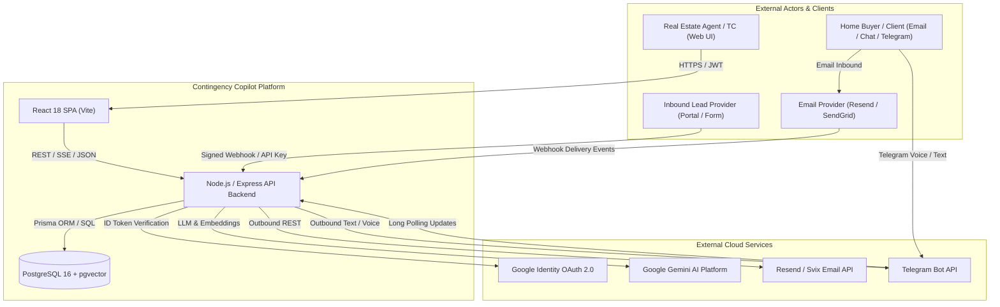
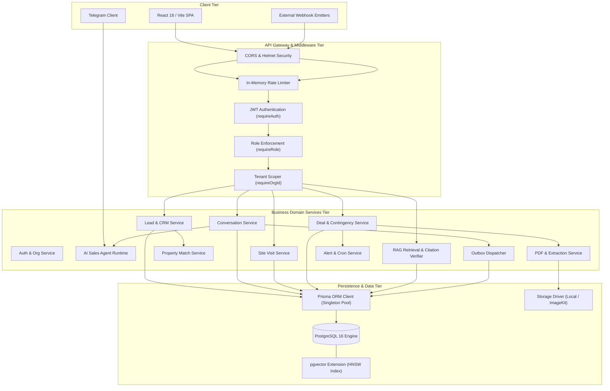

# Master High-Level Design (HLD)
## Contingency Deadline Copilot & B2B Real Estate AI Sales Platform

**Document Version:** 1.0.0  
**Target System:** Multi-Tenant Real Estate Sales Automation & Transaction Contingency Platform  
**Target Environment:** Node.js 22 LTS / PostgreSQL 16 (pgvector) / Express / React 18 (Vite)  
**Primary Architect:** Principal Software Systems Architect  
**Status:** Baseline Documented & Verified  

---

## 1. Executive Summary

The **Contingency Deadline Copilot & Real Estate AI Sales Platform** is an enterprise-grade, multi-tenant B2B SaaS application designed to solve two mission-critical vulnerabilities faced by independent real estate brokers, agents, and transaction coordinator (TC) teams:

1. **Transaction Contingency Compliance:** Failure to track or meet contract contingency deadlines (inspection, financing, appraisal, title, HOA disclosures) results in legal disputes, lost earnest money deposits, and contractual forfeiture.
2. **Lead Intake & Sales Conversions:** Real estate inquiries leak due to delayed follow-ups, unvetted buyer preferences, disjointed communication channels, and uncoordinated property site visits.

The system integrates an **Agentic Sales Copilot**, an **Automated Contract Ingestion & Contingency Engine**, and a **Multi-Document Knowledge Assistant (RAG)** into a unified multi-tenant architecture. Built with strict organizational isolation, asynchronous transactional outbox messaging, deterministic property matching, and AI safety fences, the platform enables brokerages to automate buyer qualification and deadline compliance without risking data leakage or unvetted state mutations.

---

## 2. Project Overview & Business Objectives

### 2.1 Business Objectives
- **Zero Missed Deadlines:** Guarantee 100% calculation accuracy for contract contingencies based on jurisdictional calendar/business day rules, dispatching multi-window alerts (3-day, 1-day, day-of, missed).
- **Automate First-Response & Qualification:** Ingest inbound inquiries from webhooks, website forms, portals, and Telegram; autonomously converse, qualify budget/timeline, and match active inventory.
- **Human-in-the-Loop AI Governance:** Ensure that AI agents propose actions (requirements, tasks, follow-up messages, site visit schedules) rather than mutating authoritative records without human or policy oversight.
- **Seamless Lead-to-Deal Lifecycle:** Transition qualified buyers into purchase agreements via atomic database transactions that bind buyer, property, and contingencies in a single invariant-enforced workflow.
- **Enterprise Multi-Tenancy:** Provide strict data isolation across brokerages, ensuring users, leads, deals, documents, vector embeddings, and audit trails never cross organizational boundaries.

---

## 3. Problem Statement & System Scope

### 3.1 Problem Statement
Real estate contracts are dense, non-standardized legal documents containing strict, overlapping performance obligations. Furthermore, real estate sales pipelines are notoriously fragmented: lead intake happens via third-party portals, follow-up occurs across SMS/WhatsApp/Telegram, and deal tracking is managed in offline spreadsheets. Existing CRM and transaction management tools operate in silos:
- Traditional CRMs lack contract parsing, legal timeline math, and AI grounded in actual property inventory.
- Generic LLM wrappers suffer from hallucinations, prompt injections, unbounded autonomous execution, and cross-tenant data leaks.

### 3.2 System Scope
The system encompasses:
- **Brokerage Management & Access Control:** Organization onboarding, invite-only memberships, Google OAuth authentication, and role-based permissions (`OWNER`, `AGENT`).
- **Inbound Lead Ingestion:** Authenticated HMAC-SHA256 webhooks and API-key-authenticated server-to-server endpoints.
- **Conversational Sales Copilot:** Bounded AI execution loop (maximum 5 rounds), persistent buyer memory, deterministic inventory querying, human takeover suppression, and Telegram bot integration.
- **Site Visit Operations:** Conflict-checked property showing scheduling, rescheduling, outcome logging, and no-show tracking.
- **Lead-to-Deal Conversion:** ACID-compliant transformation of leads into contract deals with property inventory locking.
- **Document & Contract Intelligence:** PDF contract extraction with Google Gemini, day-type deadline calculation, page-level text/OCR extraction, and RAG Q&A with deep verbatim citation verification.
- **Transactional Messaging:** Outbox-pattern email dispatch with retry backoff, Svix webhook verification, and PII masking.

---

## 4. Functional & Non-Functional Requirements

### 4.1 Functional Requirements (FR)
- **FR-01 (Authentication & Membership):** Users authenticate via Google OAuth or dev sandbox; memberships are invite-only with cryptographic SHA-256 tokens.
- **FR-02 (Multi-Tenant Isolation):** Every resource query must filter by `organizationId`; cross-tenant access must fail closed with HTTP 404.
- **FR-03 (Lead Management):** Support CRUD, assignment history, inbound/outbound call logging, follow-up task tracking, and activity timelines.
- **FR-04 (Conversational Copilot):** Real-time multi-channel messaging (Email, Web Chat, Telegram) with state machine (`AUTOPILOT`, `DRAFT_ONLY`, `HUMAN_TAKEOVER`, `PAUSED`, `CLOSED`).
- **FR-05 (Deterministic Property Matching):** Enforce strict SQL hard filters (budget ceiling, bedrooms, property type) before applying soft preference ranking.
- **FR-06 (Site Visit Management):** Schedule showings with agent calendar conflict detection, supporting ISO datetime parsing with strict daylight-saving transition rejection.
- **FR-07 (Contract Deadline Calculation):** Compute deadlines from contract acceptance dates using jurisdictional calendar or business day rules, skipping weekends and state/federal holidays.
- **FR-08 (Document Ingestion & RAG Assistant):** Extract PDF text and OCR fallback, chunk by document page and section, store embeddings, and answer queries with verifiable citations.
- **FR-09 (Transactional Outbox Dispatch):** Enqueue outbound emails in an outbox table; worker processes claims with optimistic locking and exponential backoff.
- **FR-10 (Audit Logging):** Record immutable audit events for deal mutations, lead updates, document parsing, and message deliveries with PII masking.

### 4.2 Non-Functional Requirements (NFR)
- **NFR-01 (Security & Tenancy):** Zero cross-tenant data leakage. Tenant boundaries enforced at middleware, service, and database levels.
- **NFR-02 (Data Integrity & Concurrency):** Unique constraints on `(organizationId, email)` and `(organizationId, phone)`. Atomic transaction locks for lead conversions.
- **NFR-03 (Reliability & Resilience):** Graceful process shutdown (`SIGTERM`/`SIGINT`) draining HTTP requests and disconnecting connection pools within 10 seconds.
- **NFR-04 (Performance):** Sub-200ms latency for operational API endpoints; SSE streaming for long-running LLM generation.
- **NFR-05 (Observability & Privacy):** Structured JSON logging, correlation IDs, error masking in production, and zero unmasked PII in logs.

---

## 5. Assumptions, Constraints, Dependencies & Open Questions

### 5.1 Assumptions
- All real estate contracts uploaded are standard purchase agreements, counter-offers, or addenda in PDF format.
- Organizations operate within defined jurisdictional holiday calendars (default: US/CA or IN/KA).
- Outbound customer messaging is currently primarily email and Telegram; SMS/WhatsApp require future provider activation.

### 5.2 Constraints
- Monolithic Express application architecture with modular service layers.
- Single shared PostgreSQL database with logical tenant separation via foreign keys and composite unique indexes.
- Rate limiting is currently in-memory per application instance, requiring single-node deployment or sticky routing until Redis is introduced.

### 5.3 External Dependencies
- **PostgreSQL 16 with pgvector:** Authoritative datastore and vector embedding storage.
- **Google Gemini API (`@google/genai`):** LLM for clause extraction, OCR fallback, conversational sales agent, and RAG context synthesis.
- **Google OAuth 2.0:** User authentication and identity validation.
- **Resend / SendGrid:** Outbound email delivery and inbound parse webhook gateways.
- **Svix:** Webhook HMAC signature verification engine for Resend.
- **Telegram Bot API:** Messaging channel for buyer conversation and voice synthesis.
- **Azure Neural / ElevenLabs TTS:** Speech synthesis engines for voice notes.

### 5.4 Open Architectural Questions
1. **Distributed Rate Limiting:** Should the platform adopt Redis or PostgreSQL-backed tokens for multi-replica cluster scaling?
2. **Dedicated Outbox Daemon:** Should outbox processing move from internal timers to an independent worker process?
3. **Multi-Region Jurisdictional Engine:** How should the platform scale state/country holiday engines dynamically per deal?

---

## 6. System Context & External Actors



---

## 7. Architecture Style & Justification

The system implements a **Modular Monolith Architecture** with clean domain separation:
- **Presentation Layer:** React single-page application with TypeScript, TailwindCSS, and client-side route guards.
- **API & Routing Layer:** Express.js controllers utilizing centralized middleware for authentication, tenant verification, payload parsing, and error normalization.
- **Domain Service Layer:** Independent, cohesive business logic modules (`lead.service`, `conversation.service`, `deal.service`, `siteVisit.service`, `deadline.service`).
- **Data Access Layer:** Prisma ORM connected to PostgreSQL, leveraging typed query building, database-level unique constraints, and atomic transactions.
- **AI Orchestration Layer:** Bounded runtime loops, structured schema validation via Zod, tool-use execution, and deterministic fallback engines.

**Justification:**  
A modular monolith eliminates the network latency, distributed transaction complexity (SAGA patterns), and operational overhead of microservices, while providing the strict modular boundaries and type safety required for high reliability.

---

## 8. Overall System Architecture



---

## 9. Major Components & Responsibilities

| Component | Repository Path | Primary Responsibility |
| :--- | :--- | :--- |
| **Authentication Service** | [`backend/src/services/auth.service.ts`](file:///Users/badal11/Desktop/Real_Estate_Contigency/backend/src/services/auth.service.ts) | Verifies Google OAuth ID tokens, issues/validates session JWTs, invalidates sessions via `sessionVersion`. |
| **Organization Service** | [`backend/src/services/organization.service.ts`](file:///Users/badal11/Desktop/Real_Estate_Contigency/backend/src/services/organization.service.ts) | Manages tenant memberships, role updates, one-time invitation links, and lead intake API keys. |
| **Lead & CRM Service** | [`backend/src/services/lead.service.ts`](file:///Users/badal11/Desktop/Real_Estate_Contigency/backend/src/services/lead.service.ts) | Ingests inbound leads, manages lead state, handles agent self-claiming, reassignment audit logs, and call tracking. |
| **Lead Conversion Service** | [`backend/src/services/leadConversion.service.ts`](file:///Users/badal11/Desktop/Real_Estate_Contigency/backend/src/services/leadConversion.service.ts) | Executes atomic transition of qualified leads to active deals; locks property status to `UNDER_CONTRACT`. |
| **AI Sales Agent Runtime** | [`backend/src/services/agent/agentRuntime.ts`](file:///Users/badal11/Desktop/Real_Estate_Contigency/backend/src/services/agent/agentRuntime.ts) | Runs 5-round bounded LLM agent loop, calls grounded tools, formats authentic advisor responses, handles fallbacks. |
| **Agent Tools & Buyer Memory** | [`backend/src/services/agent/agentTools.ts`](file:///Users/badal11/Desktop/Real_Estate_Contigency/backend/src/services/agent/agentTools.ts) | Executes inventory search, site visit booking, qualification evaluation, and persistent buyer fact extraction. |
| **Site Visit Service** | [`backend/src/services/siteVisit.service.ts`](file:///Users/badal11/Desktop/Real_Estate_Contigency/backend/src/services/siteVisit.service.ts) | Enforces agent calendar overlap rules, schedules showings, handles rescheduling and cancellation workflows. |
| **Conversation Service** | [`backend/src/services/conversation.service.ts`](file:///Users/badal11/Desktop/Real_Estate_Contigency/backend/src/services/conversation.service.ts) | Manages conversation threads, human takeover toggle, AI reply drafting, and proposal review queues. |
| **Transactional Outbox** | [`backend/src/services/messaging/outboxDispatcher.ts`](file:///Users/badal11/Desktop/Real_Estate_Contigency/backend/src/services/messaging/outboxDispatcher.ts) | Enqueues and dispatches outbound messages asynchronously with exponential backoff and optimistic worker locking. |
| **Property Match Engine** | [`backend/src/services/propertyMatch.service.ts`](file:///Users/badal11/Desktop/Real_Estate_Contigency/backend/src/services/propertyMatch.service.ts) | Enforces SQL hard constraints before applying soft scoring for price, location, bedrooms, and amenities. |
| **Contract Extraction Service**| [`backend/src/services/ai.service.ts`](file:///Users/badal11/Desktop/Real_Estate_Contigency/backend/src/services/ai.service.ts) | Parses PDF agreements using Gemini structured output to extract contingency clauses, day counts, and day types. |
| **Date Calculation Engine** | [`backend/src/services/dateEngine.service.ts`](file:///Users/badal11/Desktop/Real_Estate_Contigency/backend/src/services/dateEngine.service.ts) | Computes deadlines from acceptance dates, skipping weekends and jurisdictional holidays. |
| **RAG Knowledge Assistant** | [`backend/src/services/assistant.service.ts`](file:///Users/badal11/Desktop/Real_Estate_Contigency/backend/src/services/assistant.service.ts) | Dual-mode RAG retrieval engine injecting full context or hybrid chunks with verbatim citation verification. |
| **Alert & Cron Service** | [`backend/src/services/alert.service.ts`](file:///Users/badal11/Desktop/Real_Estate_Contigency/backend/src/services/alert.service.ts) | Periodically evaluates active deal deadlines and dispatches reminder emails for configured notification windows. |
| **Telegram Bot Service** | [`backend/src/services/telegram.service.ts`](file:///Users/badal11/Desktop/Real_Estate_Contigency/backend/src/services/telegram.service.ts) | Provides real-time conversational AI via Telegram with Edge/Azure/ElevenLabs neural voice memo synthesis. |

---

## 10. Component Interaction & Communication Patterns

- **Synchronous HTTP (REST):** Client-to-server operations for CRUD, authentication, lead assignment, and status updates.
- **Server-Sent Events (SSE):** Streaming responses from `/api/deals/:id/assistant/ask` to provide real-time status updates and token streams to the frontend.
- **Transactional Outbox (Asynchronous):** Decouples user-facing actions from external messaging APIs. Outgoing messages are committed to `outbox_jobs` in the same database transaction as the business entity, then dispatched asynchronously.
- **Inbound Webhook Verification:** External events (SendGrid Inbound, Resend Svix) are processed with timing-safe HMAC signature verification and persisted in `webhook_events` to ensure idempotency.
- **Internal Singleton Pool:** Shared Prisma Client across all services with centralized connection lifecycle management.

---

## 11. Data Flow Across the Entire System

```
[Inbound Inquiry / Webhook] ──► [HMAC / Key Auth] ──► [Atomic Ingest / Upsert] ──► [Lead Record]
                                                                                        │
                                                                                        ▼
[Customer Response] ◄── [Transactional Outbox] ◄── [Approval] ◄── [Agent Loop] ◄── [Conversations]
                                                                                        │
                                                                                        ▼
                                                                           [Site Visit Scheduled]
                                                                                        │
                                                                                        ▼
[Deal Active] ◄── [Contingencies & Deadlines] ◄── [Atomic Conversion] ◄── [Lead Won / Qualified]
      │
      ├─► [PDF Upload & Parsing] ──► [Gemini Clause Extraction] ──► [Deadline Engine]
      ├─► [RAG Page Chunking] ──► [Vector Embeddings] ──► [Assistant Q&A with Citations]
      └─► [Alert Cron Schedule] ──► [Multi-Window Check] ──► [Transactional Email Alerts]
```

---

## 12. Authentication, Authorization & Security Architecture

### 12.1 Authentication Architecture
- **Provider:** Google Identity Services (OAuth 2.0 ID tokens) validated server-side using Google Auth Library.
- **Session Tokens:** Stateless signed JWTs (`HS256`, 7-day TTL).
- **Session Revocation:** Every token contains a `sessionVersion` claim (`sv`). Token verification queries the user from the database; any role change or account removal increments `sessionVersion`, instantly invalidating existing tokens.
- **Demo Mode:** Gated behind `ENABLE_DEMO_LOGIN=true` and strictly blocked in `production` (`assertSecurityConfig()`).

### 12.2 Authorization & Multi-Tenant Enforcement
- **Strict Tenant Scoping:** Every authenticated request is bound to `req.user.organizationId`. Services call `requireOrgId()` to guarantee queries include `organizationId`.
- **Role Enforcement:** Middleware `requireRole('OWNER')` restricts sensitive administrative actions (invitations, role changes, member removals).
- **Object-Level Access Control (OLAC):** Agents are restricted to their assigned leads for conversations, site visits, and deal conversions. Unassigned leads can only be claimed or viewed in the unassigned pool.

---

## 13. Database Architecture & Data Ownership

- **Engine:** PostgreSQL 16 with `pgvector` extension.
- **ORM:** Prisma v5.22.0.
- **Tenant Ownership:** The `Organization` model forms the root tenant boundary. All core models (`User`, `Lead`, `Property`, `Deal`, `KBDocument`, `ConversationThread`, `WebhookEvent`, `LeadCallLog`, `LeadTask`, `SiteVisit`) maintain foreign keys to `Organization`.
- **Relational Invariants:**
  - One-to-one relationship between `Deal` and `Lead` enforced via `@unique` constraint on `Deal.leadId`.
  - Composite unique indexes on `(organizationId, email)` and `(organizationId, phone)` prevent duplicate leads within a brokerage.
  - Webhook deduplication guaranteed via composite unique index on `(provider, externalEventId)`.

---

## 14. External Integrations & Third-Party Dependencies

```
┌───────────────────────────┬───────────────────────────────────┬──────────────────────────────────────┐
│ Provider / System         │ Protocol / Mechanism              │ Operational Purpose                  │
├───────────────────────────┼───────────────────────────────────┼──────────────────────────────────────┤
│ Google Cloud OAuth        │ HTTPS / REST (IdToken verify)     │ User authentication & SSO            │
│ Google Gemini AI          │ HTTPS / REST (GenAI SDK)          │ Document extraction, RAG, agent loop │
│ Resend                    │ HTTPS / REST + Svix Webhooks      │ Outbound email & delivery status     │
│ SendGrid                  │ HTTPS / Multipart Inbound Parse   │ Inbound document intake              │
│ Telegram                  │ HTTPS / Long-Polling & Bot API    │ Conversational voice & text agent    │
│ Microsoft Edge / Azure    │ WebSocket / msedge-tts            │ Neural speech voice generation       │
│ ElevenLabs                │ HTTPS / REST                      │ Alternative voice generation         │
│ ImageKit (Optional)       │ HTTPS / REST                      │ Cloud media & PDF file storage       │
└───────────────────────────┴───────────────────────────────────┴──────────────────────────────────────┘
```

---

## 15. Background Processing, Queues & Scheduled Jobs

1. **Contingency Deadline Alert Daemon:** Initialized at startup via `initAlertCron()`. Runs on a cron schedule (`ALERT_CRON`, default hourly) to evaluate deadline windows (`3d`, `1d`, `dayOf`, `missed`) and dispatch emails.
2. **Transactional Outbox Worker:** Dispatches enqueued messages from `outbox_jobs` with optimistic concurrency locking (`lockedAt`, `lockedBy`), bounded attempts (maximum 3), and exponential backoff.
3. **Telegram Polling Daemon:** Background long-polling listener running with abort-signal management for real-time customer chat and voice response generation.

---

## 16. Error Handling, Retries, Timeouts & Idempotency

- **Centralized Error Handling:** Standardized error-creator utility (`createError(message, statusCode)`) consumed by `errorHandler` middleware. Production environments suppress internal stack traces and database schema details.
- **Idempotent Webhook Processing:** Persistent `WebhookEvent` table ensures that incoming webhooks from lead portals, Resend, and SendGrid are recorded and deduplicated prior to processing.
- **Graceful Shutdown:** Process traps `SIGTERM` and `SIGINT`, halts cron jobs and Telegram polling, drains in-flight HTTP connections, and closes the Prisma connection pool with a 10-second emergency fallback timeout.

---

## 17. Logging, Monitoring & Audit Trails

- **Structured Logging:** Centralized Winston-based logger outputting timestamped JSON logs with error level categorization.
- **Sensitive Data Redaction:** Email addresses and phone numbers are masked in outbox and audit logs (e.g. `b***l@example.com`).
- **Comprehensive Audit Table:** Dedicated `AuditLog` model recording entity-level diffs (`previousValue`, `newValue`), actor identifiers, timestamps, and action types (`DEAL_CREATED`, `DEADLINE_CONFIRMED`, `LEAD_UPDATED`, `MESSAGE_SENT`).

---

## 18. Deployment Architecture & Environment Separation

- **Containerized Database:** Docker Compose defines PostgreSQL 16 with `pgvector` and persistent data volumes.
- **Backend Deployment:** Node.js Express server configured via environment variables.
- **Frontend Deployment:** Vite SPA compiled to static assets, served via Nginx, Cloudflare Pages, or Vercel.
- **Environment Isolation:**
  - `development`: Local Docker Postgres, mock email simulation allowed, demo login enabled.
  - `test`: Isolated test database ending in `_test`, zero live email sends, zero external API calls.
  - `production`: Mandatory SSL, strict CORS origins, mandatory 256-bit JWT secret, demo login locked out, customer simulation locked out.

---

## 19. Scalability, Reliability & Availability

- **Stateless Application Layer:** Backend application instances hold no in-memory session state, allowing horizontal scaling behind a reverse proxy (with Redis added for distributed rate limiting).
- **Database Indexing:** Composite indexes on `[organizationId, status]`, `[organizationId, email]`, `[dealId, status]`, and `[status, nextAttemptAt]` optimize query execution plans under heavy loads.
- **Vector Search Optimization:** HNSW index on `document_chunks.embedding` provides sub-second approximate nearest neighbor retrieval across thousands of document pages.

---

## 20. Backup, Disaster Recovery & Business Continuity

- **Database State:** Authoritative state resides entirely in PostgreSQL. Backups must be scheduled via continuous WAL archiving and daily `pg_dump` snapshots.
- **File Storage:** Uploaded contract documents reside on local disk (`backend/uploads`) or ImageKit CDN. For multi-server production, ImageKit or S3-compatible cloud storage is mandatory.
- **Recovery Point Objective (RPO):** < 1 hour with WAL archiving.
- **Recovery Time Objective (RTO):** < 30 minutes to spin up a replacement container and restore from database backup.

---

## 21. Architectural Risks, Trade-Offs & Limitations

### 21.1 Risk & Limitation Matrix

| Risk / Limitation | Severity | Current Mitigation | Permanent Recommended Solution |
| :--- | :---: | :--- | :--- |
| **In-Memory Rate Limiting** | Medium | Local memory map per process | Implement Redis-backed distributed token bucket limiter. |
| **Outbox Dispatch Triggering** | Medium | Triggered on message review and periodic polling | Deploy dedicated background worker process with cron loop. |
| **Local File Storage Default** | Medium | Local filesystem (`./uploads`) | Enforce S3/ImageKit cloud storage driver in production. |
| **Regional Calendar Conflict** | Low | Date engine supports both US/CA and IN/KA | Move holiday country/subdivision configuration to Deal and Organization models. |

---

## 22. Recommended Implementation Roadmap

1. **Phase 1: Operational Infrastructure (Weeks 1–2):**
   - Implement Redis for distributed rate limiting and outbox queue management.
   - Configure AWS S3 / Cloudflare R2 driver for document storage.
2. **Phase 2: Channel Activation (Weeks 3–4):**
   - Connect Twilio WhatsApp and SMS live credentials.
   - Configure Meta Graph API for Instagram DM integration.
3. **Phase 3: Automated Disaster Recovery (Weeks 5–6):**
   - Establish automated daily WAL backups and point-in-time recovery on production PostgreSQL host.
   - Implement end-to-end synthetic monitoring for webhook endpoints and cron dispatchers.
