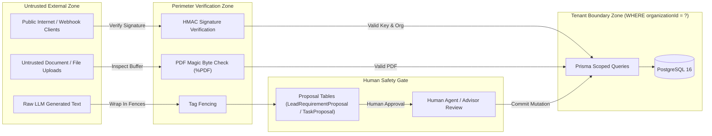

# System Architecture & Topology
## Contingency Deadline Copilot & Real Estate AI Platform

**Document Version:** 1.0.0  
**Status:** Baseline Verified  
**Primary Architect:** Principal Software Systems Architect  

---

## 1. System Topology Overview

The Contingency Deadline Copilot platform is architected as a **Modular Monolith** combining a modern React single-page frontend with an Express/Node.js backend, backed by PostgreSQL 16 with `pgvector` for both relational persistence and vector similarity retrieval.

```mermaid
flowchart TB
    subgraph Client_Layer ["Client & Interaction Layer"]
        AgentBrowser["Web Browser (React 18 SPA)"]
        LeadMobile["Lead / Buyer (Telegram Messenger)"]
        PortalHook["Lead Generation Source (Portal Webhook)"]
        EmailClient["Email Client (Agent / Buyer / Inbound Forward)"]
    end

    subgraph Trust_Boundary_Gateway ["Security & Perimeter Gateway"]
        ReverseProxy["Reverse Proxy / TLS Termination (Nginx / Cloudflare)"]
        HelmetCORS["Security Headers (Helmet) & CORS Allowlist"]
        RateLimitGuard["Rate Limiter (In-Memory Sliding Window)"]
        HmacVerifier["Svix & HMAC-SHA256 Signature Verifier"]
    end

    subgraph App_Core ["Application Core (Node.js 22 LTS / Express)"]
        subgraph Middleware_Stack ["HTTP Middleware Stack"]
            RawBodyParser["Raw Body Preserver (for Webhooks)"]
            AuthCheck["JWT Session Validator (requireAuth)"]
            RoleCheck["Role-Based Access Control (requireRole)"]
            TenantScoper["Tenant Boundary Validator (requireOrgId)"]
            ErrHandler["Global Error Handler & PII Redactor"]
        end

        subgraph Domain_Controllers ["API Route Controllers"]
            AuthCtrl["Auth & Org Routes (/api/auth, /api/org)"]
            LeadCtrl["Leads & Intake Routes (/api/leads)"]
            ConvCtrl["Conversations Routes (/api/leads/:id/conversations)"]
            VisitCtrl["Site Visits Routes (/api/site-visits)"]
            TaskCtrl["Lead Tasks Routes (/api/tasks)"]
            DealCtrl["Deals & Documents Routes (/api/deals)"]
            AssistCtrl["Assistant & RAG Routes (/api/deals/:id/assistant)"]
            AlertCtrl["Notifications Routes (/api/deals/:id/notifications)"]
            HookCtrl["Webhooks Routes (/api/webhooks, /api/inbound)"]
        end

        subgraph Service_Engines ["Business Domain Services"]
            AuthEngine["AuthService (JWT / Google IdToken)"]
            OrgEngine["OrganizationService (Membership / API Keys)"]
            LeadEngine["LeadService (Intake / Claims / Reassignments)"]
            AgentLoop["SalesAgentRuntime (5-Round Bounded ReAct Loop)"]
            VisitEngine["SiteVisitService (Conflict-Checked Showing Engine)"]
            MatchEngine["PropertyMatchService (Hard Filter + Soft Rank)"]
            ConvEngine["ConversationService (State Machine & Guardrails)"]
            OutboxDispatcher["OutboxDispatcher (ACID Enqueue & Backoff)"]
            DealConverter["LeadConversionService (Atomic Deal Creation)"]
            DateEngine["DateEngine (Business/Calendar Days & Holidays)"]
            PdfExtractor["PdfService (Text Layer & Gemini OCR Fallback)"]
            RagAssistant["AssistantService (Full Context / Hybrid RAG)"]
            CitationCheck["CitationVerifier (Verbatim Chunk Matcher)"]
            TelegramBot["TelegramService (Long-Polling & Neural Voice)"]
            AlertCron["AlertService (Cron-driven Window Evaluator)"]
        end
    end

    subgraph Data_Storage_Tier ["Data Persistence & Storage Tier"]
        PrismaORM["Prisma Client Singleton Pool"]
        Postgres[(PostgreSQL 16 Engine)]
        PgVectorExt["pgvector Extension (HNSW Index on document_chunks)"]
        FileSystem["File Storage Driver (Local Disk ./uploads or ImageKit)"]
    end

    subgraph Cloud_Integrations ["External Cloud APIs & Services"]
        GoogleIdentity["Google OAuth 2.0 Identity Service"]
        GeminiAPI["Google Gemini Generative AI API"]
        ResendGateway["Resend Email Delivery API"]
        SendGridGateway["SendGrid Inbound Parse Gateway"]
        TelegramCloud["Telegram Bot API Cloud"]
        NeuralVoiceEngine["Azure Speech / ElevenLabs Neural TTS"]
    end

    %% Network Connections
    AgentBrowser -->|HTTPS / WSS| ReverseProxy
    LeadMobile -->|Telegram Protocol| TelegramCloud
    PortalHook -->|HTTPS POST| ReverseProxy
    EmailClient -->|SMTP / IMAP| ResendGateway
    EmailClient -->|SMTP / IMAP| SendGridGateway

    ReverseProxy --> HelmetCORS --> RateLimitGuard --> RawBodyParser
    RateLimitGuard --> HmacVerifier --> HookCtrl
    RawBodyParser --> AuthCheck --> RoleCheck --> TenantScoper

    TenantScoper --> Domain_Controllers
    Domain_Controllers --> Service_Engines

    Service_Engines --> PrismaORM --> Postgres
    Postgres --- PgVectorExt
    PdfExtractor --> FileSystem

    AuthEngine --> GoogleIdentity
    AgentLoop --> GeminiAPI
    PdfExtractor --> GeminiAPI
    RagAssistant --> GeminiAPI
    OutboxDispatcher --> ResendGateway
    TelegramBot --> TelegramCloud
    TelegramBot --> NeuralVoiceEngine
    SendGridGateway -->|Webhook POST| ReverseProxy
    ResendGateway -->|Svix Webhook POST| ReverseProxy
```

---

## 2. Layer-by-Layer Architectural Breakdown

### 2.1 Client Layer
- **Desktop & Mobile Web Application:** React 18 single-page application built with Vite and styled with modern TailwindCSS, featuring dark glassmorphic styling, responsive side navigation, and modular dashboard widgets.
- **Telegram Messaging Interface:** Direct messaging bridge for buyers, enabling bidirectional text dialogue and ultra-realistic voice note interaction without requiring an app download.
- **External Webhook Emitters:** Real estate inquiry forms, third-party portals, and email forwarding services that post directly into the platform's intake gateways.

### 2.2 Security & Gateway Tier
- **Reverse Proxy & TLS:** Terminates HTTPS traffic, enforces HTTP/2 or HTTP/1.1 connections, and routes `/api/*` traffic to Express and static assets to the frontend host.
- **Security Headers (`helmet`):** Removes `X-Powered-By`, sets `Strict-Transport-Security`, prevents MIME sniffing, and enforces framing restrictions.
- **CORS Allowlist:** Validates request `Origin` headers against an explicit domain allowlist defined in `CORS_ORIGIN`. Local development origins are restricted to development mode.
- **Cryptographic Webhook Gateways:** 
  - `POST /api/webhooks/resend`: Validates constant-time Svix HMAC-SHA256 signatures (`svix-id`, `svix-timestamp`, `svix-signature`).
  - `POST /api/inbound/email`: Validates `X-Webhook-Signature` against `WEBHOOK_SECRET` for JSON, and shared high-entropy secrets for multipart inbound uploads.

### 2.3 Middleware & Authentication Pipeline
- **Raw Body Retention:** Custom JSON body parser verify hook preserves the untouched byte stream (`req.rawBody = Buffer.from(buf)`) to allow exact signature validation.
- **JWT Verification & Revocation Check (`requireAuth`):** Validates stateless bearer tokens, extracts tenant ID (`claims.org`), user ID (`claims.sub`), and session version (`claims.sv`). Looks up the user in PostgreSQL; if `sessionVersion` does not match, the request fails with HTTP 401.
- **Role Authorization (`requireRole`):** Restricts administrative functions (`POST /api/org/invitations`, `PATCH /api/org/members/:id/role`) strictly to users with the `OWNER` role.
- **Tenant Scope Guard (`requireOrgId`):** Guarantees that the authenticated tenant ID is passed down to all underlying service queries, preventing cross-tenant leakage.

### 2.4 Domain Modules & Services
- **`LeadService` & `LeadConversionService`:** Handles lead lifecycle transitions (`NEW` → `CONTACTED` → `QUALIFIED` → `PROPOSAL` → `WON` / `LOST`), ownership assignment history, call logs, and atomic conversion to deals.
- **`AgentRuntime` & `AgentTools`:** Implements an enterprise ReAct agent loop bounded to 5 rounds. Leverages Google Gemini function calling to execute inventory searches, site visit checks, and preference proposals.
- **`ConversationService` & `OutboxDispatcher`:** Decouples AI response generation from delivery. Enforces a conversation state machine (`AUTOPILOT`, `DRAFT_ONLY`, `HUMAN_TAKEOVER`, `PAUSED`, `CLOSED`), requiring human approval before enqueuing messages into `outbox_jobs`.
- **`DealService` & `AiService`:** Manages contract documents, executes Gemini clause extraction, and triggers the `DateEngine` to calculate calendar/business day contingency deadlines.
- **`AssistantService` & `CitationVerifier`:** Dual-mode RAG engine providing full-context injection (< 120k tokens) or vector hybrid search (> 120k tokens) with strict verbatim quote verification against document chunks.
- **`SiteVisitService`:** Manages property showing appointments with automated agent calendar conflict checking, outcome notes, and cancellation reasons.
- **`TelegramService`:** Autonomous long-polling bot daemon with voice memo generation via Edge Neural / Azure TTS and Google Gemini.

### 2.5 Data Persistence & Storage Tier
- **Relational Tables:** PostgreSQL 16 stores organizations, users, leads, deals, properties, documents, tasks, and audit logs.
- **Vector Embeddings:** Stored in `document_chunks.embedding` using PostgreSQL `pgvector`, indexed via HNSW cosine distance for sub-second similarity ranking.
- **Document Storage:** Files stored on the local filesystem (`./uploads`) with optional ImageKit CDN cloud storage integration.

---

## 3. Trust Boundaries & Security Controls

### Trust Boundary Rules
1. **Never Trust Request Body for Tenancy:** The tenant ID is never accepted from the request body or URL parameters. It is strictly derived from the authenticated JWT session claims or the cryptographic API key record.
2. **Never Allow LLM to Mutate Authoritative State Directly:** LLMs cannot directly update `LeadRequirement` or `TransactionTask`. They must insert into `LeadRequirementProposal` or `TaskProposal` for agent review.
3. **Never Disclose Cross-Tenant Existence:** Any query for a resource belonging to another organization returns HTTP 404 (Not Found) rather than 403 (Forbidden), completely preventing ID enumeration attacks.
4. **Never Log Sensitive Information:** PII (email addresses, phone numbers) is redacted in outbox and audit logs, and external API body payloads are not logged in plain text.
